# src/logic/dispatch/runtime 架构

本目录只维护这一份说明。设计与契约直接编辑本文；文件清单、类图和导航由 [架构脚本](../../../../scripts/source-architecture.mjs) 更新，生成区域之外的人工说明会保留。

## 封装意图

派发编排：任务状态、领取、图依赖与应用命令通过 logic/dispatch/rules 的派发端口写入；共享 Store 尚未拆分。

## 类与模块的设计意图

下表依据源码声明及文件头说明定位封装。字段表示该实例持有的状态或协作引用，不表示它拥有被引用服务的生命周期；实际资源责任和调用限制见下文契约及源码注释。

| 类／模块 | 实现形式与实例字段 | 封装依据 |
| --- | --- | --- |
| [AutoCollaboration](auto-collaboration.ts) | 实例类；持有 `batches`、`preparedTasks`、`cycles`、`waitingSlots`、`resuming`、`closed`、`pending`、`scheduled`、`releaseListener`、`owner`、`dispatch`、`members`、`execution`、`reportIssue` | 应用按工作区装配一个；关闭必须早于主/成员执行管理器与派发存储。 |
| [AutomaticReturnService](automatic-return-service.ts) | 实例类；持有 `owner`、`store`、`goals`、`logs`、`models` | 恢复只转交可靠成果，不运行旧成员；最新启动意图、完整日志、模型配置与当前文件均须匹配，同目标异常额度从持久任务图核实，未知保持封存。 |
| [WorkspaceDispatchService](dispatch-service.ts) | 实例类；持有 `closed`、`goals`、`automaticReturns`、`owners`、`continuations`、`interruptions`、`activeInputs`、`history`、`recoveries`、`replans`、`effects`、`humanDecisions`、`humanContinuations`、`usage`、`budgets`、`queuedCancellation`、`queuedDependencyReplacement`、`queuedDependencyAddition`、`queuedDependencyRevision`、`checkpointAbandonment`、`commandVerification`、`memberPauses`、`owner`、`store` | 新派发按知识→模型→Store 锁序核当前岗位、能力及责任，保存原 Workflow 选择与不可变执行绑定，同命令不能改选。周期冻结输入及软限额，关闭封存待办；旧回执不能重开周期。 |
| [goal-repair.ts](goal-repair.ts) | 函数／契约模块 | 只有明确可修复的业务拒绝才重新唤醒主调度；权限、未知副作用、身份和日志异常保持停放。 |
| [member-failure-limit.ts](member-failure-limit.ts) | 函数／契约模块 | 失败后另派新任务不能重置额度；不另存内存计数，也不把文字输出、换编号或其它成功任务当作消除失败的依据。 |
| [OwnerExecutionService](owner-execution-service.ts) | 实例类；持有 `owner`、`store`、`models` | 当前登记与真实能力/模型必须同时匹配；知识锁在外，模型短锁其次，Store 事务最后，不能在事务中反向读取排队服务。 |

## 接口设计契约

#### 主会话办公室登记

新派发的前置引用必须与可信派发 scopeId 同话题；即使旧候选仍在同一主图，也不能隐式灌入新话题的子 Agent 上下文。跨话题需要主 Agent 在新任务中明确整理需求，不复用旧原生线程或直接消费旧前置。

普通排队启动以管理器传入的持久队列 ID 打开新话题；主动首轮仍生成新身份，结果回注与明确补充沿原周期。前端不能通过运行 options 指定任意周期，原 openScope 幂等/关闭门禁继续校验。

`OpenGraph`、`ConversationBinding`、`CreateMember` 和 `DispatchTask` 把 `prepareMember` 给出的长期 `teamSession` 与原登记事务一同提交。每个办公室的同一 Agent 跨任务和周期复用逻辑对话，任务执行实例与原生通道仍按原任务保存；周期关闭只处理执行事实，不删除逻辑对话。原命令重放返回原回执，不创建第二个逻辑身份。

自动协调器遇 `TEAM_SESSION_BUSY` 保留该任务并继续尝试其它角色；本批仍有此类等待时不提前汇总为执行结果。完成/停止仍依赖原成员的可靠结算与占用释放事件。

#### 分阶段候选审阅

新派发依赖要求主 Agent 显式接受前置候选；未批准时不启动后继。AutoCollaboration 与成员领取共享 dependenciesReady，当前可执行成员结束后即回注主运行，不等尚被审阅关口阻塞的后继。member-results 主轮从同周期任务图保留尚未启动的 queued/waiting 任务，批准并结束该主轮后继续原待办，不创建替代任务或重放原派发。回注包含 candidateReview 以及显式审阅指引。

候选接受本身是可靠持久事实；主轮失败不会触发后继自动执行。停止、容量、权限、知识和文件门禁保持。重启自动回传仍只支持既有的全部成员可靠交付条件，含未启动后继的周期不因新审阅字段获得自动重启许可；旧日志和活动用户数据不迁移。

主轮正常结束后，若当前目标审阅由同一 runId 保存为 blocked 或 awaiting_user，先退役批次并进入统一关闭/停泊门禁，不再启动继承待办或创建结果回注。启动前拒绝没有成员运行可计入异常额度，这条显式决定仍必须终止自动尝试。旧 runId 的审阅不拦截用户明确恢复的新主轮；等待合法性、原检查点清单与完整日志仍由 parkScope 验证，阻塞不伪装成功。异步读取后重核周期活性，取消优先。

#### 异常执行后的自动接续上限

`memberFailureStopReason` 是协调层纯策略：同一 scope 累计 3 个已启动且可靠结算为 failed/interrupted 的成员任务后，停止自动接续。不是按任务名称、负责人、原生实例或错误文案分组，也不是连续失败计数；另派任务、成功交付其它任务和文本/工具进展均不清除已发生异常。采用整个目标的保守额度，代价是三项独立异常也会要求用户核实。用户取消、求助、检查点、未启动待办和正常候选不计入异常。阈值当前固定，模型不能调整。

权威状态仍是持久任务图，失败/中断任务不能重新执行、改成其它终态或删除；不新增第二份计数与恢复文件。AutoCollaboration 在启动下一成员、回注结果及验收返工前检查，同样约束没有待回传成员的主轮收尾。触发后先退役批次、撤销容量等待，再将明确理由持久保存到 goal.blocked 并暂停用户队列；既有在途成员沿原停止、关闭、结算及资源排空流程收尾，未确认结果保持原事实，不生成成功候选。各任务原 waitReason 继续展示具体中断原因，目标卡展示自动接续停止原因。

AutomaticReturnService 在恢复取证中使用同一策略，覆盖第三次异常已经落盘但尚未写入 blocked 的退出窗口。已持久 blocked 或关闭的周期本来就不能自动恢复；等待与重规划仍须用户显式操作。旧任务历史不迁移，失败计数不会跨到用户明确创建的新目标。原有每目标 32 次主调度上限、最终验收最多 3 次返工/同指纹最多 2 次以及逐工具重复失败保护继续生效。

变化仅在协调层组合纯策略；运行计时、引擎适配、任务终态和存储协议保持。无进展计时器只在当前运行内续期，到期后的迟到事件不能重新激活；它不负责跨任务重试额度。未来调整异常分类或次数从 member-failure-limit 修改，实时与重启两个消费者共同验证；变化频率尚无统计依据，不预设通用重试框架。

#### 指定话题补充与排空

`AutoCollaboration.InterruptTopic` 冻结指定办公室原 Cycle 及全部 Batch，先持久保存补充，调用可信主轮停止端口，等待在途调度/领取退出，再按已提交图停止原话题的全部成员并等真实结算。暂停占位仍由同一个主会话持有；不调用 closeScope 伪装暂停，不停止其它话题成员。迟到结果继续归原任务；旧 Batch 在排空期间不能派工或自动结束。取消和关闭仍可封存原周期；未确认排空保留意图，不重放未知结果。

本进程中新建安全等待时只调用 holdCollaboration，随后原目标显式接续并完成会自动交还普通队列。initialize 恢复旧等待仍调用持久暂停，保留应用重启后必须确认队列的规则；执行错误和未知结果继续使用 pauseCollaboration，不与安全等待混为一种状态。

新话题的 followupOf 只接受同办公室已结束周期，入队和创建时分别核验；openScope 的幂等指纹包含来源。后续话题沿新队列身份创建，原周期不重开、不转移候选或验收。

派发服务装配 OfficeHistoryService 复用原存储与受限 canonical 读取端口。AutoCollaboration 的主运行历史读取加入在途只读集合，整话题暂停等待其结束；读取不置 workRequested，也不驱动调度。不同办公室不可互读。

##### 多角色冻结与恢复

负责人配置捕获、正式兜底 policy、自动协作批次和返回模型 hash 均携带完整 modelRoles。完整快照变化阻止旧绑定继续领取；不自动替换模型或重启任务。

#### 根运行插入回执

旧协调器的 insertActiveInput 复用 ScopeActiveInputService.Send 完成 prepare/原生发送/resolve，仍由当前 cycle 核实运行与停止状态；新根生命周期不创建旧 cycle。

MainToolContext 的公共定义移至 execution/rules/conversation-binding；AutoCollaboration 仍按旧批次实现相同语义，没有新增执行队列或改变旧恢复行为。

#### 递归用量只读装配

WorkspaceDispatchService 的 goalPorts 可同时提供 ScopeUsageLogs.inspectAgent，交给原 ScopeUsageService 读取递归后代。旧目标审核仍只消费自己的 inspectMain/inspectMember，不通过新增用量读取端口获得恢复或执行能力。

#### 递归核实意图的所有权

AutoCollaboration.RecoveryPreflight 返回已核实来源的协议。acceptRecovery 仍提交真实新核实意图，但对 agent-tools-v1 来源不创建旧 cycles；预算、子调用和终态由新根 AgentLifecycle 负责。旧来源继续保留旧协调器的恢复语义，不将旧任务冒充新调用。

##### 递归工具迁移收口

重规划预检只返回已核实来源的执行协议。递归来源交由 Agent 根生命周期，acceptReplan 不注册旧 cycles；旧来源保持旧协调器路径。

## 开闭边界

本目录的职责及允许协作由[封装意图](#封装意图)限定，输入输出、状态与失败语义以[接口设计契约](#接口设计契约)为准。扩展从已有公开入口及实际装配位置进入；没有明确可替换契约的部分按真实影响修改和验证，不预建未使用的基类或插件入口。

<!-- architecture:generated:start -->

## 文件清单

| 文件 | 形式 | 当前职责 |
| --- | --- | --- |
| [ARCHITECTURE.md](ARCHITECTURE.md) | 说明文档 | 本目录的文件清单、真实声明、依赖与子封装导航。 |
| [auto-collaboration.ts](auto-collaboration.ts) | 源码模块 | 管理用户任务周期，串接主调度、成员回传、重启后可靠成果接收及最多三轮验收返工；同角色等待不阻断其它角色，未知事实或额度耗尽停止，可靠关闭后释放执行实例。 |
| [automatic-return-service.ts](automatic-return-service.ts) | 源码模块 | 持久保存主轮待回传批次，重启时核实可自动接收的已完成成员结果。 |
| [dispatch-service.ts](dispatch-service.ts) | 源码模块 | 工作区的成员注册、主对话实例绑定、主会话派发及任务图查询；主/子逻辑对话随登记可靠保存且跨周期保留，重启仅保留通过完整核实的待回传周期，其余中断封存。 |
| [goal-repair.ts](goal-repair.ts) | 源码模块 | 调度层最终验收返工的分类、限次与系统反馈，复用原目标及主运行入口。 |
| [member-failure-limit.ts](member-failure-limit.ts) | 源码模块 | 从同一目标的持久任务终态判断是否停止自动接续，供实时协调和重启核实共用。 |
| [owner-execution-service.ts](owner-execution-service.ts) | 源码模块 | 在既有知识、模型和派发存储之间核实岗位执行绑定，为计划、派发、领取和依赖维护提供同一入口。 |

## 架构类图

成员标记：`+` 公开、`-` 私有、`#` 受保护、`$` 静态；构造函数单独列出。文档和资源仅在文件清单中导航，不作为代码节点。

### auto-collaboration.ts

成员 1/4（同名节点为同一声明，跨图合并阅读）。

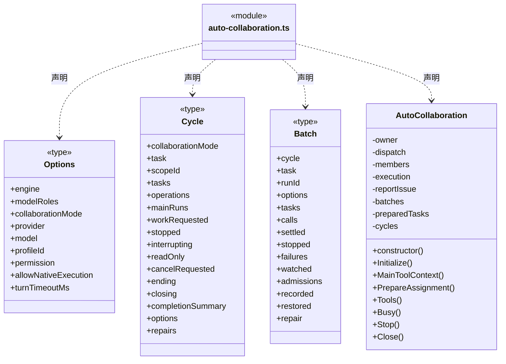

成员 2/4（同名节点为同一声明，跨图合并阅读）。

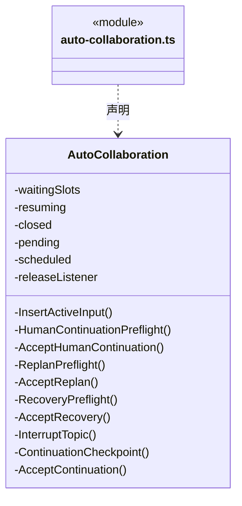

成员 3/4（同名节点为同一声明，跨图合并阅读）。

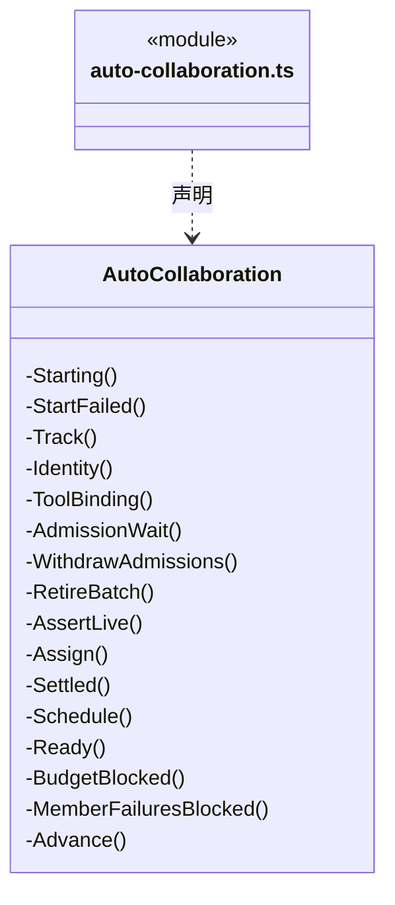

成员 4/4（同名节点为同一声明，跨图合并阅读）。

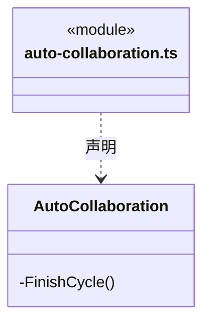

直接依赖：[../../../core/errors.ts](../../../core/errors.ts)、[../../../core/platform/node/serialization.ts](../../../core/platform/node/serialization.ts)、[../../conversation/runtime/execution-manager.ts](../../conversation/runtime/execution-manager.ts)、[dispatch-service.ts](dispatch-service.ts)、[goal-repair.ts](goal-repair.ts)、[member-failure-limit.ts](member-failure-limit.ts)、[../../engines/index.ts](../../engines/index.ts)、[../../execution/admission/admission-wait.ts](../../execution/admission/admission-wait.ts)、[../../execution/admission/workspace-lease.ts](../../execution/admission/workspace-lease.ts)、[../../execution/assembly/loop-engine.ts](../../execution/assembly/loop-engine.ts)、[../../execution/rules/conversation-binding.ts](../../execution/rules/conversation-binding.ts)、[../../execution/rules/input-source.ts](../../execution/rules/input-source.ts)、[../../execution/rules/types.ts](../../execution/rules/types.ts)、[../../knowledge/rules/ports.ts](../../knowledge/rules/ports.ts)、[../../tasks/rules/checkpoint-handoff.ts](../../tasks/rules/checkpoint-handoff.ts)、[../../tasks/rules/dispatch-commands.ts](../../tasks/rules/dispatch-commands.ts)、[../../tasks/rules/dispatch-scope.ts](../../tasks/rules/dispatch-scope.ts)、[../../tasks/rules/graph-types.ts](../../tasks/rules/graph-types.ts)、[../../tasks/rules/human-continue.ts](../../tasks/rules/human-continue.ts)、[../../tasks/rules/main-tool-output.ts](../../tasks/rules/main-tool-output.ts)、[../../tasks/rules/member-checkpoint-chain.ts](../../tasks/rules/member-checkpoint-chain.ts)、[../../tasks/rules/member-checkpoint.ts](../../tasks/rules/member-checkpoint.ts)、[../../tasks/rules/scope-active-input.ts](../../tasks/rules/scope-active-input.ts)、[../../tasks/rules/scope-continuation-attachments.ts](../../tasks/rules/scope-continuation-attachments.ts)、[../../tasks/rules/scope-continuation.ts](../../tasks/rules/scope-continuation.ts)、[../../tasks/rules/scope-goal.ts](../../tasks/rules/scope-goal.ts)、[../../tasks/rules/scope-recovery.ts](../../tasks/rules/scope-recovery.ts)、[../../tasks/rules/scope-replan.ts](../../tasks/rules/scope-replan.ts)、[../../tasks/rules/topic-interruption.ts](../../tasks/rules/topic-interruption.ts)、[../../team/runtime/member-execution.ts](../../team/runtime/member-execution.ts)、[../../team/runtime/member-state.ts](../../team/runtime/member-state.ts)、[../../tools/runtime/candidate-review-tools.ts](../../tools/runtime/candidate-review-tools.ts)、[../../tools/runtime/dispatch-tools.ts](../../tools/runtime/dispatch-tools.ts)、[../../tools/runtime/goal-tools.ts](../../tools/runtime/goal-tools.ts)、[../../tools/runtime/main-tool-contracts.ts](../../tools/runtime/main-tool-contracts.ts)、[../../tools/runtime/office-history-tools.ts](../../tools/runtime/office-history-tools.ts)。

### automatic-return-service.ts

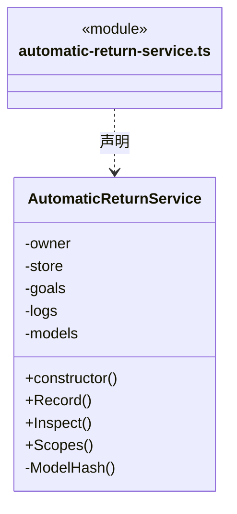

直接依赖：[../../../core/errors.ts](../../../core/errors.ts)、[../../../core/platform/node/serialization.ts](../../../core/platform/node/serialization.ts)、[../rules/dispatch-storage.ts](../rules/dispatch-storage.ts)、[member-failure-limit.ts](member-failure-limit.ts)、[owner-execution-service.ts](owner-execution-service.ts)、[../../execution/rules/types.ts](../../execution/rules/types.ts)、[../../knowledge/rules/ports.ts](../../knowledge/rules/ports.ts)、[../../tasks/rules/automatic-return.ts](../../tasks/rules/automatic-return.ts)、[../../tasks/rules/dispatch-scope.ts](../../tasks/rules/dispatch-scope.ts)、[../../tasks/rules/graph-types.ts](../../tasks/rules/graph-types.ts)、[../../tasks/rules/scope-goal.ts](../../tasks/rules/scope-goal.ts)、[../../tasks/runtime/scope-goal-service.ts](../../tasks/runtime/scope-goal-service.ts)、[../../team/rules/workspace-member-rules.ts](../../team/rules/workspace-member-rules.ts)。

### dispatch-service.ts

成员 1/4（同名节点为同一声明，跨图合并阅读）。

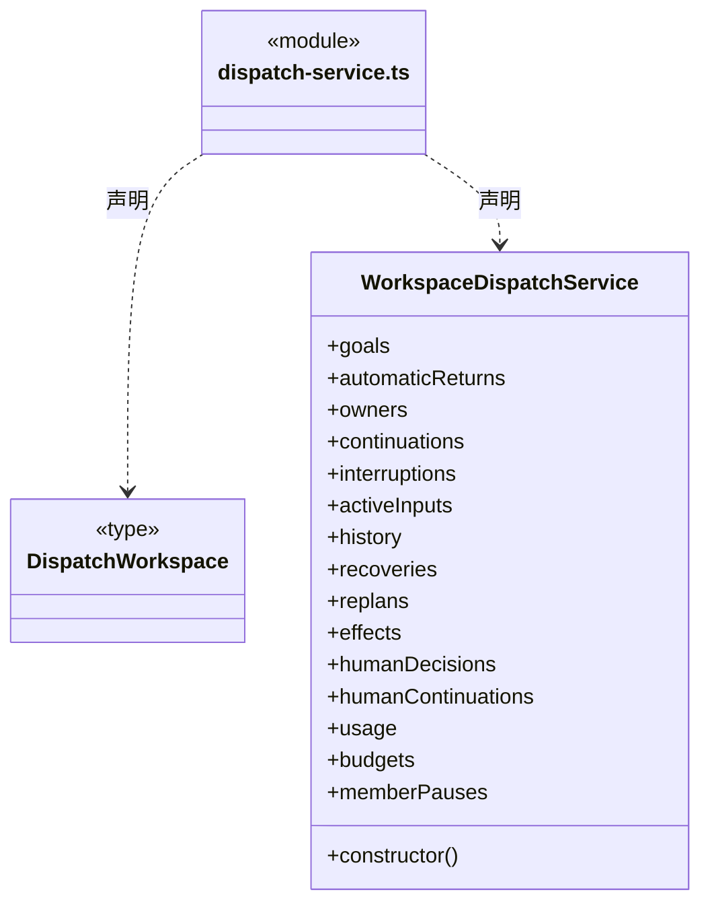

成员 2/4（同名节点为同一声明，跨图合并阅读）。

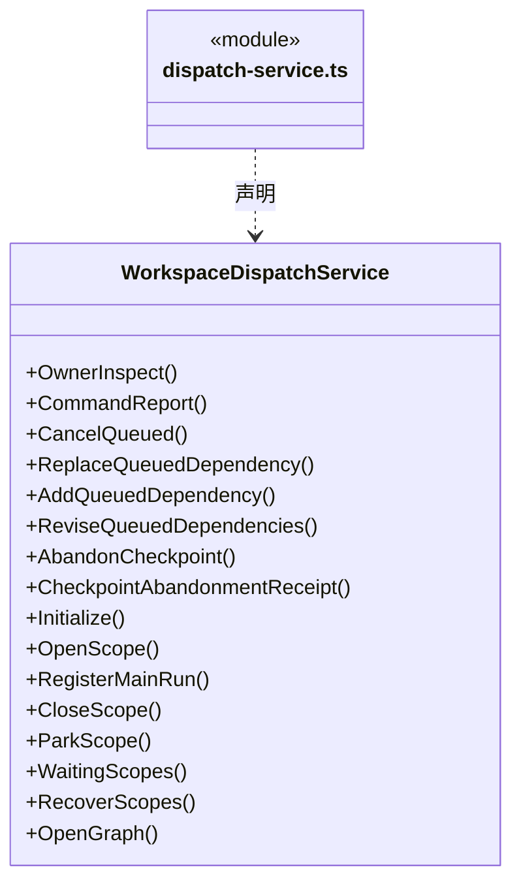

成员 3/4（同名节点为同一声明，跨图合并阅读）。

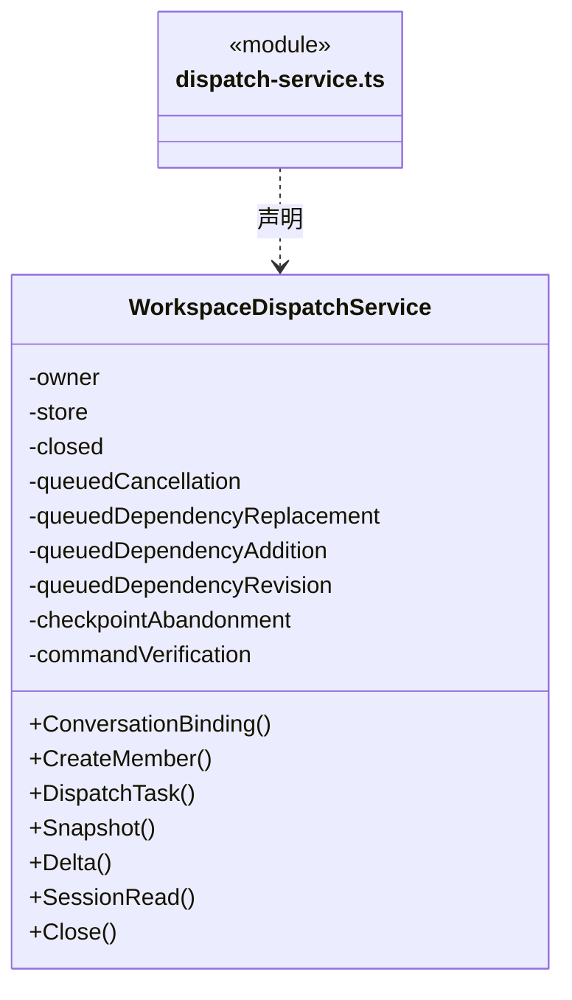

成员 4/4（同名节点为同一声明，跨图合并阅读）。

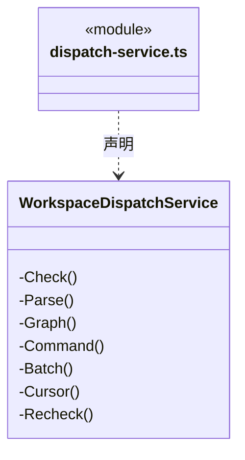

直接依赖：[../../../core/errors.ts](../../../core/errors.ts)、[../../../core/platform/node/serialization.ts](../../../core/platform/node/serialization.ts)、[../../budget/rules/scope-budget.ts](../../budget/rules/scope-budget.ts)、[../../budget/runtime/scope-budget-service.ts](../../budget/runtime/scope-budget-service.ts)、[../../budget/runtime/scope-usage-service.ts](../../budget/runtime/scope-usage-service.ts)、[../rules/dispatch-storage.ts](../rules/dispatch-storage.ts)、[automatic-return-service.ts](automatic-return-service.ts)、[owner-execution-service.ts](owner-execution-service.ts)、[../../evidence/runtime/command-verification-service.ts](../../evidence/runtime/command-verification-service.ts)、[../../evidence/runtime/effect-observation-service.ts](../../evidence/runtime/effect-observation-service.ts)、[../../execution/context/automatic-context.ts](../../execution/context/automatic-context.ts)、[../../execution/context/dispatch-context.ts](../../execution/context/dispatch-context.ts)、[../../execution/rules/conversation-binding.ts](../../execution/rules/conversation-binding.ts)、[../../execution/rules/types.ts](../../execution/rules/types.ts)、[../../knowledge/rules/ports.ts](../../knowledge/rules/ports.ts)、[../../knowledge/rules/types.ts](../../knowledge/rules/types.ts)、[../../tasks/rules/candidate-review.ts](../../tasks/rules/candidate-review.ts)、[../../tasks/rules/checkpoint-handoff.ts](../../tasks/rules/checkpoint-handoff.ts)、[../../tasks/rules/dispatch-commands.ts](../../tasks/rules/dispatch-commands.ts)、[../../tasks/rules/dispatch-scope.ts](../../tasks/rules/dispatch-scope.ts)、[../../tasks/rules/graph-types.ts](../../tasks/rules/graph-types.ts)、[../../tasks/rules/member-checkpoint.ts](../../tasks/rules/member-checkpoint.ts)、[../../tasks/rules/queued-dependency-addition.ts](../../tasks/rules/queued-dependency-addition.ts)、[../../tasks/rules/queued-dependency-replacement.ts](../../tasks/rules/queued-dependency-replacement.ts)、[../../tasks/rules/queued-dependency-revision.ts](../../tasks/rules/queued-dependency-revision.ts)、[../../tasks/rules/queued-task-cancel.ts](../../tasks/rules/queued-task-cancel.ts)、[../../tasks/rules/scope-run-tracking.ts](../../tasks/rules/scope-run-tracking.ts)、[../../tasks/rules/scope-view.ts](../../tasks/rules/scope-view.ts)、[../../tasks/rules/topic-interruption.ts](../../tasks/rules/topic-interruption.ts)、[../../tasks/rules/types.ts](../../tasks/rules/types.ts)、[../../tasks/runtime/main-command-request.ts](../../tasks/runtime/main-command-request.ts)、[../../tasks/runtime/office-history-service.ts](../../tasks/runtime/office-history-service.ts)、[../../tasks/runtime/queued-dependency-addition-service.ts](../../tasks/runtime/queued-dependency-addition-service.ts)、[../../tasks/runtime/queued-dependency-replacement-service.ts](../../tasks/runtime/queued-dependency-replacement-service.ts)、[../../tasks/runtime/queued-dependency-revision-service.ts](../../tasks/runtime/queued-dependency-revision-service.ts)、[../../tasks/runtime/queued-task-cancel-service.ts](../../tasks/runtime/queued-task-cancel-service.ts)、[../../tasks/runtime/scope-active-input-service.ts](../../tasks/runtime/scope-active-input-service.ts)、[../../tasks/runtime/scope-continuation-service.ts](../../tasks/runtime/scope-continuation-service.ts)、[../../tasks/runtime/scope-goal-service.ts](../../tasks/runtime/scope-goal-service.ts)、[../../tasks/runtime/scope-human-continuation-service.ts](../../tasks/runtime/scope-human-continuation-service.ts)、[../../tasks/runtime/scope-human-decision-service.ts](../../tasks/runtime/scope-human-decision-service.ts)、[../../tasks/runtime/scope-recovery-service.ts](../../tasks/runtime/scope-recovery-service.ts)、[../../tasks/runtime/scope-replan-service.ts](../../tasks/runtime/scope-replan-service.ts)、[../../tasks/runtime/topic-interruption-service.ts](../../tasks/runtime/topic-interruption-service.ts)、[../../team/rules/agent-types.ts](../../team/rules/agent-types.ts)、[../../team/runtime/agent-manager.ts](../../team/runtime/agent-manager.ts)、[../../team/runtime/checkpoint-abandonment-service.ts](../../team/runtime/checkpoint-abandonment-service.ts)、[../../team/runtime/member-checkpoint-verifier.ts](../../team/runtime/member-checkpoint-verifier.ts)、[../../team/runtime/member-pause-service.ts](../../team/runtime/member-pause-service.ts)。

### goal-repair.ts

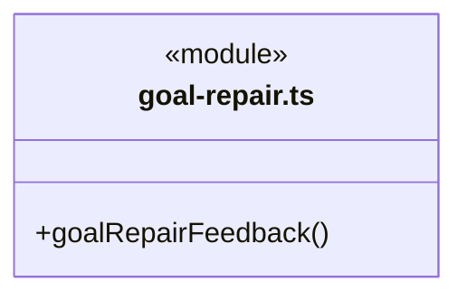

直接依赖：[../../../core/platform/node/serialization.ts](../../../core/platform/node/serialization.ts)、[../../execution/rules/input-source.ts](../../execution/rules/input-source.ts)、[../../tasks/rules/dispatch-scope.ts](../../tasks/rules/dispatch-scope.ts)、[../../tasks/rules/graph-types.ts](../../tasks/rules/graph-types.ts)。

### member-failure-limit.ts

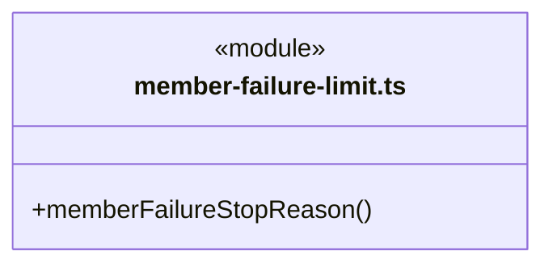

直接依赖：[../../tasks/rules/graph-types.ts](../../tasks/rules/graph-types.ts)。

### owner-execution-service.ts

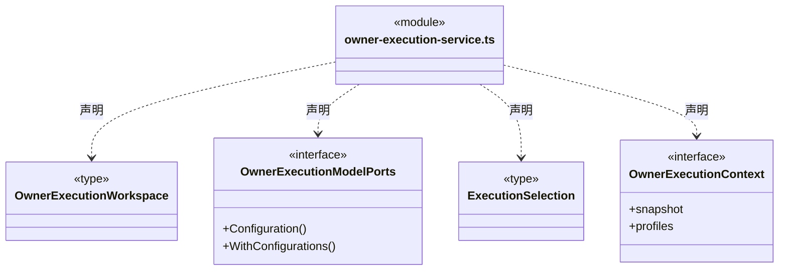

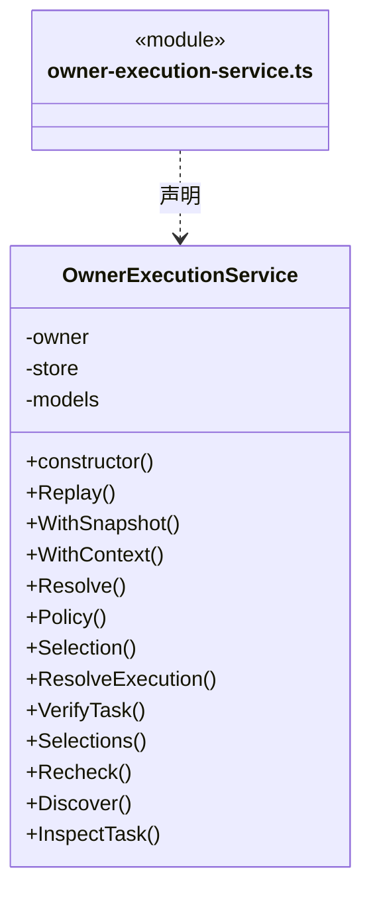

直接依赖：[../../../core/errors.ts](../../../core/errors.ts)、[../rules/dispatch-storage.ts](../rules/dispatch-storage.ts)、[../../execution/context/dispatch-context.ts](../../execution/context/dispatch-context.ts)、[../../knowledge/rules/ports.ts](../../knowledge/rules/ports.ts)、[../../knowledge/rules/types.ts](../../knowledge/rules/types.ts)、[../../tasks/rules/graph-types.ts](../../tasks/rules/graph-types.ts)、[../../team/rules/automatic-execution.ts](../../team/rules/automatic-execution.ts)、[../../team/rules/implicit-module-owner.ts](../../team/rules/implicit-module-owner.ts)、[../../team/rules/member-execution-binding.ts](../../team/rules/member-execution-binding.ts)、[../../team/rules/member-execution-rules.ts](../../team/rules/member-execution-rules.ts)、[../../team/rules/owner-execution-discovery.ts](../../team/rules/owner-execution-discovery.ts)、[../../team/rules/workspace-member-rules.ts](../../team/rules/workspace-member-rules.ts)、[../../team/rules/workspace-member.ts](../../team/rules/workspace-member.ts)、[../../workspace/rules/knowledge-source-rules.ts](../../workspace/rules/knowledge-source-rules.ts)。

### 本目录调用边界

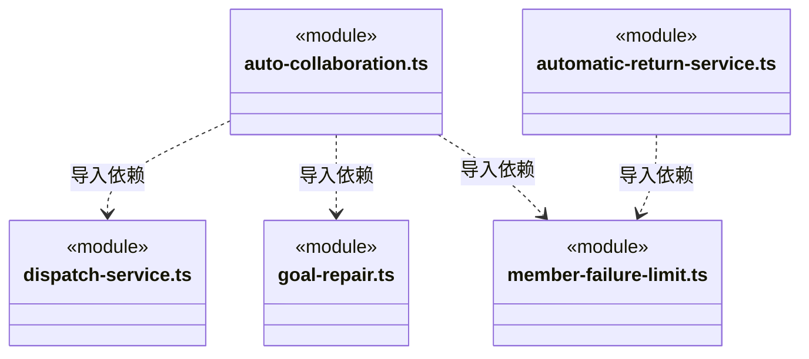

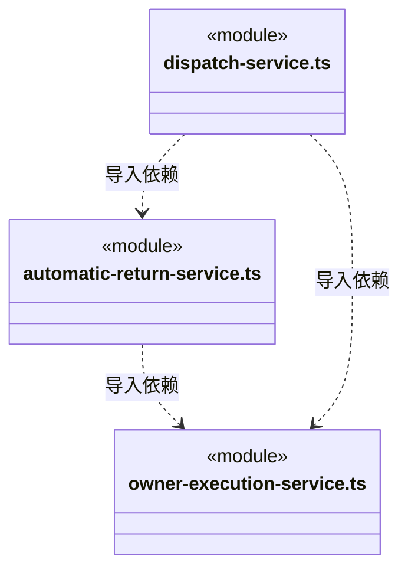

## 子目录导航

无子目录。

[返回上层](../ARCHITECTURE.md)。

每次修改本目录代码，同步维护文件头、关键契约说明及本图。未实现的治理、证据验收和自动编排能力不列入当前类图。

<!-- architecture:generated:end -->
