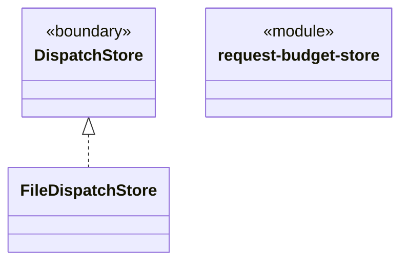

# src/logic/dispatch/storage 架构

## 设计意图

以一份工作区追加日志维护派发及相关审计事实，保留联合提交与恢复校验的原子边界。

`FileDispatchStore` 串行核实并提交状态变化，恢复时按原日志前缀重放；任务图、岗位、来源和文件操作附录由各自规则约束。`request-budget-store` 仅投影预算读视图和提交能力，不建立另一份账本或拆开原事务。

## 主要组成

| 组成 | 定位 |
| --- | --- |
| [FileDispatchStore](dispatch-store.ts) | 将岗位、模块责任、来源代次和受控文件阶段，以及办公室逻辑对话、执行实例、原生通道、任务图和信封可靠保存到同一工作区日志。 |
| [request-budget-store](request-budget-store.ts) | 将唯一派发事务适配为请求预算专用能力，保持原子边界。 |

<!-- architecture:generated:start -->

## 架构关系

外部继承／实现边界：[DispatchStore](../rules/dispatch-storage.ts)。

[上层设计](../ARCHITECTURE.md)

<!-- architecture:generated:end -->
