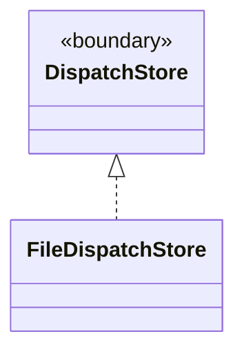

# src/logic/dispatch/storage 架构

## 设计意图

以工作区日志保存任务图、执行实例与相关命令事实。FileDispatchStore 维护共同的事务边界，预算适配只缩小访问接口，不拆开原子提交。

## 主要组成

| 组成 | 定位 |
| --- | --- |
| [FileDispatchStore](dispatch-store.ts) | 将岗位、模块责任、来源代次和受控文件阶段，以及办公室逻辑对话、执行实例、原生通道、任务图和信封可靠保存到同一工作区日志。 |

<!-- architecture:generated:start -->

## 架构关系

外部继承／实现边界：[DispatchStore](../rules/dispatch-storage.ts)。

[上层设计](../ARCHITECTURE.md)

<!-- architecture:generated:end -->
