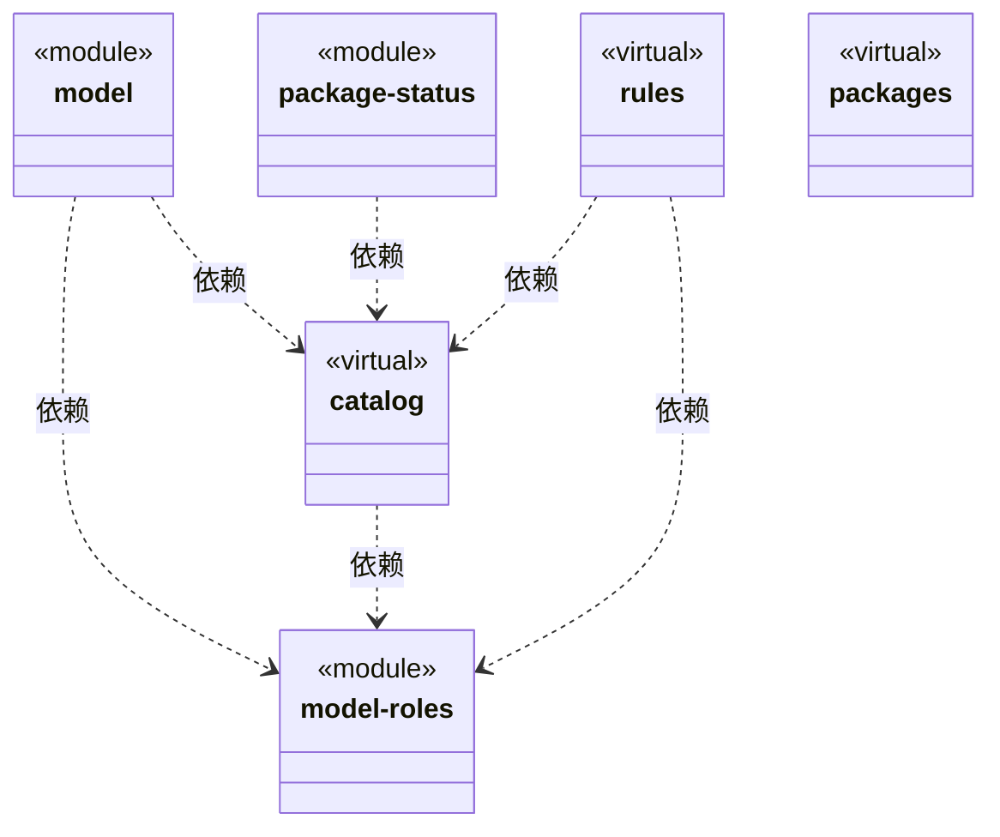
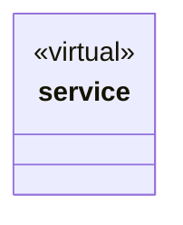

# src/logic/engines 架构

## 设计意图

管理官方引擎身份、能力声明、模型选型和本机包选择，使引擎目录不等于 SDK 加载或运行状态。

`catalog` 声明支持项，`rules` 派生兼容选择，`service` 将选型映射到模型服务，`packages` 维护安装选择与运行引用。本层公开快照连接这些边界；具体循环实现在 execution，制品签名与缓存准备由 updates 提供。

## 主要组成

| 组成 | 定位 |
| --- | --- |
| [model](model.ts) | 引擎执行准备后的模型快照契约，供岗位、任务与装配保存公开参数。 |
| [model-roles](model-roles.ts) | V2 额外模型角色的公开引用与冻结快照，供 Agent、岗位和任务共同携带。 |
| [package-status](package-status.ts) | 表达引擎安装选择与准备进度的公开事实，不加载实际运行包。 |

## 现状与目标边界

当前 [index.ts](index.ts)、[model.ts](model.ts)、[model-roles.ts](model-roles.ts) 和 [package-status.ts](package-status.ts) 是父层公开契约，与目录、规则和服务子模块并存。目标是按引擎公共协议聚合这些纯定义，父层保留必要兼容转接；此聚合尚未实施。迁移影响 Agent、任务、模型投影和 Bridge 消费者，不能通过聚合出口把安装服务或 SDK 带入纯契约依赖。

<!-- architecture:generated:start -->

## 架构关系

标注为 `virtual` 的节点是直接子模块的虚拟类封装；内部设计沿下方入口阅读。

### 关系组 1：catalog

### 关系组 2：service

## 子模块

| 虚拟封装 | 整体职责 |
| --- | --- |
| [catalog](catalog/ARCHITECTURE.md) | 以随版本发布的代码清单定义官方支持的引擎身份和能力，避免远程索引注册任意实现。 |
| [packages](packages/ARCHITECTURE.md) | 管理应用选择的官方引擎版本、依赖闭包和运行引用，隔离下载制品与启用选择。 |
| [rules](rules/ARCHITECTURE.md) | 从官方声明和已配置模型中计算引擎兼容性、角色选择及有序操作引用。 |
| [service](service/ARCHITECTURE.md) | 把引擎选择转换为模型服务可核实的协议需求，返回绑定引擎身份的冻结执行快照。 |

[上层设计](../ARCHITECTURE.md)

<!-- architecture:generated:end -->
