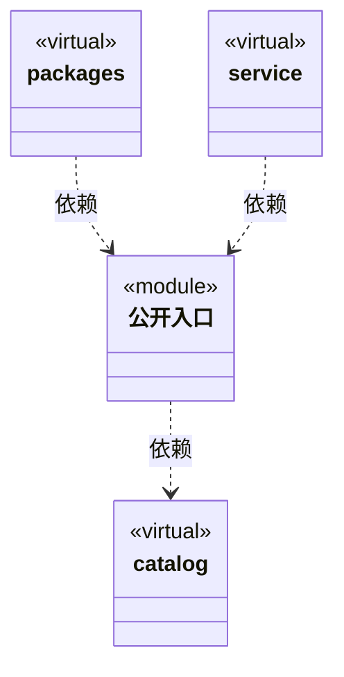

# src/logic/engines 架构

## 设计意图

维护具体引擎与模型清单、协议兼容规则和运行包适配器，供宿主装配到 Kernel 的 kernel。

## 主要组成

| 组成 | 定位 |
| --- | --- |
| [公开入口](index.ts) | 供现有消费者访问公开协议。 |

<!-- architecture:generated:start -->

## 架构关系

标注为 `virtual` 的节点是直接子模块的虚拟类封装；内部设计沿下方入口阅读。

## 子模块

| 虚拟封装 | 整体职责 |
| --- | --- |
| [catalog](catalog/ARCHITECTURE.md) | 声明随产品发布的引擎、适配器兼容规则和可选模型角色。 |
| [packages](packages/ARCHITECTURE.md) | 管理应用选择的官方引擎版本、依赖闭包和运行引用，隔离下载制品与启用选择。 |
| [service](service/ARCHITECTURE.md) | 把引擎选择转换为模型服务可核实的协议需求，返回绑定引擎身份的冻结执行快照。 |

[上层设计](../ARCHITECTURE.md)

<!-- architecture:generated:end -->
