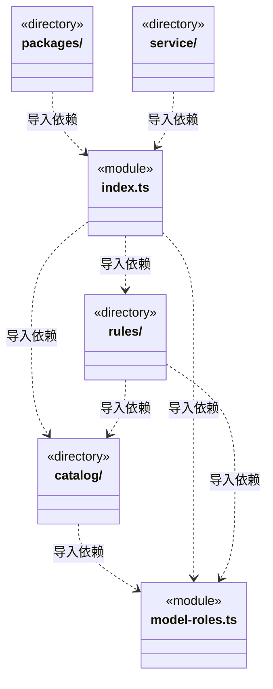
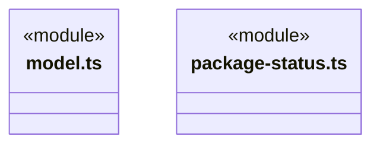
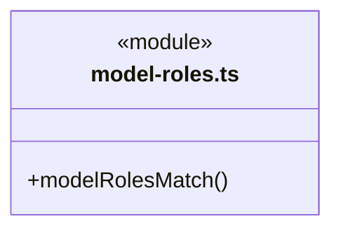

# src/logic/engines 架构

## 目录定位

官方引擎的静态身份、业务专长、协议兼容和执行模型快照；便携入口不加载 SDK，模型设置与引擎服务单向组合。

本文描述当前实现。通过分析目录边界后维护的 [源码架构脚本](../../../scripts/source-architecture.mjs) 同步清单和声明；代码变更时仍须核对职责、关键成员与关系。

## 代码清单

| 文件 | 当前职责 |
| --- | --- |
| [index.ts](index.ts) | 官方引擎目录、兼容规则和运行选型的便携公共入口。 |
| [model-roles.ts](model-roles.ts) | V2 额外模型角色的公开引用与冻结快照，供 Agent、岗位和任务共同携带。 |
| [model.ts](model.ts) | 引擎执行准备后的模型快照契约，供岗位、任务与装配保存公开参数。 |
| [package-status.ts](package-status.ts) | 官方引擎包管理的便携状态投影。 |

## 架构类图

各图中的同名节点表示同一目录边界；跨组及完整直接依赖如下（无边不代表继承）：

- `catalog` → `model-roles.ts`：导入。
- `index.ts` → `catalog`：导入。
- `index.ts` → `rules`：导入。
- `index.ts` → `model.ts`：导入。
- `index.ts` → `model-roles.ts`：导入。
- `index.ts` → `package-status.ts`：导入。
- `model.ts` → `catalog`：导入。
- `model.ts` → `model-roles.ts`：导入。
- `package-status.ts` → `catalog`：导入。
- `packages` → `index.ts`：导入。
- `rules` → `model-roles.ts`：导入。
- `rules` → `catalog`：导入。
- `service` → `index.ts`：导入。

### model-roles.ts 公开入口

## 子目录导航

- [catalog/](catalog/ARCHITECTURE.md)：开发者在代码中声明官方支持引擎；清单随 Logic 资源发布，声明只读，不支持用户注册或配置覆盖。
- [packages/](packages/ARCHITECTURE.md)：官方包安装选择、固定依赖与运行引用；制品经冷壳验签，安装成功后原子切换，失败不自动重试。
- [rules/](rules/ARCHITECTURE.md)：从静态清单派生身份校验、协议约束和兼容接口筛选；只组合通用模型规则，不联网或持有凭据。
- [service/](service/ARCHITECTURE.md)：EngineModelProfiles 将引擎选型映射为模型协议需求，复用模型服务唯一配置锁和延迟解密；返回引擎快照，不拥有模型存储或引擎安装状态。

[返回上层](../ARCHITECTURE.md)。

每次修改本目录代码，同步维护文件头、关键契约说明及本图。未实现的治理、证据验收和自动编排能力不列入当前类图。

## 设计契约 v1 与落地范围

以下内容区分已接通能力与后续设计；以各节的实现状态为准，不将目标图当作现状图。维护源：[CONTRACT.md](CONTRACT.md)；生成类图时同步附加，勿直接修改本附录。

# 官方引擎目录与选型

本模块属于 Logic。`catalog/supported-engines.ts` 是开发者维护的只读静态清单，声明 Pi、Claude Code、Codex 的稳定 ID、显示名、业务专长和支持协议。身份联合类型、校验枚举、界面选型与模型连接需求均从该清单派生；不读取 JSON 支持表，也不接受用户或远端索引注册新引擎。

`index.ts` 是便携公开入口，不加载 SDK、文件系统或服务。`rules/model-selection.ts` 把引擎声明投影为 `ModelConnectionRequirement`，再交给模型模块选择实际接口。主接口优先；显式接口的模型限制不回退官方预设；关闭自动识别仍有效。不根据模型名称猜测能力，不转换协议或模型 ID。业务类型是选择提示，协议可选不代表认证、配额、工具调用或运行能力已经验证。

`service/index.ts` 只向可信服务装配开放。Application 各持有一个通用 `LlmProfiles` 和一个组合它的 `EngineModelProfiles`：前者拥有供应商设置、唯一配置队列和凭据；后者负责引擎协议需求、执行快照及引擎诊断。引擎服务不复制模型存储或锁，不保存默认引擎，不自动重试。

执行选型链路：主 Agent/岗位引用 → EngineModelProfiles → LlmProfiles 配置短锁 → ResolvedEngineModel → 原执行装配。AgentModelSelection 的严格 schema 由 `team/rules/agent-runtime.ts` 持有。主对话与主 Agent 配置继续读取同一 revision。

## 兼容与凭据

- `ResolvedLlm` 是通用模型连接；`ResolvedEngineModel` 在其公开 profile 上组合可选 engine。仅调用者明确给出引擎才加入该字段，旧缺省快照不补字段、不改哈希，也不迁移用户配置。
- `withConfigurations` 一次捕获全部引用，在同一个模型队列内使用对应快照；回调内不能重新进入模型设置队列。
- `withRuntimeConfiguration` 只在原回调存活期间解密已捕获定义。即使外层已有缓存，每次 resolve 仍检查原锁的有效期；回调结束后拒绝。预算和准入在调用方核实，启动引擎发生在锁释放之后。
- 不兼容时由引擎层将 LLM_CONNECTION_API 转为已有 LLM_ENGINE_API；缺失模型、密钥、存储错误及业务停止原样传播。失败没有自动重试或任务重启。
- Bridge 的 `engines.ts` 仅公开目录及兼容预览；`agent-settings.ts` 公开团队角色选型；`models.ts` 不再混合上述两种职责。IPC 的 models.test 仍兼容原请求与响应，由引擎服务投影后交给模型服务探测。

## 当前范围与维护入口

本步完成静态清单和模型职责解耦。具体三引擎适配器仍位于 `execution/engines`，工厂仍位于 `execution/assembly/loop-engine.ts`。多模型角色的引用、快照与执行准备已接通；独立包构建、已下载清单、通用冷壳、引擎管理 UI 尚未迁移；逐角色预算已提供统一预留/结算接口，不能因本清单增加一条记录就宣称新引擎可运行。

清单属于可更新 Logic 资源。冷启动与更新模块禁止依赖此清单，包括类型边；当前旧冷壳的固定三包清单仍待后续整体迁移，本步不改其协议和指纹。

修改业务描述和支持协议从 `catalog/supported-engines.ts` 入手；修改兼容投影从 `rules/model-selection.ts` 入手；修改执行准备从 `service/model-profiles.ts` 入手。新增真正可运行的引擎还需适配器及包发布流程。模型服务和目录不能反向导入引擎模块。

### V2 模型角色绑定

primary 仍由 Agent 原来的 profileId/modelId 与运行 profile 表达；可选 modelRoles={version:2,roles} 只保存额外角色，不复制 primary。角色 ID、能力、必填与可选型号白名单由官方引擎声明拥有；未知角色、错误能力、遗漏必填和未列型号均在读取凭据前拒绝。当前三个代码引擎未声明额外角色。旧记录不补空块，新增空块也属于明确的新快照。

模型层 generationSnapshotSchema 和 embeddingSnapshotSchema 各自校验公开参数；向量没有生成输出容量。一次 withModelOperations 捕获主模型和全部附加角色，公开预览与延迟解析各自复制；调用方修改预览不能改变随后解密的定义。公开快照仅在 modelRoles.roles 保存无密钥配置，解析后的凭据在 ResolvedEngineModel.modelRoles 单独持有，不能落入日志。

### 官方包管理

packages 服务独立于 model-profiles；Application 持有唯一安装状态。静态声明新增 storageDirectory 和固定依赖种类，制品决定依赖准确摘要。目录不加载包或发起网络；详细恢复、引用与重试语义见 [包管理契约](packages/CONTRACT.md)。

package-status 只投影版本、固定依赖、使用数量及错误，没有路径或凭据；View 通过桥契约访问。
