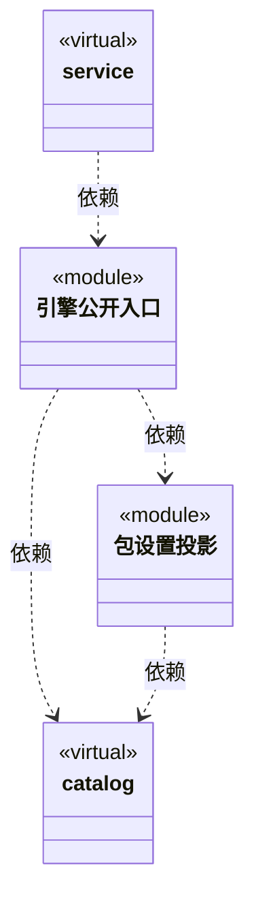

# 引擎选型与制品入口

## 设计意图

将引擎声明、公开状态与可信运行服务分开。上层通过清单校验身份与模型需求，包服务负责固定可执行制品，模型服务负责捕获选型；纯入口不启动引擎或加载凭据。

## 主要组成

| 组成 | 定位 |
| --- | --- |
| [引擎公开入口](index.ts) | 导出清单、适配协议与状态类型，服务经独立入口访问。 |
| [包设置投影](package-status.ts) | 呈现启用、活动版本、候选版本和修订号，不暴露服务实例。 |

<!-- architecture:generated:start -->

## 架构关系

标注为 `virtual` 的节点是直接子模块的虚拟类封装；内部设计沿下方入口阅读。

## 子模块

| 虚拟封装 | 整体职责 |
| --- | --- |
| [catalog](catalog/ARCHITECTURE.md) | 依据引擎声明选择模型协议和额外角色，供设置预览与执行准备共用。兼容列表只是静态筛选，不能替代真实连接验证；本模块不下载制品、不读取凭据。 |
| [service](service/ARCHITECTURE.md) | 将 Agent 的引擎选型转换为模型服务的连接需求，复用模型服务的配置队列捕获主模型与额外角色。公开快照不包含凭据，延迟解析受回调生命周期约束；不管理安装或自动重试。 |

[上层设计](../ARCHITECTURE.md)

<!-- architecture:generated:end -->
