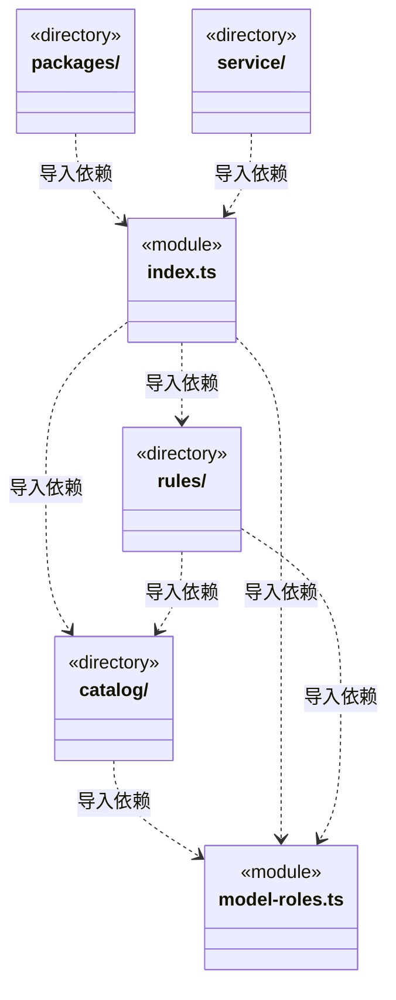
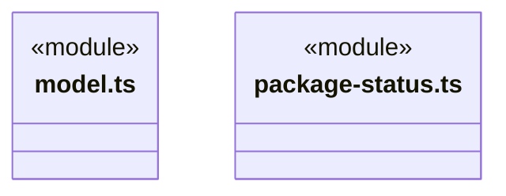
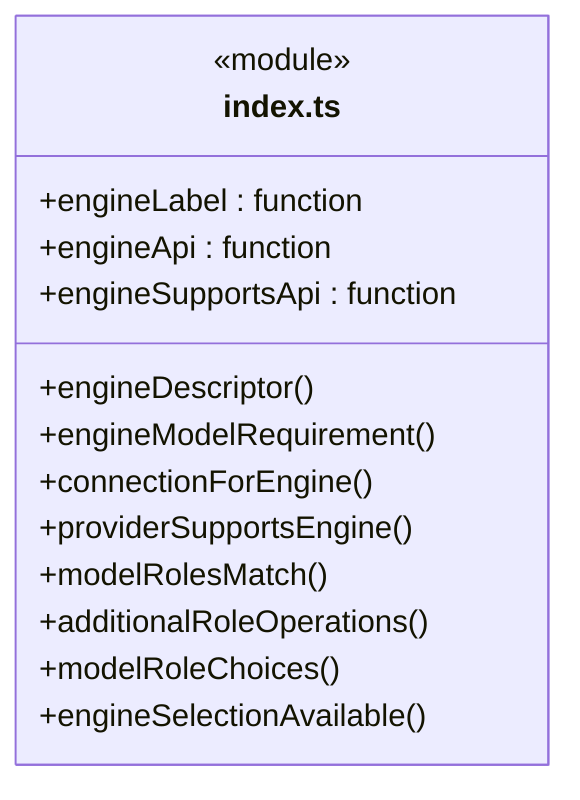
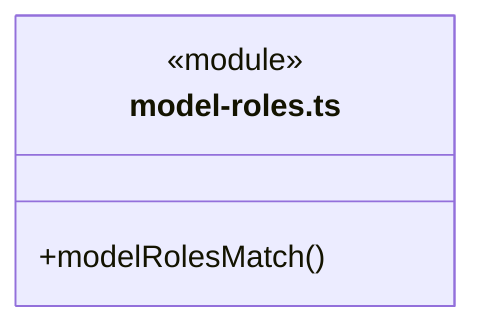
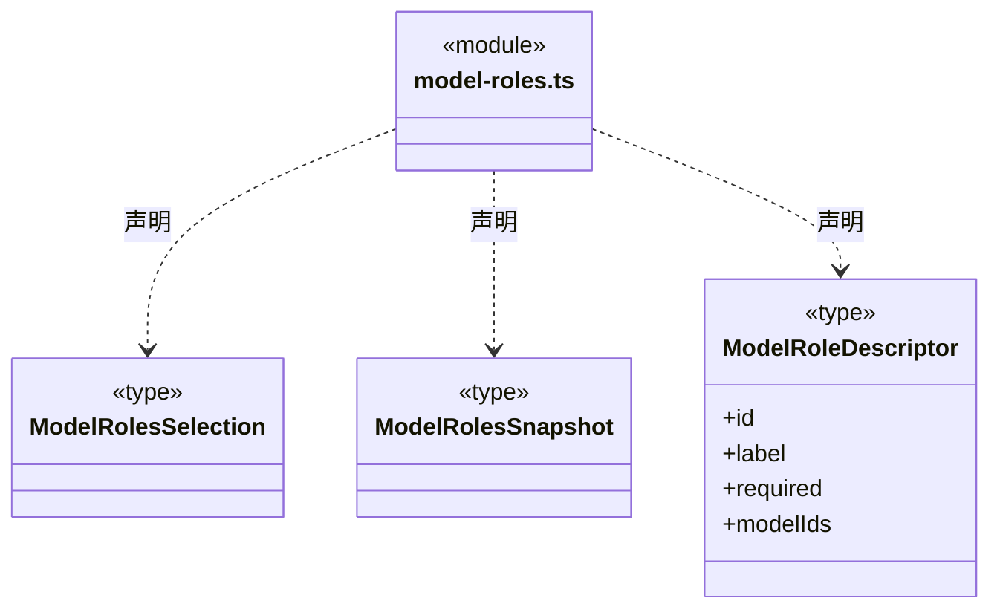
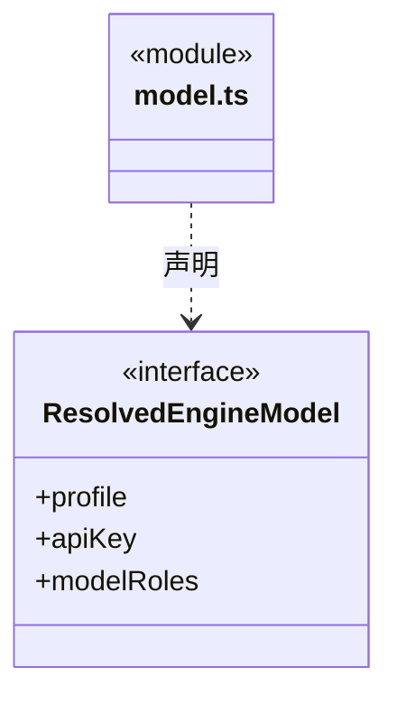
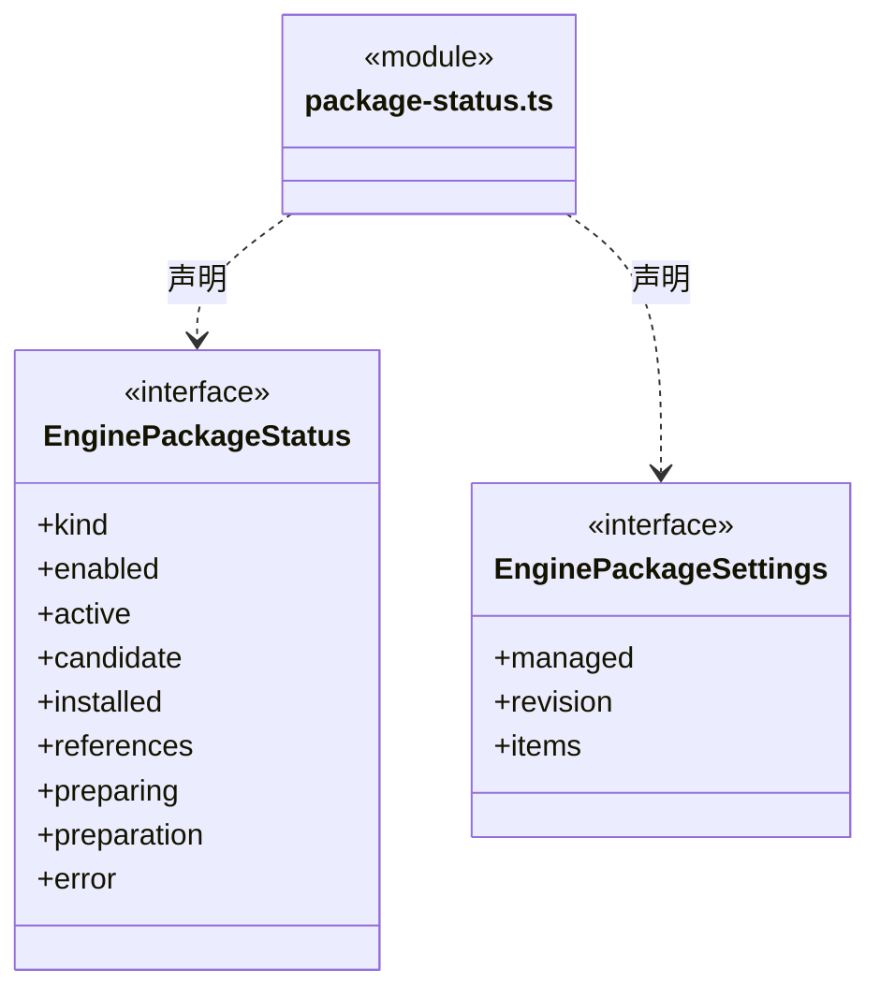

# src/logic/engines 架构

本目录只维护这一份说明。设计与契约直接编辑本文；文件清单、类图和导航由 [架构脚本](../../../scripts/source-architecture.mjs) 更新，生成区域之外的人工说明会保留。

## 封装意图

官方引擎的静态身份、业务专长、协议兼容和执行模型快照；便携入口不加载 SDK，模型设置与引擎服务单向组合。

## 类与模块的设计意图

下表依据源码声明及文件头说明定位封装。字段表示该实例持有的状态或协作引用，不表示它拥有被引用服务的生命周期；实际资源责任和调用限制见下文契约及源码注释。

| 类／模块 | 实现形式与实例字段 | 封装依据 |
| --- | --- | --- |
| [index.ts](index.ts) | 函数／契约模块 | 规则消费者与 View 不加载 SDK、凭据服务或具体 Loop；服务装配使用独立 service 入口。 |
| [model-roles.ts](model-roles.ts) | 函数／契约模块 | primary 保持原 profileId/modelId 与运行 profile 的唯一位置；新增角色放在版本化块中，旧记录不补块、不重复保存主模型。 |
| [model.ts](model.ts) | 函数／契约模块 | 引擎身份归执行选型，不进入通用模型连接；兼容旧快照中缺省的 engine，禁止补写影响历史哈希。 |
| [package-status.ts](package-status.ts) | 函数／契约模块 | 设置显示版本、依赖和结果，不取得制品路径、凭据或管理服务实例；revision 用于拒绝过时页面的修改。 |

## 接口设计契约

### 官方引擎目录与选型

本模块属于 Logic。`catalog/supported-engines.ts` 是开发者维护的只读静态清单，声明 Pi、Claude Code、Codex 和 memory 的稳定 ID、显示名、业务专长和支持协议。身份联合类型、校验枚举、界面选型与模型连接需求均从该清单派生；不读取 JSON 支持表，也不接受用户或远端索引注册新引擎。

`index.ts` 是便携公开入口，不加载 SDK、文件系统或服务。`rules/model-selection.ts` 把引擎声明投影为 `ModelConnectionRequirement`，再交给模型模块选择实际接口。主接口优先；显式接口的模型限制不回退官方预设；关闭自动识别仍有效。不根据模型名称猜测能力，不转换协议或模型 ID。业务类型是选择提示，协议可选不代表认证、配额、工具调用或运行能力已经验证。

`service/index.ts` 只向可信服务装配开放。Application 各持有一个通用 `LlmProfiles` 和一个组合它的 `EngineModelProfiles`：前者拥有供应商设置、唯一配置队列和凭据；后者负责引擎协议需求、执行快照及引擎诊断。引擎服务不复制模型存储或锁，不保存默认引擎，不自动重试。

执行选型链路：主 Agent/岗位引用 → EngineModelProfiles → LlmProfiles 配置短锁 → ResolvedEngineModel → 原执行装配。AgentModelSelection 的严格 schema 由 `team/rules/agent-runtime.ts` 持有。主对话与主 Agent 配置继续读取同一 revision。

#### 兼容与凭据

- `ResolvedLlm` 是通用模型连接；`ResolvedEngineModel` 在其公开 profile 上组合可选 engine。仅调用者明确给出引擎才加入该字段，旧缺省快照不补字段、不改哈希，也不迁移用户配置。
- `WithConfigurations` 一次捕获全部引用，在同一个模型队列内使用对应快照；回调内不能重新进入模型设置队列。
- `WithRuntimeConfiguration` 只在原回调存活期间解密已捕获定义。即使外层已有缓存，每次 resolve 仍检查原锁的有效期；回调结束后拒绝。预算和准入在调用方核实，启动引擎发生在锁释放之后。
- 不兼容时由引擎层将 LLM_CONNECTION_API 转为已有 LLM_ENGINE_API；缺失模型、密钥、存储错误及业务停止原样传播。失败没有自动重试或任务重启。
- Bridge 的 `engines.ts` 仅公开目录及兼容预览；`agent-settings.ts` 公开团队角色选型；`models.ts` 不再混合上述两种职责。IPC 的 models.test 仍兼容原请求与响应，由引擎服务投影后交给模型服务探测。

#### 当前范围与维护入口

具体引擎位于 `execution/engines` 并分别构建为独立 E。正式 R 的装配通过通用包加载器，不内嵌具体实现；开发模式才使用源码工厂表。多模型角色、逐角色预算、签名制品发现、共享缓存和设置管理已接通。记忆引擎作为首个自定义双模型 Loop，经过本地完整应用验证，外部供应商与公开发布验收尚未运行。

清单属于可更新 Logic 资源。冷启动与更新模块禁止依赖此清单，包括类型边；冷壳按通用签名 E 元数据校验和准备，不导入厂商 SDK 或官方清单。新增兼容引擎只改 R/E；同 C 构建字节隔离已验证，首次迁移仍需发布包含新管理框架的 C。

修改业务描述和支持协议从 `catalog/supported-engines.ts` 入手；修改兼容投影从 `rules/model-selection.ts` 入手；修改执行准备从 `service/model-profiles.ts` 入手。新增真正可运行的引擎还需适配器及包发布流程。模型服务和目录不能反向导入引擎模块。

##### V2 模型角色绑定

primary 仍由 Agent 原来的 profileId/modelId 与运行 profile 表达；可选 modelRoles={version:2,roles} 只保存额外角色，不复制 primary。角色 ID、能力、必填与可选型号白名单由官方引擎声明拥有；未知角色、错误能力、遗漏必填和未列型号均在读取凭据前拒绝。三个代码引擎未声明额外角色；memory 必须绑定 embedding。旧记录不补空块，新增空块也属于明确的新快照。

模型层 generationSnapshotSchema 和 embeddingSnapshotSchema 各自校验公开参数；向量没有生成输出容量。一次 withModelOperations 捕获主模型和全部附加角色，公开预览与延迟解析各自复制；调用方修改预览不能改变随后解密的定义。公开快照仅在 modelRoles.roles 保存无密钥配置，解析后的凭据在 ResolvedEngineModel.modelRoles 单独持有，不能落入日志。

##### 官方包管理

packages 服务独立于 model-profiles；Application 持有唯一安装状态。静态声明拥有 storageDirectory、nativeHistoryFormat 和固定依赖种类，制品决定依赖准确摘要。目录不加载包或发起网络；详细恢复、引用与重试语义见 [包管理契约](packages/ARCHITECTURE.md#contract)。

package-status 投影版本、固定依赖、使用数量、短期准备进度及错误，没有路径或凭据；View 通过桥契约访问。准备包含缓存校验，不代表重复下载，也不等于已安装。

modelRoleChoices / engineSelectionAvailable 是无副作用的多角色可选模型投影，主对话与 Agent 页面共用，不在 View 另维护型号白名单。

## 开闭边界

本目录的职责及允许协作由[封装意图](#封装意图)限定，输入输出、状态与失败语义以[接口设计契约](#接口设计契约)为准。扩展从已有公开入口及实际装配位置进入；没有明确可替换契约的部分按真实影响修改和验证，不预建未使用的基类或插件入口。

<!-- architecture:generated:start -->

## 文件清单

| 文件 | 形式 | 当前职责 |
| --- | --- | --- |
| [ARCHITECTURE.md](ARCHITECTURE.md) | 说明文档 | 本目录的文件清单、真实声明、依赖与子封装导航。 |
| [index.ts](index.ts) | 源码模块 | 官方引擎目录、兼容规则和运行选型的便携公共入口。 |
| [model-roles.ts](model-roles.ts) | 源码模块 | V2 额外模型角色的公开引用与冻结快照，供 Agent、岗位和任务共同携带。 |
| [model.ts](model.ts) | 源码模块 | 引擎执行准备后的模型快照契约，供岗位、任务与装配保存公开参数。 |
| [package-status.ts](package-status.ts) | 源码模块 | 官方引擎包管理的便携状态投影。 |

## 架构类图

成员标记：`+` 公开、`-` 私有、`#` 受保护、`$` 静态；`function` 为函数值成员，`get`／`set` 为访问器。调用／构造／索引签名按匿名签名列出，不虚构方法名；`global.` 表示全局声明补充，非运行时嵌套类。构造函数单独列出，运行时私有字段保留 `#`。文档和资源仅在文件清单中导航，不作为代码节点。

各图中的同名节点表示同一目录边界；跨组及完整直接依赖如下（无边不代表继承）：

- `catalog` → `model-roles.ts`：导入。
- `index.ts` → `catalog`：导入。
- `index.ts` → `model-roles.ts`：导入。
- `index.ts` → `model.ts`：导入。
- `index.ts` → `package-status.ts`：导入。
- `index.ts` → `rules`：导入。
- `model.ts` → `catalog`：导入。
- `model.ts` → `model-roles.ts`：导入。
- `package-status.ts` → `catalog`：导入。
- `packages` → `index.ts`：导入。
- `rules` → `catalog`：导入。
- `rules` → `model-roles.ts`：导入。
- `service` → `index.ts`：导入。

### index.ts

[查看源码](index.ts)。

直接依赖：[catalog/supported-engines.ts](catalog/supported-engines.ts)、[model-roles.ts](model-roles.ts)、[model.ts](model.ts)、[package-status.ts](package-status.ts)、[rules/model-choices.ts](rules/model-choices.ts)、[rules/model-roles.ts](rules/model-roles.ts)、[rules/model-selection.ts](rules/model-selection.ts)。

### model-roles.ts

[查看源码](model-roles.ts)。

直接依赖：[../models/index.ts](../models/index.ts)。

### model.ts

[查看源码](model.ts)。

直接依赖：[catalog/supported-engines.ts](catalog/supported-engines.ts)、[model-roles.ts](model-roles.ts)、[../models/index.ts](../models/index.ts)。

### package-status.ts

[查看源码](package-status.ts)。

直接依赖：[catalog/supported-engines.ts](catalog/supported-engines.ts)、[../updates/engine-artifacts.ts](../updates/engine-artifacts.ts)。

## 子目录导航

- [catalog/](catalog/ARCHITECTURE.md)：开发者在代码中声明官方支持引擎；清单随 Logic 资源发布，声明只读，不支持用户注册或配置覆盖。
- [packages/](packages/ARCHITECTURE.md)：官方包安装选择、固定依赖与运行引用；制品经冷壳验签，安装成功后原子切换，失败不自动重试。
- [rules/](rules/ARCHITECTURE.md)：从静态清单派生身份校验、协议约束和兼容接口筛选；只组合通用模型规则，不联网或持有凭据。
- [service/](service/ARCHITECTURE.md)：EngineModelProfiles 将引擎选型映射为模型协议需求，复用模型服务唯一配置锁和延迟解密；返回引擎快照，不拥有模型存储或引擎安装状态。

[返回上层](../ARCHITECTURE.md)。

每次修改本目录代码，同步维护文件头、关键契约说明及本图。未实现的治理、证据验收和自动编排能力不列入当前类图。

<!-- architecture:generated:end -->
