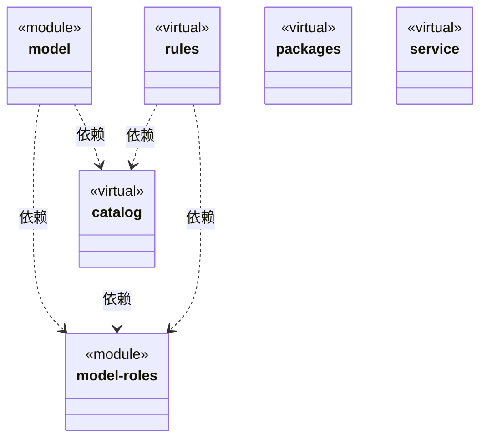

# src/logic/engines 架构

## 设计意图

官方引擎的静态身份、业务专长、协议兼容和执行模型快照；便携入口不加载 SDK，模型设置与引擎服务单向组合。

## 主要组成

| 组成 | 定位 |
| --- | --- |
| [model](model.ts) | 引擎执行准备后的模型快照契约，供岗位、任务与装配保存公开参数。 |
| [model-roles](model-roles.ts) | V2 额外模型角色的公开引用与冻结快照，供 Agent、岗位和任务共同携带。 |

<!-- architecture:generated:start -->

## 架构关系

标注为 `virtual` 的节点是直接子模块的虚拟类封装；内部设计沿下方入口阅读。

## 子模块

| 虚拟封装 | 整体职责 |
| --- | --- |
| [catalog](catalog/ARCHITECTURE.md) | 开发者在代码中声明官方支持引擎；清单随 Logic 资源发布，声明只读，不支持用户注册或配置覆盖。 |
| [packages](packages/ARCHITECTURE.md) | 官方包安装选择、固定依赖与运行引用；制品经冷壳验签，安装成功后原子切换，失败不自动重试。 |
| [rules](rules/ARCHITECTURE.md) | 从静态清单派生身份校验、协议约束和兼容接口筛选；只组合通用模型规则，不联网或持有凭据。 |
| [service](service/ARCHITECTURE.md) | EngineModelProfiles 将引擎选型映射为模型协议需求，复用模型服务唯一配置锁和延迟解密；返回引擎快照，不拥有模型存储或引擎安装状态。 |

[上层设计](../ARCHITECTURE.md)

<!-- architecture:generated:end -->
