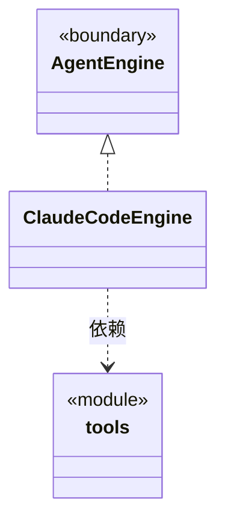

# src/logic/engines/adapters/claude 架构

## 设计意图

把 Claude Agent SDK 的会话、事件与工具调用转换为宿主统一执行协议。

`ClaudeCodeEngine` 持有本次 SDK 会话，`sdk` 隔离加载，`tools` 连接可信工具，`package` 暴露工厂。运行环境和能力由宿主注入，历史反馈不扩大授权；这里不开放对外通用 MCP 服务。

## 主要组成

| 组成 | 定位 |
| --- | --- |
| [ClaudeCodeEngine](engine.ts) | Claude Code 的 AgentEngine 适配器，管理 SDK 与原生会话；目标返工沿合成系统资料输入，不带入新授权。 |
| [tools](tools.ts) | 将宿主已授权能力适配成 SDK 工具，保持真实调用身份。 |

<!-- architecture:generated:start -->

## 架构关系

外部继承／实现边界：[AgentEngine](../../../execution/rules/types.ts)。

[上层设计](../ARCHITECTURE.md)

<!-- architecture:generated:end -->
