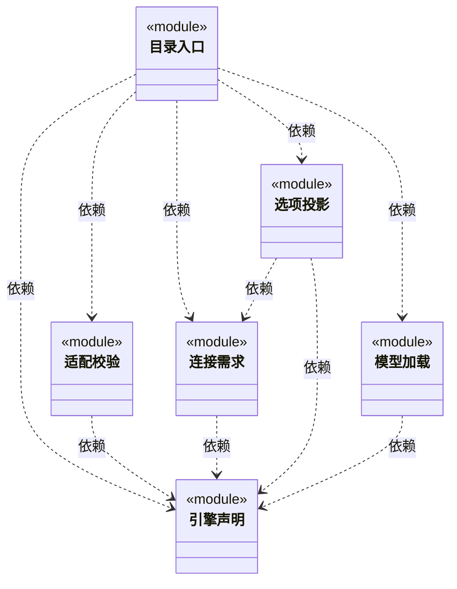
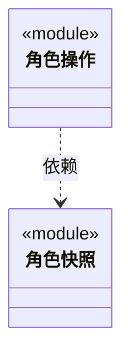

# 引擎目录与兼容规则

## 设计意图

依据引擎声明选择模型协议和额外角色，供设置预览与执行准备共用。兼容列表只是静态筛选，不能替代真实连接验证；本模块不下载制品、不读取凭据。

## 主要组成

| 组成 | 定位 |
| --- | --- |
| [目录入口](index.ts) | 公开引擎、模型选择及角色校验。 |
| [引擎声明](supported-engines.ts) | 登记内置与包声明的引擎身份、能力及依赖。 |
| [适配校验](adapter.ts) | 核对包身份、协议、版本和描述后取得工厂。 |
| [连接需求](model-selection.ts) | 从引擎声明投影协议需求并校验供应商兼容性。 |
| [选项投影](model-choices.ts) | 生成已配置、启用且兼容的模型选项。 |
| [模型加载](model.ts) | 组合内核模型适配器并描述已解析快照。 |
| [角色快照](model-roles.ts) | 校验额外生成或向量角色，主模型保持独立字段。 |
| [角色操作](role-operations.ts) | 按声明顺序校验和投影角色引用。 |

<!-- architecture:generated:start -->

## 架构关系

### 关系组 1：目录入口

### 关系组 2：角色快照

### 跨图协作

按引用方归并目标，保留全部跨图关系；分图只用于阅读，不表示新增模块或依赖边界。

| 引用方 | 关系 | 目标 |
| --- | --- | --- |
| [目录入口](index.ts)（图 1） | 依赖 | [角色快照](model-roles.ts)（图 2）、[角色操作](role-operations.ts)（图 2） |
| [引擎声明](supported-engines.ts)（图 1） | 依赖 | [角色快照](model-roles.ts)（图 2） |
| [选项投影](model-choices.ts)（图 1） | 依赖 | [角色快照](model-roles.ts)（图 2）、[角色操作](role-operations.ts)（图 2） |
| [模型加载](model.ts)（图 1） | 依赖 | [角色快照](model-roles.ts)（图 2） |

[上层设计](../ARCHITECTURE.md)

<!-- architecture:generated:end -->
