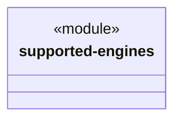

# src/logic/engines/catalog 架构

## 设计意图

以随版本发布的代码清单定义官方支持的引擎身份和能力，避免远程索引注册任意实现。

`supported-engines` 是静态声明集合，供选择规则、安装管理和界面读取，不加载 SDK。清单变化需要与实际适配器及版本协议相符；安装状态和可用模型不在静态声明中维护。

## 主要组成

| 组成 | 定位 |
| --- | --- |
| [supported-engines](supported-engines.ts) | 开发者维护的官方 Agent Loop 引擎静态清单，随 Logic 资源发布。 |

<!-- architecture:generated:start -->

## 架构关系

[上层设计](../ARCHITECTURE.md)

<!-- architecture:generated:end -->
