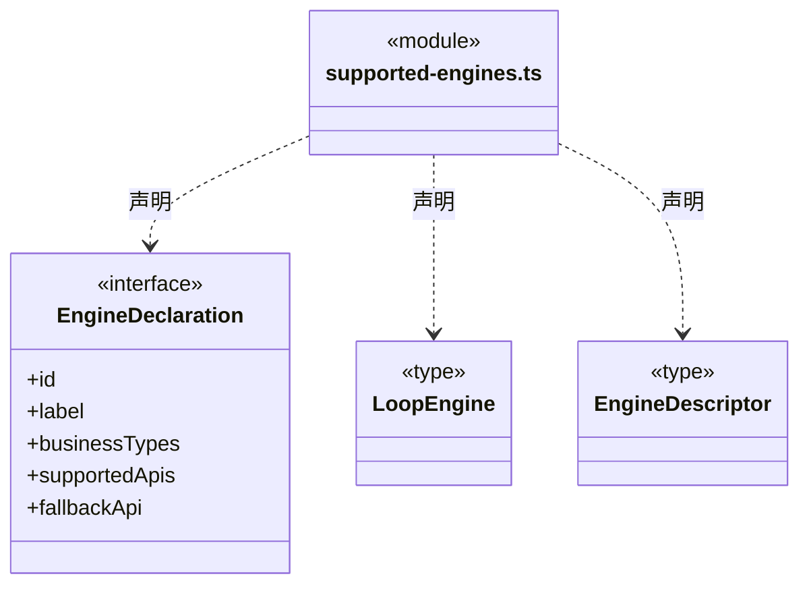

# src/logic/engines/catalog 架构

## 目录定位

开发者在代码中声明官方支持引擎；清单随 Logic 资源发布，声明只读，不支持用户注册或配置覆盖。

本文描述当前实现。通过分析目录边界后维护的 [源码架构脚本](../../../../scripts/source-architecture.mjs) 同步清单和声明；代码变更时仍须核对职责、关键成员与关系。

## 代码清单

| 文件 | 当前职责 |
| --- | --- |
| [supported-engines.ts](supported-engines.ts) | 开发者维护的官方 Agent Loop 引擎静态清单，随 Logic 资源发布。 |

## 架构类图

### supported-engines.ts

直接依赖：[../../models/index.ts](../../models/index.ts)。

## 子目录导航

无子目录。

[返回上层](../ARCHITECTURE.md)。

每次修改本目录代码，同步维护文件头、关键契约说明及本图。未实现的治理、证据验收和自动编排能力不列入当前类图。
