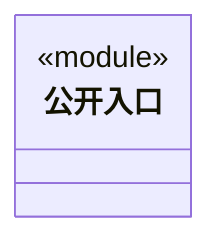

# 引擎目录

## 设计意图

声明随产品发布的引擎、适配器兼容规则和可选模型角色。

## 主要组成

| 组成 | 定位 |
| --- | --- |
| [公开入口](index.ts) | 提供引擎及模型的兼容性查询。 |

<!-- architecture:generated:start -->

## 架构关系

[上层设计](../ARCHITECTURE.md)

<!-- architecture:generated:end -->
