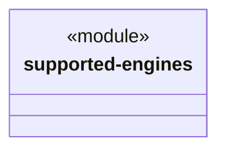

# src/logic/engines/catalog 架构

## 设计意图

开发者在代码中声明官方支持引擎；清单随 Logic 资源发布，声明只读，不支持用户注册或配置覆盖。

## 主要组成

| 组成 | 定位 |
| --- | --- |
| [supported-engines](supported-engines.ts) | 开发者维护的官方 Agent Loop 引擎静态清单，随 Logic 资源发布。 |

<!-- architecture:generated:start -->

## 架构关系

[上层设计](../ARCHITECTURE.md)

<!-- architecture:generated:end -->
