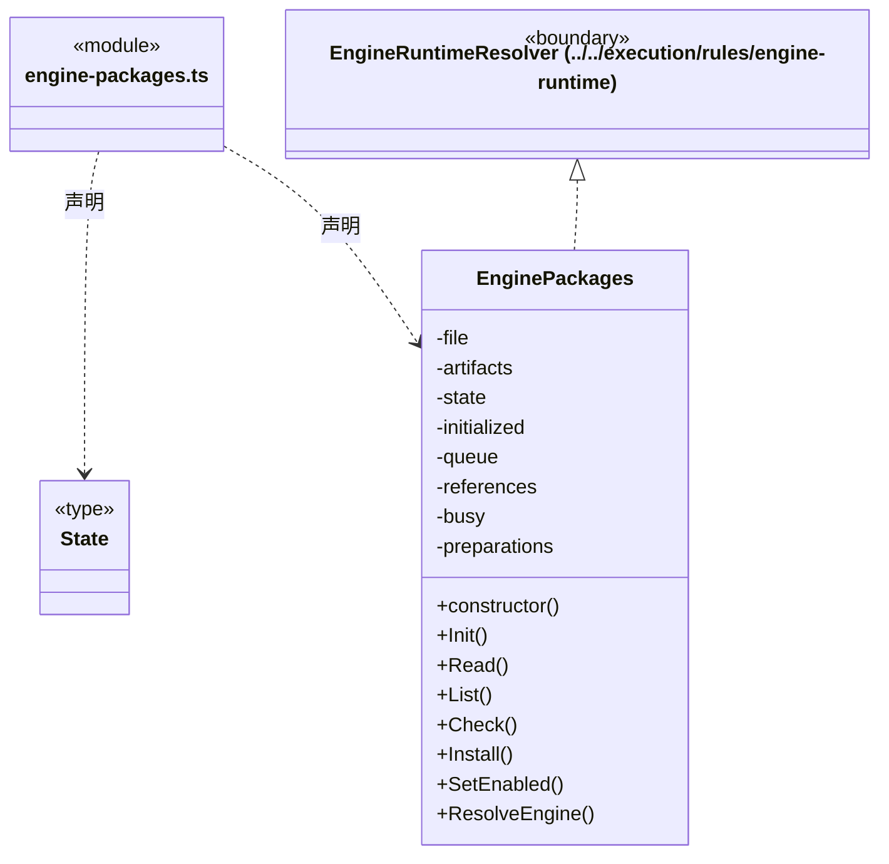
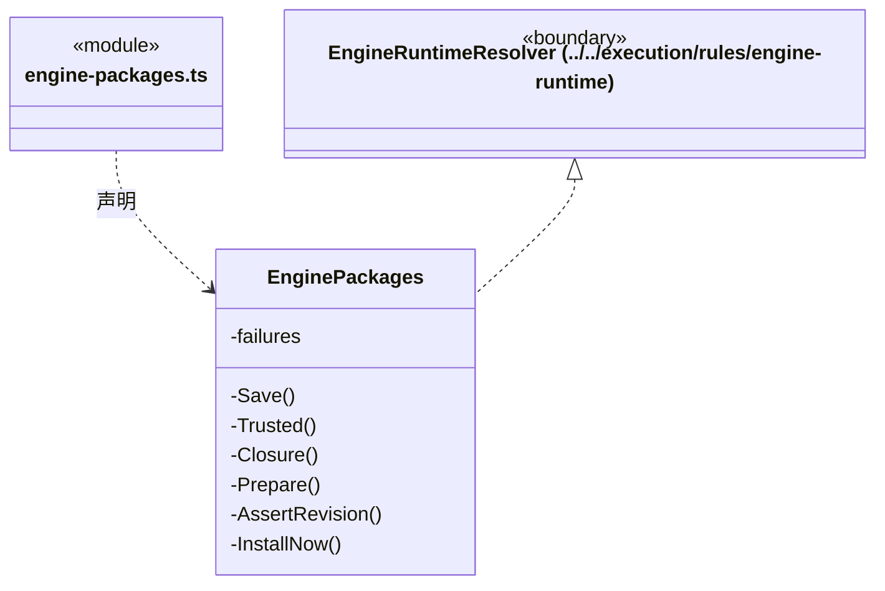
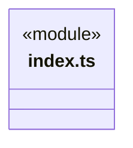
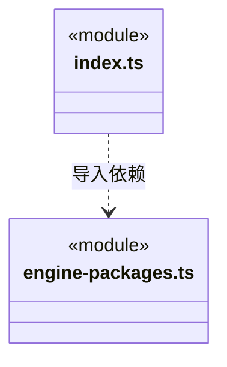

# src/logic/engines/packages 架构

本目录只维护这一份说明。设计与契约直接编辑本文；文件清单、类图和导航由 [架构脚本](../../../../scripts/source-architecture.mjs) 更新，生成区域之外的人工说明会保留。

## 封装意图

官方包安装选择、固定依赖与运行引用；制品经冷壳验签，安装成功后原子切换，失败不自动重试。

## 类与模块的设计意图

下表依据源码声明及文件头说明定位封装。字段表示该实例持有的状态或协作引用，不表示它拥有被引用服务的生命周期；实际资源责任和调用限制见下文契约及源码注释。

| 类／模块 | 实现形式与实例字段 | 封装依据 |
| --- | --- | --- |
| [EnginePackages](engine-packages.ts) | 实例类；持有 `state`、`initialized`、`queue`、`references`、`busy`、`preparations`、`failures`、`file`、`artifacts` | 支持名单来自 R 的代码，制品来自 C 的验签端口；先准备完整闭包再原子切换，失败不使任务自动下载或重启。 |
| [index.ts](index.ts) | 函数／契约模块 | Node 存储与便携模型兼容规则隔离，View 只通过桥接契约访问状态与明确动作。 |

## 接口设计契约

### 官方包生命周期

`EnginePackages` 由 Application 唯一持有。它通过通用 `EngineArtifactsPort` 取得冷壳验签的制品，静态目录仍是唯一支持名单。模型服务不读取安装状态，模型凭据不进入安装清单。

本机 `engine-installations.json` 记录 schema、revision、启用状态、活动摘要、历史已安装摘要及最后准备失败。先准备准确依赖闭包，全部成功才原子写入新选择；失败保留旧活动版。显式安装/更新可重试，首次使用失败在重开后仍停止自动准备。受管缓存损坏在同进程内停止重试，重开后重新校验仍不删除或下载替代包。

查询更新只更新可信候选，不能切换活动版。解析返回本次冻结包和依赖；Codex 所用 Pi 来自制品依赖摘要，不跟随 Pi 的默认活动版本。创建实例时保留全部包引用，close 成功后释放；请求 stop 和未知 close 不释放。更新不改已返回地址；停用后尚未创建的实例不能取得引用。

停用/移除拒绝运行引用和启用引擎的依赖。移除只清活动选择，保留不可变缓存、安装历史、模型配置和原生会话。尚未开始的任务若使用已停用引擎，会在准备阶段明确失败；不切换引擎或自动重新安装。历史原生会话继续核对确切包身份，不能因为有新版而静默恢复。

源码开发没有冷宿主制品端口，继续使用源工厂；它不伪装成已安装正式包。正式包通过同一通用加载契约启动。设置页通过 revision 与准确候选摘要显式管理；make:engines/sign:engines 生成独立发布候选。本目录不提供任意包路径、URL 或第三方源入口。

设置 read 返回同一状态代次的 revision；公开安装必须同时提交所展示的候选摘要，启停/移除提交 revision。过时页面或检查更新改变候选时在下载前拒绝。

##### 准备状态与跨版本保留

EnginePackages 为每次真实 prepare 登记独立短期进度；显式安装及已安装引擎的运行前校验都通过同一入口。读取只投影状态，不触发下载。并行准备各自清理，百分比未知不能补造；失败仍沿原持久错误与准确摘要失败屏障。活动缓存校验失败也可在对应详情查看。

安装清单位于 userRoot/engine-installations.json，不含 CBIM 版本目录；应用更换 C/R 不改启用、活动摘要或历史安装选择。制品实际复用由共享 RuntimeStore 完整校验决定，版本相同但摘要/文件冲突不能跳过验证。移除保留缓存，再添加可以离线准备；已有活动版本不随候选更新自动切换。

## 开闭边界

本目录的职责及允许协作由[封装意图](#封装意图)限定，输入输出、状态与失败语义以[接口设计契约](#接口设计契约)为准。扩展从已有公开入口及实际装配位置进入；没有明确可替换契约的部分按真实影响修改和验证，不预建未使用的基类或插件入口。

<!-- architecture:generated:start -->

## 文件清单

| 文件 | 形式 | 当前职责 |
| --- | --- | --- |
| [ARCHITECTURE.md](ARCHITECTURE.md) | 说明文档 | 本目录的文件清单、真实声明、依赖与子封装导航。 |
| [engine-packages.ts](engine-packages.ts) | 源码模块 | Application 持有的官方引擎安装选择、依赖锁和运行引用生命周期。 |
| [index.ts](index.ts) | 源码模块 | 官方引擎安装生命周期的服务入口。 |

## 架构类图

成员标记：`+` 公开、`-` 私有、`#` 受保护、`$` 静态；构造函数单独列出。文档和资源仅在文件清单中导航，不作为代码节点。

### engine-packages.ts

成员 1/2（同名节点为同一声明，跨图合并阅读）。

成员 2/2（同名节点为同一声明，跨图合并阅读）。

继承／实现来源：`EngineRuntimeResolver` → [../../execution/rules/engine-runtime.ts](../../execution/rules/engine-runtime.ts)。
直接依赖：[../../../core/platform/node/files/index.ts](../../../core/platform/node/files/index.ts)、[../../../core/utility/index.ts](../../../core/utility/index.ts)、[../index.ts](../index.ts)、[../../execution/rules/engine-runtime.ts](../../execution/rules/engine-runtime.ts)、[../../updates/engine-artifacts.ts](../../updates/engine-artifacts.ts)。

### index.ts

直接依赖：[../index.ts](../index.ts)、[engine-packages.ts](engine-packages.ts)。

### 本目录调用边界

## 子目录导航

无子目录。

[返回上层](../ARCHITECTURE.md)。

每次修改本目录代码，同步维护文件头、关键契约说明及本图。未实现的治理、证据验收和自动编排能力不列入当前类图。

<!-- architecture:generated:end -->
