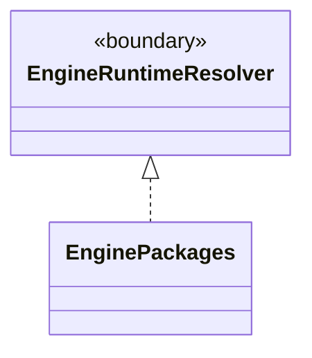

# src/logic/engines/packages 架构

## 设计意图

管理应用选择的官方引擎版本、依赖闭包和运行引用，隔离下载制品与启用选择。

`EnginePackages` 由 Application 持有，通过更新制品端口准备已验证包，在安装成功后保存选择；运行引用冻结准确版本。失败准备不会由普通对话自动重试，已有运行不因安装新版本而切换。

## 主要组成

| 组成 | 定位 |
| --- | --- |
| [EnginePackages](engine-packages.ts) | Application 持有的官方引擎安装选择、依赖锁和运行引用生命周期。 |

<!-- architecture:generated:start -->

## 架构关系

外部继承／实现边界：[EngineRuntimeResolver](../../execution/rules/engine-runtime.ts)。

[上层设计](../ARCHITECTURE.md)

<!-- architecture:generated:end -->
