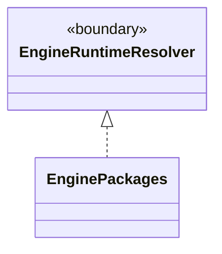

# src/logic/engines/packages 架构

## 设计意图

官方包安装选择、固定依赖与运行引用；制品经冷壳验签，安装成功后原子切换，失败不自动重试。

## 主要组成

| 组成 | 定位 |
| --- | --- |
| [EnginePackages](engine-packages.ts) | Application 持有的官方引擎安装选择、依赖锁和运行引用生命周期。 |

<!-- architecture:generated:start -->

## 架构关系

外部继承／实现边界：[EngineRuntimeResolver](../../execution/rules/engine-runtime.ts)。

[上层设计](../ARCHITECTURE.md)

<!-- architecture:generated:end -->
