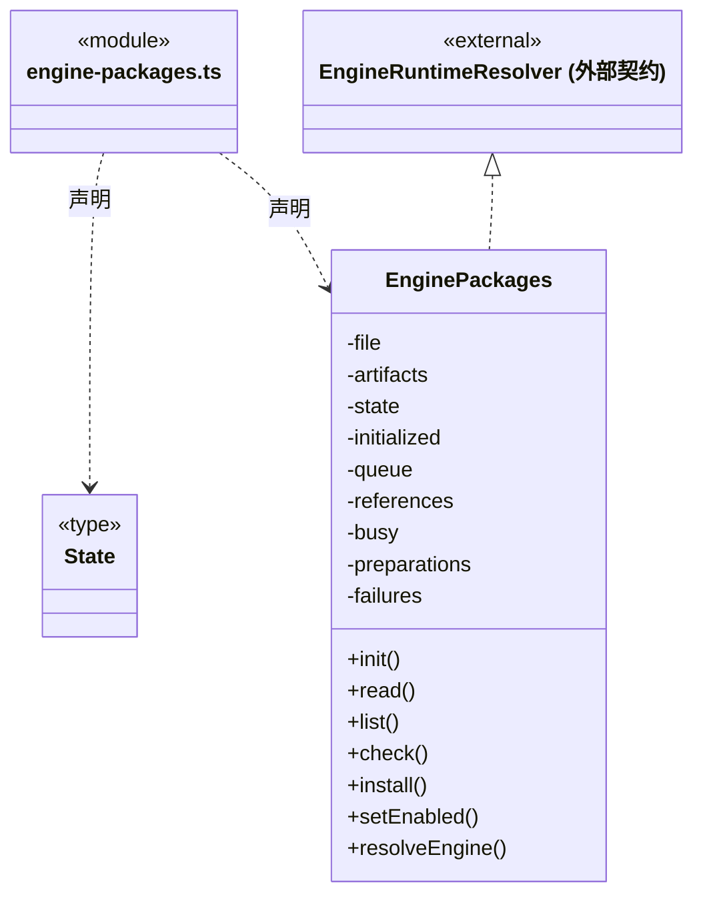
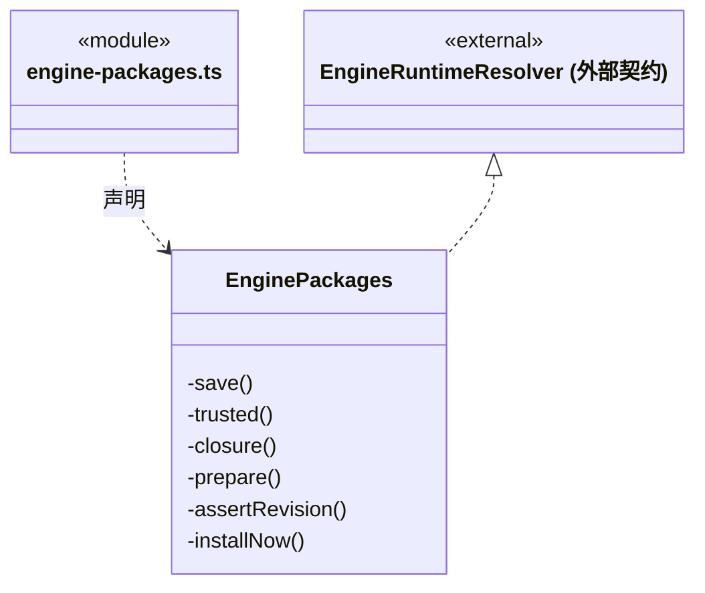
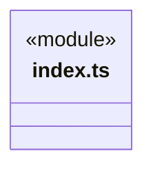
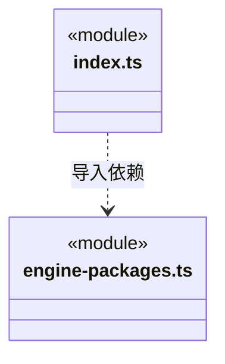

# src/logic/engines/packages 架构

## 目录定位

官方包安装选择、固定依赖与运行引用；制品经冷壳验签，安装成功后原子切换，失败不自动重试。

本文描述当前实现。通过分析目录边界后维护的 [源码架构脚本](../../../../scripts/source-architecture.mjs) 同步清单和声明；代码变更时仍须核对职责、关键成员与关系。

## 代码清单

| 文件 | 当前职责 |
| --- | --- |
| [engine-packages.ts](engine-packages.ts) | Application 持有的官方引擎安装选择、依赖锁和运行引用生命周期。 |
| [index.ts](index.ts) | 官方引擎安装生命周期的服务入口。 |

## 架构类图

### engine-packages.ts

成员 1/2（同名节点为同一声明，跨图合并阅读）。

成员 2/2（同名节点为同一声明，跨图合并阅读）。

直接依赖：[../../../core/platform/node/files/index.ts](../../../core/platform/node/files/index.ts)、[../../../core/utility/index.ts](../../../core/utility/index.ts)、[../index.ts](../index.ts)、[../../updates/engine-artifacts.ts](../../updates/engine-artifacts.ts)、[../../execution/rules/engine-runtime.ts](../../execution/rules/engine-runtime.ts)。

### index.ts

直接依赖：[engine-packages.ts](engine-packages.ts)、[../index.ts](../index.ts)。

### 本目录调用边界

## 子目录导航

无子目录。

[返回上层](../ARCHITECTURE.md)。

每次修改本目录代码，同步维护文件头、关键契约说明及本图。未实现的治理、证据验收和自动编排能力不列入当前类图。

## 设计契约 v1 与落地范围

以下内容区分已接通能力与后续设计；以各节的实现状态为准，不将目标图当作现状图。维护源：[CONTRACT.md](CONTRACT.md)；生成类图时同步附加，勿直接修改本附录。

# 官方包生命周期

`EnginePackages` 由 Application 唯一持有。它通过通用 `EngineArtifactsPort` 取得冷壳验签的制品，静态目录仍是唯一支持名单。模型服务不读取安装状态，模型凭据不进入安装清单。

本机 `engine-installations.json` 记录 schema、revision、启用状态、活动摘要、历史已安装摘要及最后准备失败。先准备准确依赖闭包，全部成功才原子写入新选择；失败保留旧活动版。显式安装/更新可重试，首次使用失败在重开后仍停止自动准备。受管缓存损坏在同进程内停止重试，重开后重新校验仍不删除或下载替代包。

查询更新只更新可信候选，不能切换活动版。解析返回本次冻结包和依赖；Codex 所用 Pi 来自制品依赖摘要，不跟随 Pi 的默认活动版本。创建实例时保留全部包引用，close 成功后释放；请求 stop 和未知 close 不释放。更新不改已返回地址；停用后尚未创建的实例不能取得引用。

停用/移除拒绝运行引用和启用引擎的依赖。移除只清活动选择，保留不可变缓存、安装历史、模型配置和原生会话。尚未开始的任务若使用已停用引擎，会在准备阶段明确失败；不切换引擎或自动重新安装。历史原生会话继续核对确切包身份，不能因为有新版而静默恢复。

源码开发没有冷宿主制品端口，继续使用源工厂；它不伪装成已安装正式包。正式包通过同一通用加载契约启动。设置页通过 revision 与准确候选摘要显式管理；make:engines/sign:engines 生成独立发布候选。本目录不提供任意包路径、URL 或第三方源入口。

设置 read 返回同一状态代次的 revision；公开安装必须同时提交所展示的候选摘要，启停/移除提交 revision。过时页面或检查更新改变候选时在下载前拒绝。

### 准备状态与跨版本保留

EnginePackages 为每次真实 prepare 登记独立短期进度；显式安装及已安装引擎的运行前校验都通过同一入口。读取只投影状态，不触发下载。并行准备各自清理，百分比未知不能补造；失败仍沿原持久错误与准确摘要失败屏障。活动缓存校验失败也可在对应详情查看。

安装清单位于 userRoot/engine-installations.json，不含 CBIM 版本目录；应用更换 C/R 不改启用、活动摘要或历史安装选择。制品实际复用由共享 RuntimeStore 完整校验决定，版本相同但摘要/文件冲突不能跳过验证。移除保留缓存，再添加可以离线准备；已有活动版本不随候选更新自动切换。
