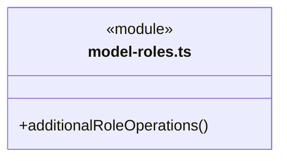
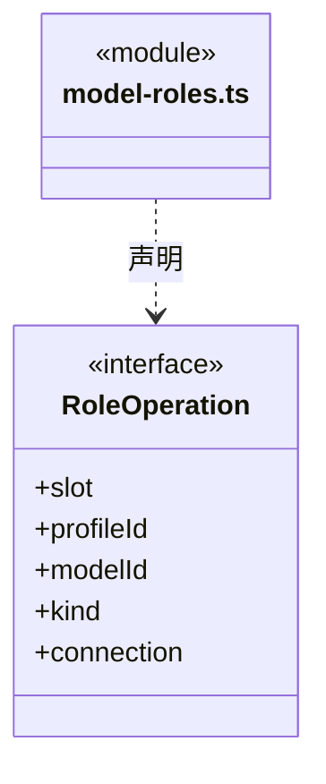
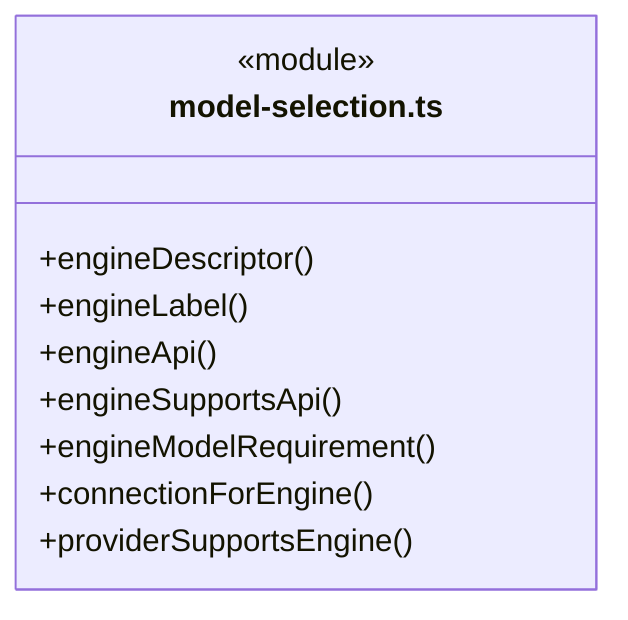

# src/logic/engines/rules 架构

## 目录定位

从静态清单派生身份校验、协议约束和兼容接口筛选；只组合通用模型规则，不联网或持有凭据。

本文描述当前实现。通过分析目录边界后维护的 [源码架构脚本](../../../../scripts/source-architecture.mjs) 同步清单和声明；代码变更时仍须核对职责、关键成员与关系。

## 代码清单

| 文件 | 当前职责 |
| --- | --- |
| [model-roles.ts](model-roles.ts) | 把官方模型角色声明与用户 V2 选型投影为有序操作引用。 |
| [model-selection.ts](model-selection.ts) | 官方引擎身份校验及引擎到模型连接需求的纯投影。 |

## 架构类图

### model-roles.ts

直接依赖：[../model-roles.ts](../model-roles.ts)、[../../models/index.ts](../../models/index.ts)。

### model-selection.ts

直接依赖：[../../models/index.ts](../../models/index.ts)、[../catalog/supported-engines.ts](../catalog/supported-engines.ts)。

## 子目录导航

无子目录。

[返回上层](../ARCHITECTURE.md)。

每次修改本目录代码，同步维护文件头、关键契约说明及本图。未实现的治理、证据验收和自动编排能力不列入当前类图。
