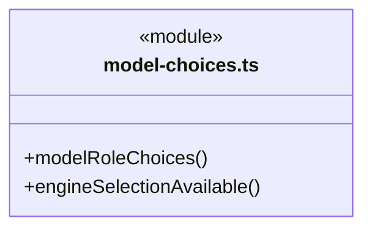
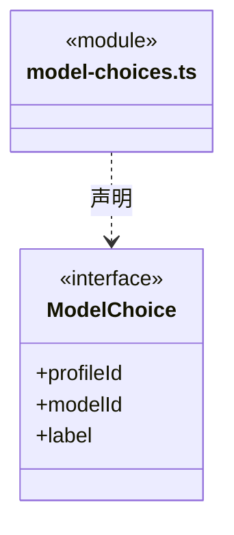
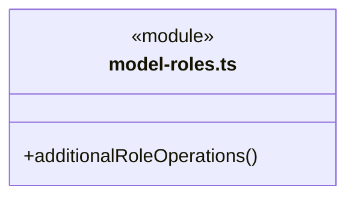
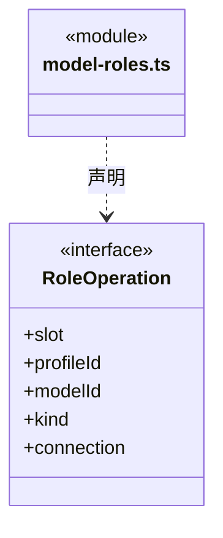
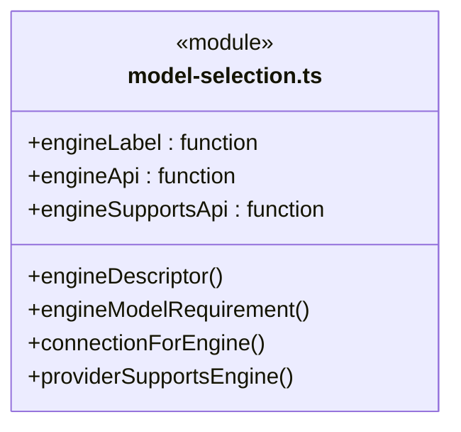
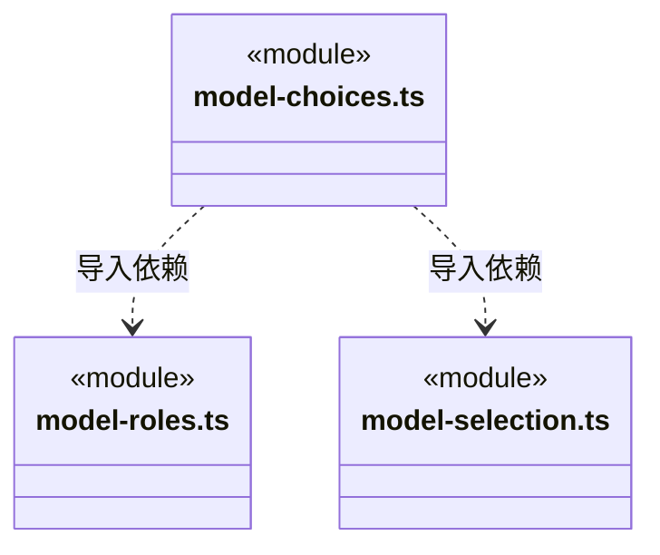

# src/logic/engines/rules 架构

本目录只维护这一份说明。设计与契约直接编辑本文；文件清单、类图和导航由 [架构脚本](../../../../scripts/source-architecture.mjs) 更新，生成区域之外的人工说明会保留。

## 封装意图

从静态清单派生身份校验、协议约束和兼容接口筛选；只组合通用模型规则，不联网或持有凭据。

## 类与模块的设计意图

下表依据源码声明及文件头说明定位封装。字段表示该实例持有的状态或协作引用，不表示它拥有被引用服务的生命周期；实际资源责任和调用限制见下文契约及源码注释。

| 类／模块 | 实现形式与实例字段 | 封装依据 |
| --- | --- | --- |
| [model-choices.ts](model-choices.ts) | 函数／契约模块 | Agent 编辑、主对话与引擎能力列表共用规则；纯预览不解密或联网，保存和启动仍由配置服务复核。 |
| [model-roles.ts](model-roles.ts) | 函数／契约模块 | 保存、岗位采纳、执行准备共用同一必填/能力/型号规则；实际存储与凭据仍由模型服务负责。 |
| [model-selection.ts](model-selection.ts) | 函数／契约模块 | 把引擎偏好与模型供应商配置分开；界面筛选、岗位登记和执行准备使用同一份静态声明。 |

## 接口设计契约

model-choices 根据模型角色的操作、协议、白名单和启用状态生成可选项，primary 仍沿原单模型字段；engineSelectionAvailable 检查必填角色与禁用/缺失模型，仅用于前端预览，服务仍复核。

## 开闭边界

本目录的职责及允许协作由[封装意图](#封装意图)限定，输入输出、状态与失败语义以[接口设计契约](#接口设计契约)为准。扩展从已有公开入口及实际装配位置进入；没有明确可替换契约的部分按真实影响修改和验证，不预建未使用的基类或插件入口。

<!-- architecture:generated:start -->

## 文件清单

| 文件 | 形式 | 当前职责 |
| --- | --- | --- |
| [ARCHITECTURE.md](ARCHITECTURE.md) | 说明文档 | 本目录的文件清单、真实声明、依赖与子封装导航。 |
| [model-choices.ts](model-choices.ts) | 源码模块 | 将开发者声明的各模型角色投影为已配置、启用且兼容的选择列表。 |
| [model-roles.ts](model-roles.ts) | 源码模块 | 把官方模型角色声明与用户 V2 选型投影为有序操作引用。 |
| [model-selection.ts](model-selection.ts) | 源码模块 | 官方引擎身份校验及引擎到模型连接需求的纯投影。 |

## 架构类图

成员标记：`+` 公开、`-` 私有、`#` 受保护、`$` 静态；`function` 为函数值成员，`get`／`set` 为访问器。调用／构造／索引签名按匿名签名列出，不虚构方法名；`global.` 表示全局声明补充，非运行时嵌套类。构造函数单独列出，运行时私有字段保留 `#`。文档和资源仅在文件清单中导航，不作为代码节点。

### model-choices.ts

[查看源码](model-choices.ts)。

直接依赖：[../catalog/supported-engines.ts](../catalog/supported-engines.ts)、[../model-roles.ts](../model-roles.ts)、[model-roles.ts](model-roles.ts)、[model-selection.ts](model-selection.ts)、[../../models/index.ts](../../models/index.ts)。

### model-roles.ts

[查看源码](model-roles.ts)。

直接依赖：[../model-roles.ts](../model-roles.ts)、[../../models/index.ts](../../models/index.ts)。

### model-selection.ts

[查看源码](model-selection.ts)。

直接依赖：[../catalog/supported-engines.ts](../catalog/supported-engines.ts)、[../../models/index.ts](../../models/index.ts)。

### 本目录调用边界

## 子目录导航

无子目录。

[返回上层](../ARCHITECTURE.md)。

每次修改本目录代码，同步维护文件头、关键契约说明及本图。未实现的治理、证据验收和自动编排能力不列入当前类图。

<!-- architecture:generated:end -->
