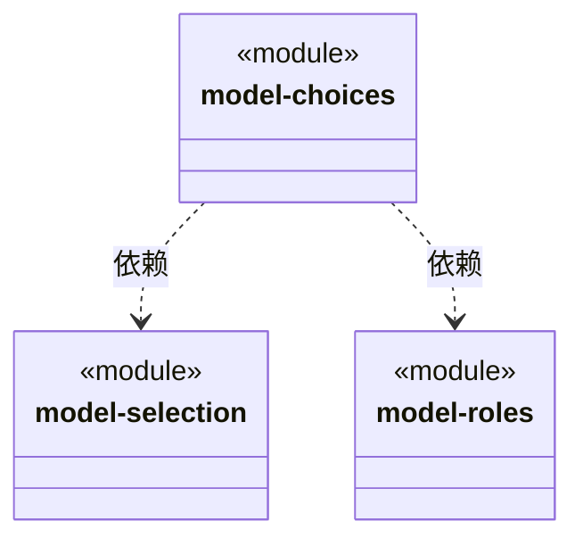

# src/logic/engines/rules 架构

## 设计意图

从静态清单派生身份校验、协议约束和兼容接口筛选；只组合通用模型规则，不联网或持有凭据。

## 主要组成

| 组成 | 定位 |
| --- | --- |
| [model-selection](model-selection.ts) | 官方引擎身份校验及引擎到模型连接需求的纯投影。 |
| [model-choices](model-choices.ts) | 将开发者声明的各模型角色投影为已配置、启用且兼容的选择列表。 |
| [model-roles](model-roles.ts) | 把官方模型角色声明与用户 V2 选型投影为有序操作引用。 |

<!-- architecture:generated:start -->

## 架构关系

[上层设计](../ARCHITECTURE.md)

<!-- architecture:generated:end -->
