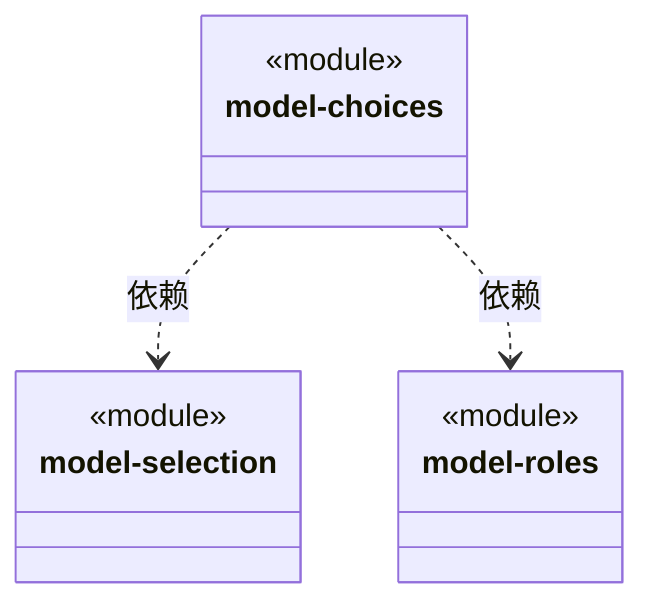

# src/logic/engines/rules 架构

## 设计意图

从官方声明和已配置模型中计算引擎兼容性、角色选择及有序操作引用。

`model-selection` 校验引擎身份与协议需求，`model-choices` 筛选可用模型，`model-roles` 核对额外角色。全部规则消费公开配置，不联网、不读取凭据；最终配置捕获与延迟解密由服务负责。

## 主要组成

| 组成 | 定位 |
| --- | --- |
| [model-selection](model-selection.ts) | 官方引擎身份校验及引擎到模型连接需求的纯投影。 |
| [model-choices](model-choices.ts) | 将开发者声明的各模型角色投影为已配置、启用且兼容的选择列表。 |
| [model-roles](model-roles.ts) | 把官方模型角色声明与用户 V2 选型投影为有序操作引用。 |

<!-- architecture:generated:start -->

## 架构关系

[上层设计](../ARCHITECTURE.md)

<!-- architecture:generated:end -->
