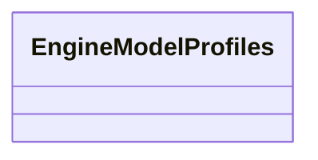

# src/logic/engines/service 架构

## 设计意图

把引擎选择转换为模型服务可核实的协议需求，返回绑定引擎身份的冻结执行快照。

`EngineModelProfiles` 组合 engines 规则和 models 服务，复用后者的配置锁与延迟解密。它不保存第二份模型配置，也不管理安装状态；角色选择必须在同一次有效配置捕获中一致。

## 主要组成

| 组成 | 定位 |
| --- | --- |
| [EngineModelProfiles](model-profiles.ts) | 把 Agent 引擎选型映射为通用模型连接需求，并在返回快照中冻结显式引擎身份。 |

<!-- architecture:generated:start -->

## 架构关系

[上层设计](../ARCHITECTURE.md)

<!-- architecture:generated:end -->
