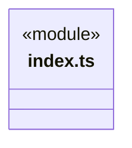
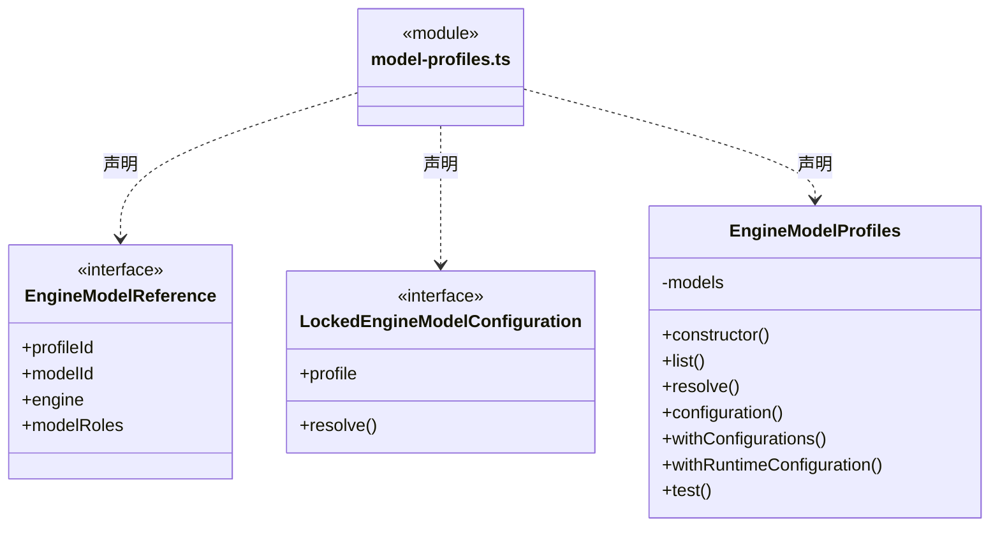
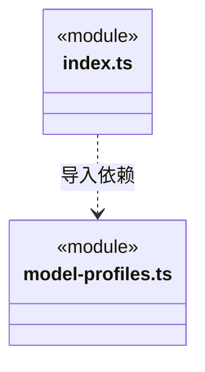

# src/logic/engines/service 架构

## 目录定位

EngineModelProfiles 将引擎选型映射为模型协议需求，复用模型服务唯一配置锁和延迟解密；返回引擎快照，不拥有模型存储或引擎安装状态。

本文描述当前实现。通过分析目录边界后维护的 [源码架构脚本](../../../../scripts/source-architecture.mjs) 同步清单和声明；代码变更时仍须核对职责、关键成员与关系。

## 文件清单

| 文件 | 形式 | 当前职责 |
| --- | --- | --- |
| [ARCHITECTURE.md](ARCHITECTURE.md) | 说明文档 | 本目录的文件清单、真实声明、依赖与子封装导航。 |
| [index.ts](index.ts) | 源码模块 | 应用装配可用的引擎选型服务入口，与便携清单分离。 |
| [model-profiles.ts](model-profiles.ts) | 源码模块 | 把 Agent 引擎选型映射为通用模型连接需求，并在返回快照中冻结显式引擎身份。 |

## 架构类图

成员标记：`+` 公开、`-` 私有、`#` 受保护、`$` 静态；构造函数单独列出。文档和资源仅在文件清单中导航，不作为代码节点。

### index.ts

直接依赖：[model-profiles.ts](model-profiles.ts)。

### model-profiles.ts

直接依赖：[../../../core/errors.ts](../../../core/errors.ts)、[../../models/index.ts](../../models/index.ts)、[../../models/service/index.ts](../../models/service/index.ts)、[../index.ts](../index.ts)。

### 本目录调用边界

## 子目录导航

无子目录。

[返回上层](../ARCHITECTURE.md)。

每次修改本目录代码，同步维护文件头、关键契约说明及本图。未实现的治理、证据验收和自动编排能力不列入当前类图。
