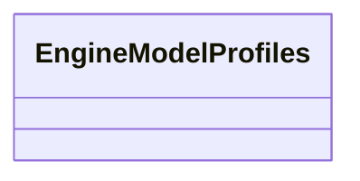

# src/logic/engines/service 架构

## 设计意图

EngineModelProfiles 将引擎选型映射为模型协议需求，复用模型服务唯一配置锁和延迟解密；返回引擎快照，不拥有模型存储或引擎安装状态。

## 主要组成

| 组成 | 定位 |
| --- | --- |
| [EngineModelProfiles](model-profiles.ts) | 把 Agent 引擎选型映射为通用模型连接需求，并在返回快照中冻结显式引擎身份。 |

<!-- architecture:generated:start -->

## 架构关系

[上层设计](../ARCHITECTURE.md)

<!-- architecture:generated:end -->
