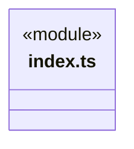
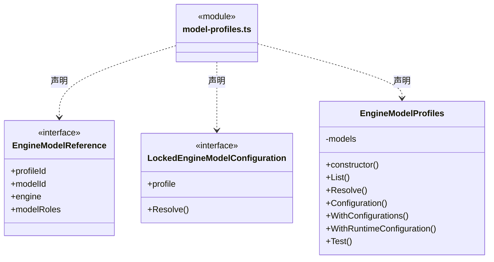
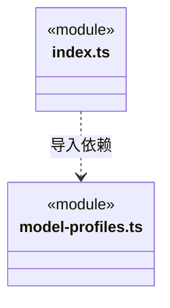

# src/logic/engines/service 架构

本目录只维护这一份说明。设计与契约直接编辑本文；文件清单、类图和导航由 [架构脚本](../../../../scripts/source-architecture.mjs) 更新，生成区域之外的人工说明会保留。

## 封装意图

EngineModelProfiles 将引擎选型映射为模型协议需求，复用模型服务唯一配置锁和延迟解密；返回引擎快照，不拥有模型存储或引擎安装状态。

## 类与模块的设计意图

下表依据源码声明及文件头说明定位封装。字段表示该实例持有的状态或协作引用，不表示它拥有被引用服务的生命周期；实际资源责任和调用限制见下文契约及源码注释。

| 类／模块 | 实现形式与实例字段 | 封装依据 |
| --- | --- | --- |
| [index.ts](index.ts) | 函数／契约模块 | 只有可信 Logic/Bridge 服务接触模型解析与延迟凭据，View 和纯规则不能加载这些能力。 |
| [EngineModelProfiles](model-profiles.ts) | 实例类；持有 `models` | 引擎策略不进入模型配置服务；复用该服务唯一设置队列、配置捕获与延迟解密，避免新增锁或再次读取造成快照漂移。 |

## 接口设计契约

- [index.ts](index.ts)：应用装配可用的引擎选型服务入口，与便携清单分离。
- [model-profiles.ts](model-profiles.ts)：职责边界：不保存模型、不管理引擎安装、不自动重试；缺省 engine 保持缺省，历史快照及其哈希不改写。

`EngineModelReference` 固定供应商、主模型与可选引擎/附加角色。角色顺序从官方引擎声明取得，不能由调用方追加未知操作；多模型执行必须明确主模型身份。`List` 和 `Configuration` 读取公开配置，前者不探测网络，后者不解密也不保证运行时凭据有效。

`WithConfigurations` 在进入模型队列前克隆全部引用，所有角色映射与回调都复用模型服务的同一配置事务；本类只持有注入的模型服务引用，不创建第二套配置、锁或持久状态。`WithRuntimeConfiguration` 返回的延迟 `Resolve` 仅在回调存活期内有效，每次调用都先核原锁，即使已有缓存也不能在回调外取凭据。启动引擎应等事务和锁释放后进行。

`Resolve` 在执行准备阶段选择协议并获取凭据；无显式模型时沿用模型服务当前默认值，不保存选择。`Test` 委托模型服务执行实际连接诊断；仅不兼容接口错误转成引擎错误，其余模型、存储、凭据和事务错误原样传播，不自动重试。

## 开闭边界

引擎差异通过上层官方清单与纯规则映射为模型操作，本层继续组合注入的模型服务窄接口。新增角色或协议时核对映射、固定角色顺序和公开快照；模型持久化、队列及凭据生命周期仍留在模型服务，不为每种引擎新增存储或锁。本目录没有另设引擎安装或运行时注册入口。

<!-- architecture:generated:start -->

## 文件清单

| 文件 | 形式 | 当前职责 |
| --- | --- | --- |
| [ARCHITECTURE.md](ARCHITECTURE.md) | 说明文档 | 本目录的文件清单、真实声明、依赖与子封装导航。 |
| [index.ts](index.ts) | 源码模块 | 应用装配可用的引擎选型服务入口，与便携清单分离。 |
| [model-profiles.ts](model-profiles.ts) | 源码模块 | 把 Agent 引擎选型映射为通用模型连接需求，并在返回快照中冻结显式引擎身份。 |

## 架构类图

成员标记：`+` 公开、`-` 私有、`#` 受保护、`$` 静态；构造函数单独列出。文档和资源仅在文件清单中导航，不作为代码节点。

### index.ts

直接依赖：[model-profiles.ts](model-profiles.ts)。

### model-profiles.ts

直接依赖：[../../../core/errors.ts](../../../core/errors.ts)、[../../models/index.ts](../../models/index.ts)、[../../models/service/index.ts](../../models/service/index.ts)、[../index.ts](../index.ts)。

### 本目录调用边界

## 子目录导航

无子目录。

[返回上层](../ARCHITECTURE.md)。

每次修改本目录代码，同步维护文件头、关键契约说明及本图。未实现的治理、证据验收和自动编排能力不列入当前类图。

<!-- architecture:generated:end -->
