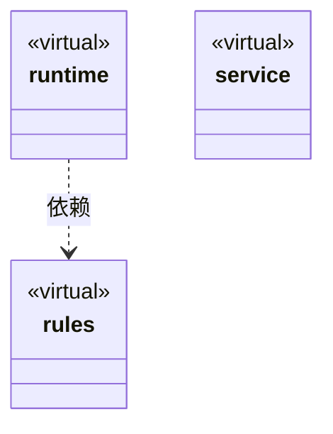

# src/logic/evidence 架构

## 设计意图

组织执行证据的表达、可信采集与独立复核，区分已有记录、当前观察和业务验收。

`rules` 定义证据身份与有效性，`runtime` 读取原运行及真实文件形成报告，`service` 适配知识和治理等持久事实。证据归原调用与冻结范围，报告不自动执行修复、授予权限或宣布目标完成。

## 主要组成

本层没有直接产品实现，由下方子模块组成；每个直接子模块作为一个虚拟封装，只在本层呈现整体职责与协作。

<!-- architecture:generated:start -->

## 架构关系

标注为 `virtual` 的节点是直接子模块的虚拟类封装；内部设计沿下方入口阅读。

## 子模块

| 虚拟封装 | 整体职责 |
| --- | --- |
| [rules](rules/ARCHITECTURE.md) | 统一文件基线、产物清单、进度和验证证据的含义，约束模型输入与可信事实之间的边界。 |
| [runtime](runtime/ARCHITECTURE.md) | 按原运行和可信记录生成可追溯的核实报告，为用户处置提供事实而不猜测操作结果。 |
| [service](service/ARCHITECTURE.md) | 把工作区知识事务与治理记录适配为有界的只读效果证据，供证据运行服务组合。 |

[上层设计](../ARCHITECTURE.md)

<!-- architecture:generated:end -->
