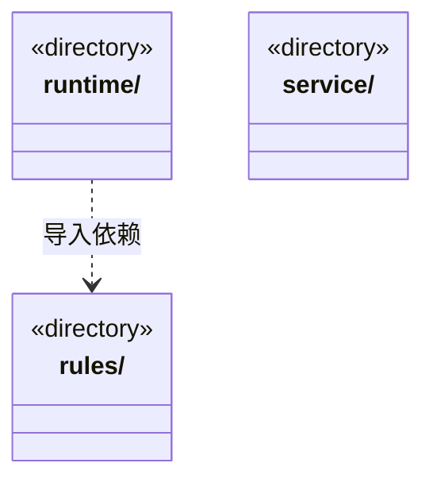

# src/logic/evidence 架构

## 目录定位

产物验证、进度证据及核实规则；服务与规则分开归属，实际依赖通过明确入口验证。

本文描述当前实现。通过分析目录边界后维护的 [源码架构脚本](../../../scripts/source-architecture.mjs) 同步清单和声明；代码变更时仍须核对职责、关键成员与关系。

## 代码清单

本层无直接代码文件。

## 架构类图

各图中的同名节点表示同一目录边界；跨组及完整直接依赖如下（无边不代表继承）：

- `runtime` → `rules`：导入。

## 子目录导航

- [rules/](rules/ARCHITECTURE.md)：证据领域：输出清单、产物、命令/人工/效果观察与完成报告规则。记录、有效性和业务验收分别核实；业务读取适配在 logic/evidence/service，编排在 logic/evidence/runtime。
- [runtime/](runtime/ARCHITECTURE.md)：证据编排：收集、核实和提交产物/输出/效果/人工证据，消费 logic/evidence/rules 的证据规则及对应存储端口。
- [service/](service/ARCHITECTURE.md)：真实工程效果读取适配：在明确范围和版本下采集观察供证据服务使用。

[返回上层](../ARCHITECTURE.md)。

每次修改本目录代码，同步维护文件头、关键契约说明及本图。未实现的治理、证据验收和自动编排能力不列入当前类图。
