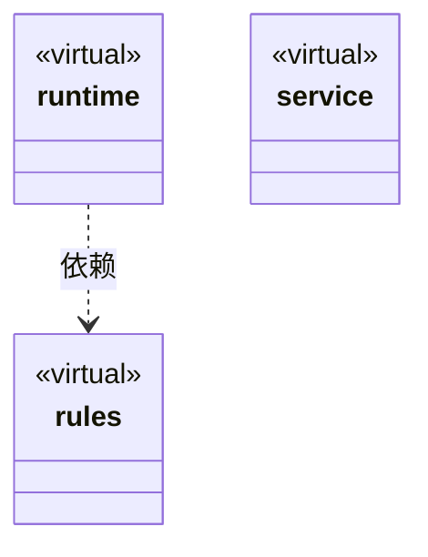

# src/logic/evidence 架构

## 设计意图

封装执行事实的采集、核实与报告。规则界定证据含义，运行服务组织复核，读取适配接入真实工程；保存证据与业务验收保持分离。

## 主要组成

本层由下列子模块组合，每个子模块作为独立的虚拟类封装参与本层协作。

<!-- architecture:generated:start -->

## 架构关系

标注为 `virtual` 的节点是直接子模块的虚拟类封装；内部设计沿下方入口阅读。

## 子模块

| 虚拟封装 | 整体职责 |
| --- | --- |
| [rules](rules/ARCHITECTURE.md) | 统一产物、进度和验证证据的业务表达。纯规则负责身份和有效性判断，工具类把模型输入接到注入的可信能力；记录存在不等于业务验收通过。 |
| [runtime](runtime/ARCHITECTURE.md) | 组合原运行、可信日志和实际文件生成核实报告。不同服务按文件基线、完整清单、命令和影响观察分工，读取与明确处置保持可区分的责任。 |
| [service](service/ARCHITECTURE.md) | 真实工程效果读取适配：在明确范围和版本下采集观察供证据服务使用。 |

[上层设计](../ARCHITECTURE.md)

<!-- architecture:generated:end -->
