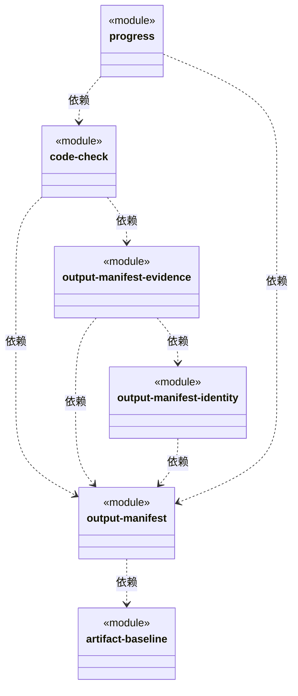
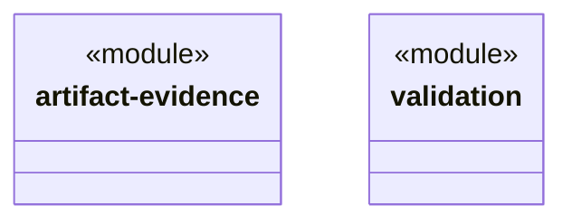

# src/logic/evidence/rules 架构

## 设计意图

保存引擎事件与产物证明的序列化协议及确定性核验。回执与模型描述不能替代真实采集，也不代表 Office 业务验收通过。

## 主要组成

| 组成 | 定位 |
| --- | --- |
| [artifact-baseline](artifact-baseline.ts) | 显式文件基线、工具输入及独立只读核实报告的序列化契约。 |
| [artifact-evidence](artifact-evidence.ts) | 从本轮已提交事件核实文件采集来源与不可变基线，供运行时和只读报告共用。 |
| [code-check](code-check.ts) | 代码检查的可信事实、摘要和交付证明，连接冻结 Workflow 与原始运行日志。 |
| [output-manifest-evidence](output-manifest-evidence.ts) | 计算完整产物清单身份，并从原 canonical 核实采集、授权和真实成功回执的对应关系。 |
| [output-manifest-identity](output-manifest-identity.ts) | 完整清单的确定性范围/内容指纹及引用投影，作为清单和原操作证明共用的单向基础。 |
| [output-manifest](output-manifest.ts) | 声明范围完整清单、可信采集事件和独立复核的公开序列化契约。 |
| [progress](progress.ts) | 单 Agent 执行计划及交付候选的领域状态，独立于 Pi、磁盘和界面。 |
| [validation](validation.ts) | JSON/CSV/PNG 产物验证工具、不可变检查事实及 Workflow 精确出口的叶子契约。 |

<!-- architecture:generated:start -->

## 架构关系

### 关系组 1：output-manifest

### 关系组 2：artifact-evidence

### 跨图协作

按引用方归并目标，保留全部跨图关系；分图只用于阅读，不表示新增模块或依赖边界。

| 引用方 | 关系 | 目标 |
| --- | --- | --- |
| [artifact-evidence](artifact-evidence.ts)（图 2） | 依赖 | [artifact-baseline](artifact-baseline.ts)（图 1） |
| [code-check](code-check.ts)（图 1） | 依赖 | [artifact-evidence](artifact-evidence.ts)（图 2） |
| [output-manifest-evidence](output-manifest-evidence.ts)（图 1） | 依赖 | [artifact-evidence](artifact-evidence.ts)（图 2） |
| [progress](progress.ts)（图 1） | 依赖 | [validation](validation.ts)（图 2） |
| [validation](validation.ts)（图 2） | 依赖 | [artifact-baseline](artifact-baseline.ts)（图 1）、[output-manifest](output-manifest.ts)（图 1） |

[上层设计](../ARCHITECTURE.md)

<!-- architecture:generated:end -->
