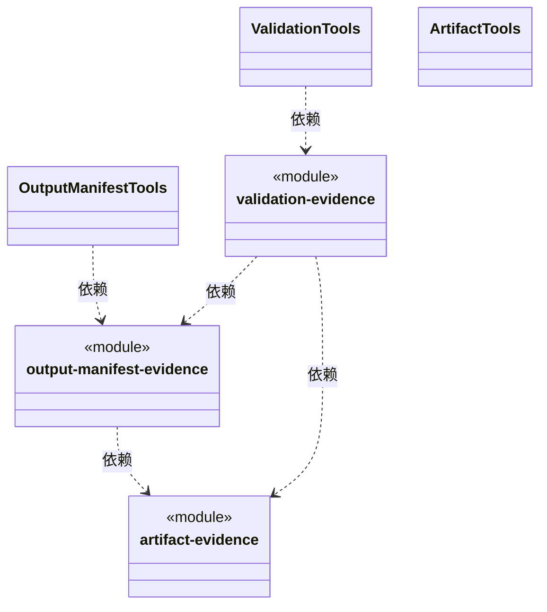
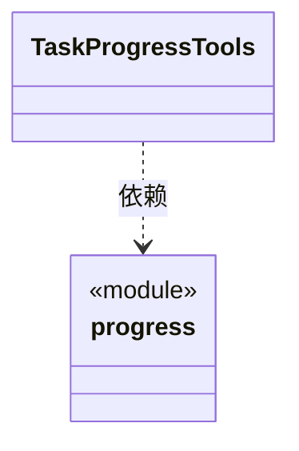

# src/logic/evidence/rules 架构

## 设计意图

统一文件基线、产物清单、进度和验证证据的含义，约束模型输入与可信事实之间的边界。

证据协议与纯判断核对身份和范围；工具类把严格输入交给注入的采集或保存端口。模型不能自报可信路径、哈希或授权来源，记录存在也不代替对原字节和业务要求的复核。

## 主要组成

| 组成 | 定位 |
| --- | --- |
| [ArtifactTools](artifact-tools.ts) | 正式成员的显式文件基线工具包装，校验模型输入并委托本轮可信采集端口。 |
| [OutputManifestTools](output-manifest-tools.ts) | 正式成员的完整清单采集与原记录查询工具；输入没有路径、哈希、模块或运行身份。 |
| [TaskProgressTools](progress-tools.ts) | 内部 Loop 的任务计划、步骤证据和交付工具，状态通过注入的持久化回调保存。 |
| [ValidationTools](validation-tools.ts) | 为已装配 JSON/CSV/PNG 验证要求的正式成员提供严格输入、唯一 wire 输出及真实能力说明。 |
| [artifact-evidence](artifact-evidence.ts) | 核实文件基线与原运行事件的关系，避免把普通回包当可信采集。 |
| [output-manifest-evidence](output-manifest-evidence.ts) | 核对完整产物清单、冻结范围及对应运行记录。 |
| [validation-evidence](validation-evidence.ts) | 依据冻结要求与原记录核实 JSON/CSV/PNG 验证证据。 |
| [progress](progress.ts) | 解释任务计划、步骤及交付进度的结构与状态语义。 |

<!-- architecture:generated:start -->

## 架构关系

### 关系组 1：output-manifest-evidence

### 关系组 2：progress

[上层设计](../ARCHITECTURE.md)

<!-- architecture:generated:end -->
