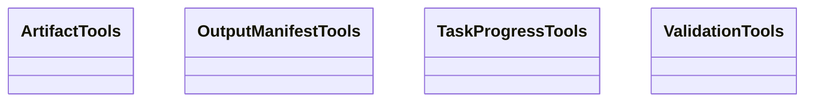

# src/logic/evidence/rules 架构

## 设计意图

统一产物、进度和验证证据的业务表达。纯规则负责身份和有效性判断，工具类把模型输入接到注入的可信能力；记录存在不等于业务验收通过。

## 主要组成

| 组成 | 定位 |
| --- | --- |
| [ArtifactTools](artifact-tools.ts) | 正式成员的显式文件基线工具包装，校验模型输入并委托本轮可信采集端口。 |
| [OutputManifestTools](output-manifest-tools.ts) | 正式成员的完整清单采集与原记录查询工具；输入没有路径、哈希、模块或运行身份。 |
| [TaskProgressTools](progress-tools.ts) | 内部 Loop 的任务计划、步骤证据和交付工具，状态通过注入的持久化回调保存。 |
| [ValidationTools](validation-tools.ts) | 为已装配 JSON/CSV/PNG 验证要求的正式成员提供严格输入、唯一 wire 输出及真实能力说明。 |

<!-- architecture:generated:start -->

## 架构关系

[上层设计](../ARCHITECTURE.md)

<!-- architecture:generated:end -->
