# src/logic/evidence/rules 架构

本目录只维护这一份说明。设计与契约直接编辑本文；文件清单、类图和导航由 [架构脚本](../../../../scripts/source-architecture.mjs) 更新，生成区域之外的人工说明会保留。

## 封装意图

证据领域：输出清单、产物、命令/人工/效果观察与完成报告规则。记录、有效性和业务验收分别核实；业务读取适配在 logic/evidence/service，编排在 logic/evidence/runtime。

## 类与模块的设计意图

下表依据源码声明及文件头说明定位封装。字段表示该实例持有的状态或协作引用，不表示它拥有被引用服务的生命周期；实际资源责任和调用限制见下文契约及源码注释。

| 类／模块 | 实现形式与实例字段 | 封装依据 |
| --- | --- | --- |
| [artifact-baseline.ts](artifact-baseline.ts) | 函数／契约模块 | 模型只选择真实工具调用，文件字节与日志身份由可信端口采集；基线只覆盖所列文件，不签发业务验收或成员恢复。 |
| [artifact-evidence.ts](artifact-evidence.ts) | 函数／契约模块 | 工具成功、采集暂存事件及文件字节不能互相代替；参数与结果哈希、调用顺序、固定身份全部匹配后才发布引用，避免两套较宽松证据规则。 |
| [ArtifactTools](artifact-tools.ts) | 实例类；持有 `knowledgeRevision`、`binding`、`ports` | 参数中没有路径、哈希或运行身份；真实采集由运行时负责，返回值只按唯一 JSON 正文核实绑定与原请求，避免解析修复或自动重采。 |
| [code-check.ts](code-check.ts) | 函数／契约模块 | 成功工具回执只说明已检查；必须重算每项结果、原输入集合和交付 manifest 的同一性。 |
| [complete-output-evidence.ts](complete-output-evidence.ts) | 函数／契约模块 | 声明的全部范围必须随同一原清单进入各出口，不能选一个未变文件子集、缺失输出或较新引用来替代。 |
| [output-manifest-evidence.ts](output-manifest-evidence.ts) | 函数／契约模块 | 范围、条目及引用须独立重算；暂存事件、模型返回的摘要或缺少终态的工具均不能单独形成完整证明。 |
| [output-manifest-identity.ts](output-manifest-identity.ts) | 函数／契约模块 | 操作证据要核前后集合，不能反向依赖遍历 canonical 的验证器而形成循环。 |
| [OutputManifestTools](output-manifest-tools.ts) | 实例类；持有 `binding`、`knowledgeRevision`、`scopes`、`ports` | 真实范围在构造时冻结，实际 wire 独立核对一次；坏回包保留已保存事件，不通过重采掩盖原错误。 |
| [output-manifest.ts](output-manifest.ts) | 函数／契约模块 | 目录条目和缺失根与文件指纹共同形成集合身份，新增文件或空目录不能在旧文件哈希相同的情况下被遗漏。 |
| [progress-schema.ts](progress-schema.ts) | 函数／契约模块 | TaskProgress 自身没有运行身份；JSON 检查事实和精确出口为可选结构，旧流程不补空证明，也不将 rejected 的执行事实改成通过。 |
| [TaskProgressTools](progress-tools.ts) | 实例类；持有 `state`、`evidence`、`generation`、`tail`、`planEstablished`、`workflow`、`identity`、`save`、`ports` | 每个运行独立持有计划与证据代次；变更串行落盘，正式派发图的状态由外层调度结算。 |
| [progress.ts](progress.ts) | 函数／契约模块 | 目标与步骤修订必须留痕；JSON 结构出口另存精确文件证明，工具成功或结构通过都不能由模型解释为人工验收。 |
| [validation-evidence.ts](validation-evidence.ts) | 函数／契约模块 | 结果正文和 succeeded 回执都不能单独声明通过；要求、基线、真实调用、文件字节指纹及事件顺序必须一致。 |
| [ValidationTools](validation-tools.ts) | 实例类；持有 `knowledgeRevision`、`bindings`、`binding`、`port` | 模型只选择已有要求与产物身份；完整模式在调用前固定可信范围/内容摘要，坏回包不重试，也不把 rejected 修复成通过。 |
| [validation.ts](validation.ts) | 函数／契约模块 | 工具成功不代表结构通过；身份、要求和文件指纹来自可信冻结上下文，不接受模型传入 Schema、路径或结论。 |
| [workflow-evidence.ts](workflow-evidence.ts) | 函数／契约模块 | 工具调用事实必须与固定模块约定、当前运行及最后副作用的真实结束边界一致；并发早读不能替代写入后的验证，不能相信模型自报 pass 或只检查内存状态。 |

## 接口设计契约

<a id="contract"></a>

<a id="contract-代码检查与交付"></a>

### 代码检查与交付

对象排序机制由 utility.orderJsonValue 提供，各证据适配保留原字段与指纹规则：artifact-evidence 使用 localeCompare，workflow-evidence/validation-evidence 使用字符序且省略 undefined，output-manifest-identity 使用字符序并保留属性。最终 JSON 序列化、Schema 复核、证据来源和验收均留在本目录，未升级历史摘要或统一排序策略。

Workflow 的 `delivery.requiredCodeChecks` 冻结检查 ID、目的、program、args、cwd、timeoutMs 和 success。必须同时声明 `artifactScope` 和 `requireCompleteManifest`，暂不支持 `executionScope` 混用。旧 Workflow 无此字段时行为不变。

`cbim_code_check_run` 只接受空对象，运行时经 command 权限执行整组检查并保存 `code.validation_checked`。同一组绑定同一份输入快照；非零退出、超时、输出超限、源码在检查期间变化均拒绝通过。test-summary-json 要求 stdout 唯一一行 `CBIM_TEST_SUMMARY {"passed":1,"failed":0,"skipped":0}`，通过数不得低于 minPassed；摘要由项目测试适配脚本输出，其真实性取决于冻结脚本，系统不推断测试覆盖了全部需求。

检查后重新 inspect 进度、用检查调用 ID 更新步骤，再采集完整清单并准备交付。交付证明绑定命令要求摘要、源码集合摘要和知识版本；历史结算从授权、可信事件和完成回包重算，当前源码由已有完整清单机制复核。

范围必须显式包含相关源码、测试、构建配置和锁文件；未声明的依赖、环境和外部服务不在证明范围。沿用完整清单上限：16 个根、512 条目、单文件 8 MiB、总计 32 MiB。构建输出应放在输入范围之外。每组最多 8 项，每项最长 5 分钟，输出最多 256 KiB。平台执行是宿主进程，不提供沙箱隔离。

阅读顺序：logic/workspace/rules/code-check.ts 定义要求，logic/evidence/rules/code-check.ts 核验事实，logic/execution/rules/capabilities/run-code-check.ts 管理生命周期，logic/file-operations/platform/files/code-check-runner.ts 执行真实进程。新增项目检查优先修改 Workflow 和项目适配脚本；新增成功判据才修改契约与平台解析，并补充失败回归。

<a id="contract-显式业务调用的基本交付"></a>

#### 显式业务调用的基本交付
validateWorkflowEvidence 的可信 requireDelivery 选项用于没有附加 Workflow 的业务 Agent。仍核原目标、连续 canonical、成功计划/交付回执、实际步骤证据及副作用结束顺序；不构造虚假 Workflow 或证明。历史无约定调用不传此选项，保留原兼容规则。返回 undefined 仅表示没有额外 Workflow 证明，不表示跳过基本交付校验。


<a id="contract-共享算法调用边界"></a>

#### 共享算法调用边界

本目录通过 Core 公开入口调用 `JsonUtils.OrderJsonValue`。静态类只承载原算法；本目录继续决定字段、比较器、错误映射及资源生命周期。函数改为静态方法不改变原持久化字节或失败语义。

## 开闭边界

本目录的职责及允许协作由[封装意图](#封装意图)限定，输入输出、状态与失败语义以[接口设计契约](#接口设计契约)为准。扩展从已有公开入口及实际装配位置进入；没有明确可替换契约的部分按真实影响修改和验证，不预建未使用的基类或插件入口。

<!-- architecture:generated:start -->

## 文件清单

| 文件 | 形式 | 当前职责 |
| --- | --- | --- |
| [ARCHITECTURE.md](ARCHITECTURE.md) | 说明文档 | 本目录的文件清单、真实声明、依赖与子封装导航。 |
| [artifact-baseline.ts](artifact-baseline.ts) | 源码模块 | 显式文件基线、工具输入及独立只读核实报告的序列化契约。 |
| [artifact-evidence.ts](artifact-evidence.ts) | 源码模块 | 从本轮已提交事件核实文件采集来源与不可变基线，供运行时和只读报告共用。 |
| [artifact-tools.ts](artifact-tools.ts) | 源码模块 | 正式成员的显式文件基线工具包装，校验模型输入并委托本轮可信采集端口。 |
| [code-check.ts](code-check.ts) | 源码模块 | 代码检查的可信事实、摘要和交付证明，连接冻结 Workflow 与原始运行日志。 |
| [complete-output-evidence.ts](complete-output-evidence.ts) | 源码模块 | 完整产物出口共用的清单选择、身份投影和当前集合比较，供运行、交付及人工核实复用。 |
| [output-manifest-evidence.ts](output-manifest-evidence.ts) | 源码模块 | 计算完整产物清单身份，并从原 canonical 核实采集、授权和真实成功回执的对应关系。 |
| [output-manifest-identity.ts](output-manifest-identity.ts) | 源码模块 | 完整清单的确定性范围/内容指纹及引用投影，作为清单和原操作证明共用的单向基础。 |
| [output-manifest-tools.ts](output-manifest-tools.ts) | 源码模块 | 正式成员的完整清单采集与原记录查询工具；输入没有路径、哈希、模块或运行身份。 |
| [output-manifest.ts](output-manifest.ts) | 源码模块 | 声明范围完整清单、可信采集事件和独立复核的公开序列化契约。 |
| [progress-schema.ts](progress-schema.ts) | 源码模块 | 执行计划、Workflow 命中证明与进度查询的严格公开结构。 |
| [progress-tools.ts](progress-tools.ts) | 源码模块 | 内部 Loop 的任务计划、步骤证据和交付工具，状态通过注入的持久化回调保存。 |
| [progress.ts](progress.ts) | 源码模块 | 单 Agent 执行计划及交付候选的领域状态，独立于 Pi、磁盘和界面。 |
| [validation-evidence.ts](validation-evidence.ts) | 源码模块 | 从可信冻结 Workflow 与本轮日志核实 JSON/CSV/PNG 验证事实，供 Runtime、交付和主目标复核共同使用。 |
| [validation-tools.ts](validation-tools.ts) | 源码模块 | 为已装配 JSON/CSV/PNG 验证要求的正式成员提供严格输入、唯一 wire 输出及真实能力说明。 |
| [validation.ts](validation.ts) | 源码模块 | JSON/CSV/PNG 产物验证工具、不可变检查事实及 Workflow 精确出口的叶子契约。 |
| [workflow-evidence.ts](workflow-evidence.ts) | 源码模块 | 核实可选 Workflow 的计划前置、工具回执及精确 必验文件结构出口，供运行时与调度结算共用。 |

## 架构类图

成员标记：`+` 公开、`-` 私有、`#` 受保护、`$` 静态；构造函数单独列出。文档和资源仅在文件清单中导航，不作为代码节点。

### artifact-baseline.ts

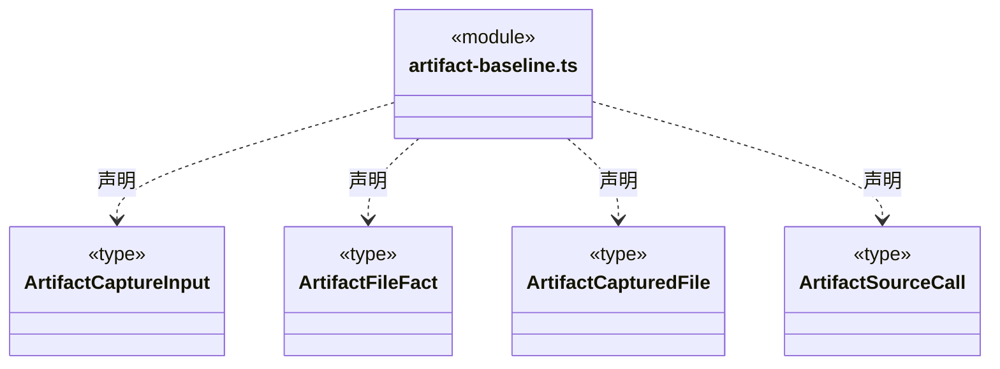

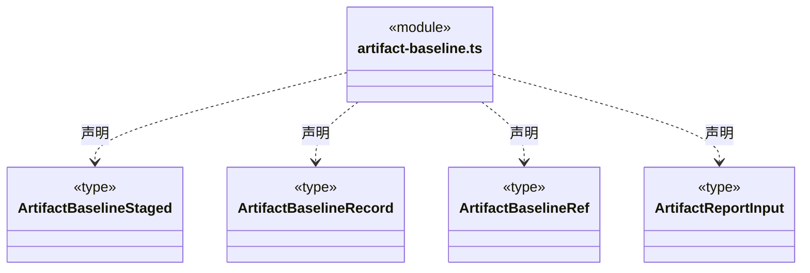

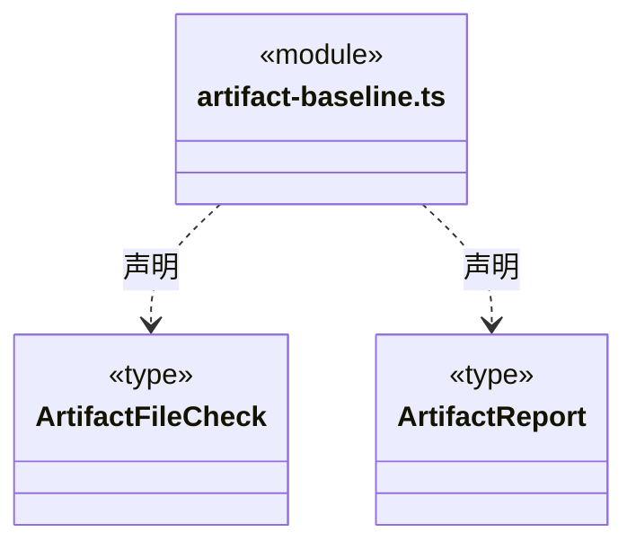


### artifact-evidence.ts

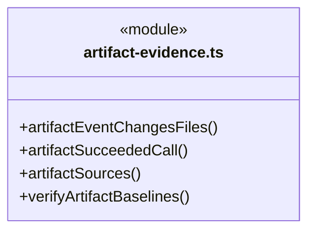

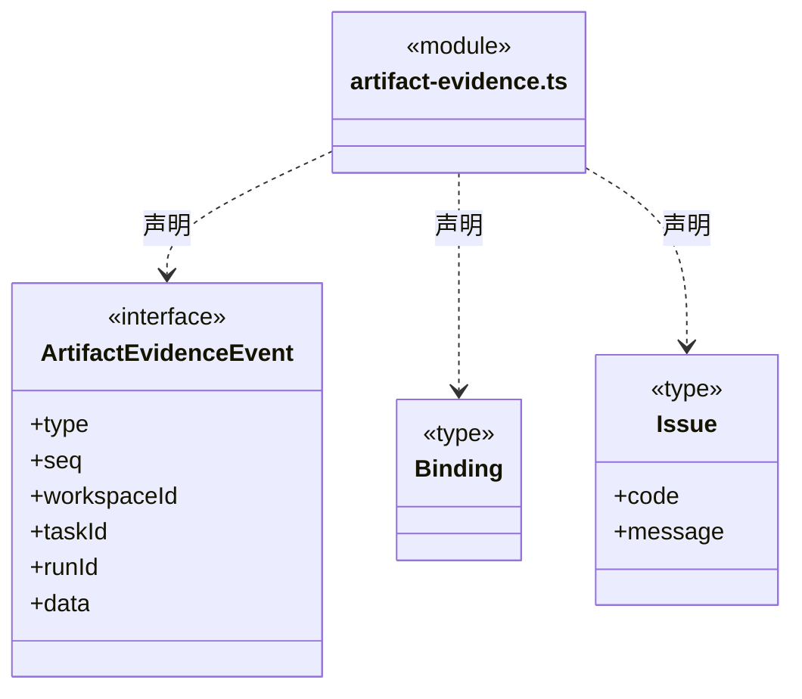

直接依赖：[../../../core/utility/index.ts](../../../core/utility/index.ts)、[../../file-operations/rules/scoped-execution.ts](../../file-operations/rules/scoped-execution.ts)、[../../../core/errors.ts](../../../core/errors.ts)、[../../../core/platform/node/serialization.ts](../../../core/platform/node/serialization.ts)、[../../tools/rules/scope-schema.ts](../../tools/rules/scope-schema.ts)、[artifact-baseline.ts](artifact-baseline.ts)。

### artifact-tools.ts

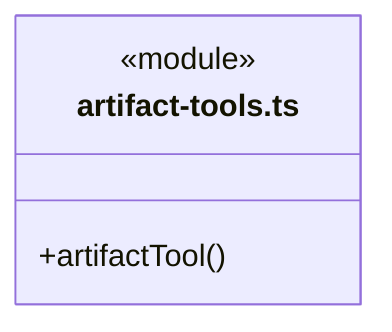

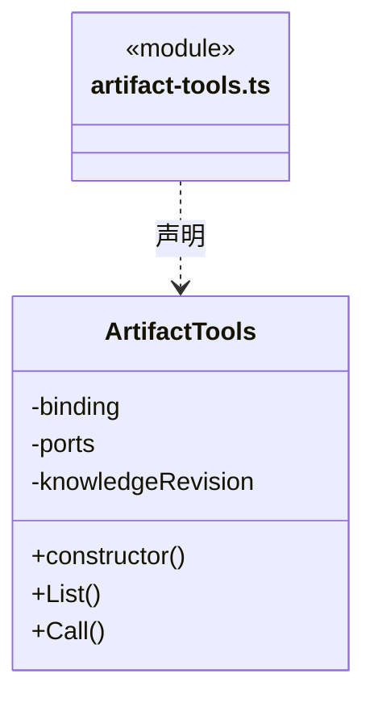

直接依赖：[../../tools/rules/results.ts](../../tools/rules/results.ts)、[artifact-baseline.ts](artifact-baseline.ts)、[../../tasks/rules/member-tool-output.ts](../../tasks/rules/member-tool-output.ts)。

### code-check.ts

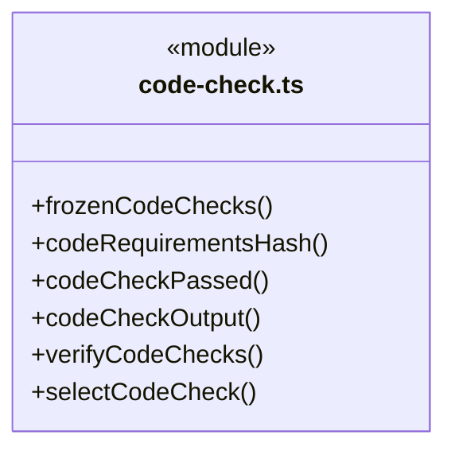

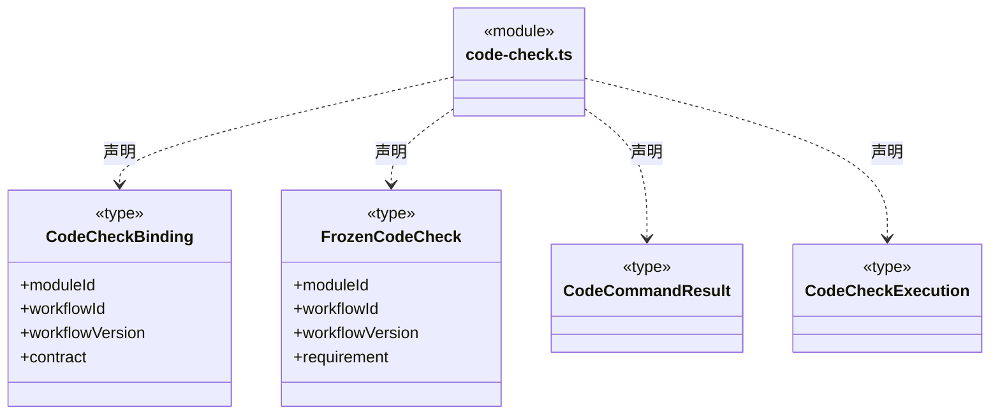

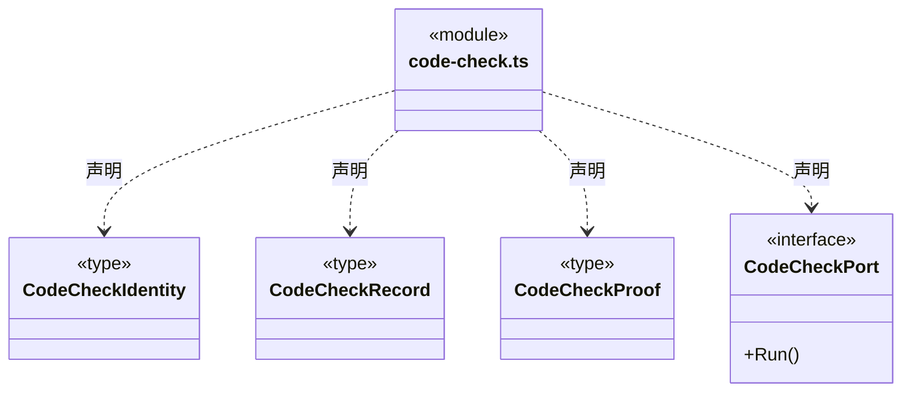

直接依赖：[../../../core/platform/node/serialization.ts](../../../core/platform/node/serialization.ts)、[../../../core/errors.ts](../../../core/errors.ts)、[../../workspace/rules/code-check.ts](../../workspace/rules/code-check.ts)、[../../workspace/rules/workflow-contract.ts](../../workspace/rules/workflow-contract.ts)、[../../workspace/rules/artifact-scope.ts](../../workspace/rules/artifact-scope.ts)、[output-manifest.ts](output-manifest.ts)、[output-manifest-evidence.ts](output-manifest-evidence.ts)、[artifact-evidence.ts](artifact-evidence.ts)、[../../tools/rules/types.ts](../../tools/rules/types.ts)。

### complete-output-evidence.ts

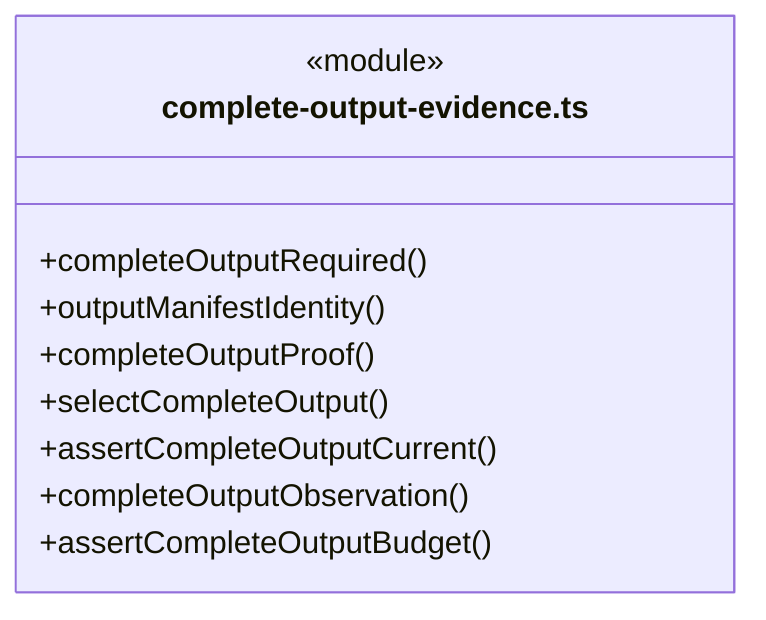

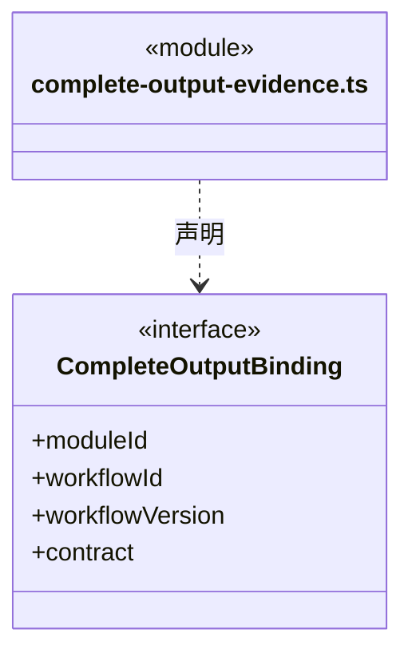

直接依赖：[../../../core/errors.ts](../../../core/errors.ts)、[../../workspace/rules/artifact-scope.ts](../../workspace/rules/artifact-scope.ts)、[artifact-baseline.ts](artifact-baseline.ts)、[output-manifest.ts](output-manifest.ts)、[output-manifest-evidence.ts](output-manifest-evidence.ts)。

### output-manifest-evidence.ts

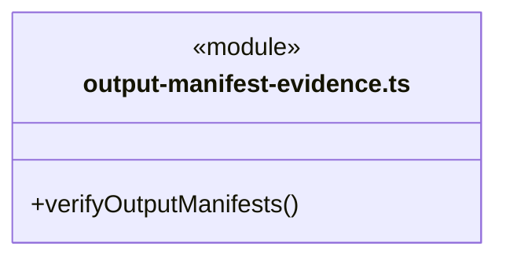

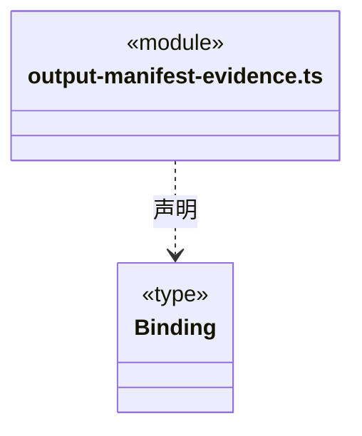

直接依赖：[../../workspace/rules/artifact-scope.ts](../../workspace/rules/artifact-scope.ts)、[artifact-evidence.ts](artifact-evidence.ts)、[output-manifest.ts](output-manifest.ts)、[output-manifest-identity.ts](output-manifest-identity.ts)、[../../file-operations/rules/artifact-transition-evidence.ts](../../file-operations/rules/artifact-transition-evidence.ts)。

### output-manifest-identity.ts

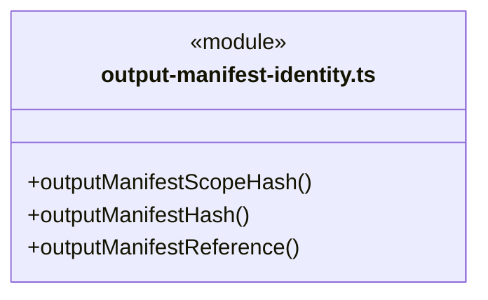

直接依赖：[../../../core/utility/index.ts](../../../core/utility/index.ts)、[../../../core/platform/node/serialization.ts](../../../core/platform/node/serialization.ts)、[../../workspace/rules/artifact-scope.ts](../../workspace/rules/artifact-scope.ts)、[output-manifest.ts](output-manifest.ts)。

### output-manifest-tools.ts

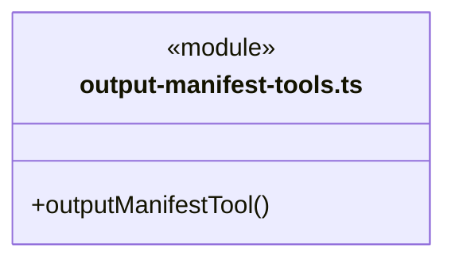

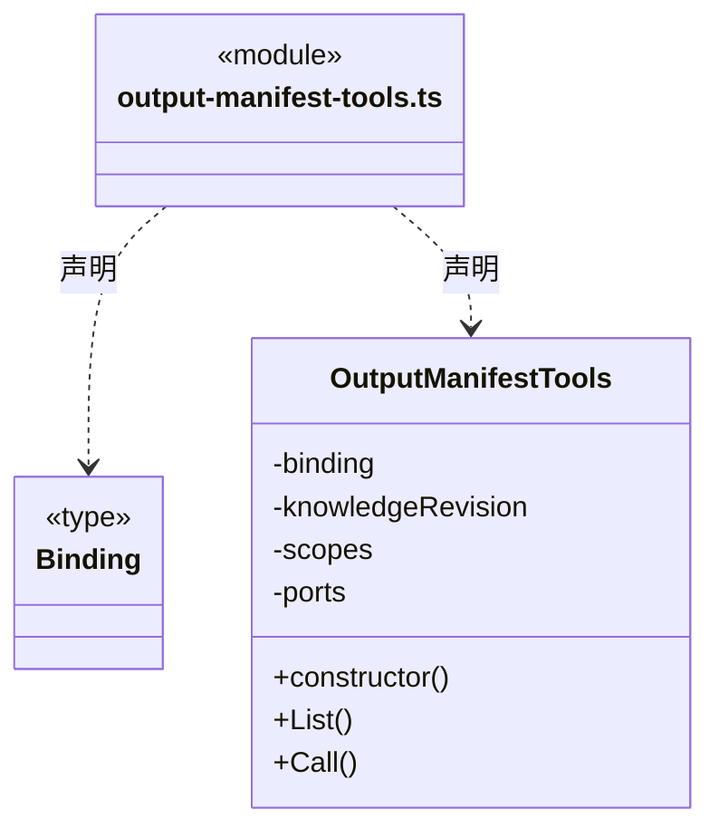

直接依赖：[../../tools/rules/results.ts](../../tools/rules/results.ts)、[../../workspace/rules/artifact-scope.ts](../../workspace/rules/artifact-scope.ts)、[output-manifest.ts](output-manifest.ts)、[output-manifest-evidence.ts](output-manifest-evidence.ts)。

### output-manifest.ts

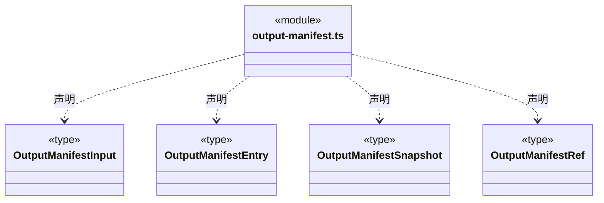

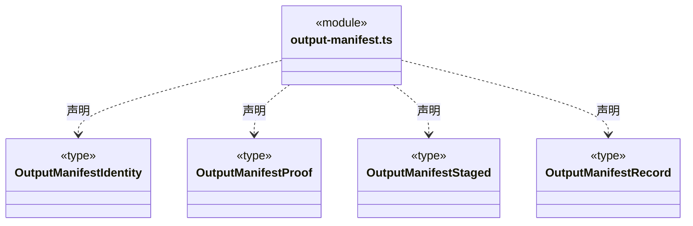

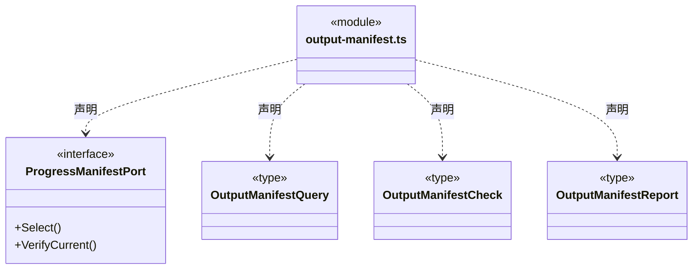

直接依赖：[../../workspace/rules/artifact-scope.ts](../../workspace/rules/artifact-scope.ts)、[artifact-baseline.ts](artifact-baseline.ts)、[../../file-operations/rules/artifact-transition.ts](../../file-operations/rules/artifact-transition.ts)。

### progress-schema.ts

```mermaid
classDiagram
class N_src_logic_evidence_rules_progress_schema_ts["progress-schema.ts"] {
  <<module>>
}
class N_src_logic_evidence_rules_progress_schema_ts_ProgressPlanInput["ProgressPlanInput"] {
  <<type>>

}
N_src_logic_evidence_rules_progress_schema_ts ..> N_src_logic_evidence_rules_progress_schema_ts_ProgressPlanInput : 声明
class N_src_logic_evidence_rules_progress_schema_ts_ProgressStepInput["ProgressStepInput"] {
  <<type>>

}
N_src_logic_evidence_rules_progress_schema_ts ..> N_src_logic_evidence_rules_progress_schema_ts_ProgressStepInput : 声明
class N_src_logic_evidence_rules_progress_schema_ts_ProgressDeliveryInput["ProgressDeliveryInput"] {
  <<type>>

}
N_src_logic_evidence_rules_progress_schema_ts ..> N_src_logic_evidence_rules_progress_schema_ts_ProgressDeliveryInput : 声明
class N_src_logic_evidence_rules_progress_schema_ts_TaskProgressInspect["TaskProgressInspect"] {
  <<type>>

}
N_src_logic_evidence_rules_progress_schema_ts ..> N_src_logic_evidence_rules_progress_schema_ts_TaskProgressInspect : 声明
```

直接依赖：[code-check.ts](code-check.ts)、[../../workspace/rules/workflow-contract.ts](../../workspace/rules/workflow-contract.ts)、[../../tools/rules/receipt-schema.ts](../../tools/rules/receipt-schema.ts)、[artifact-baseline.ts](artifact-baseline.ts)、[validation.ts](validation.ts)、[../../workspace/rules/json-validation-schema.ts](../../workspace/rules/json-validation-schema.ts)、[output-manifest.ts](output-manifest.ts)。

### progress-tools.ts

```mermaid
classDiagram
class N_src_logic_evidence_rules_progress_tools_ts["progress-tools.ts"] {
  <<module>>
  +progressTool()
}
```

成员 1/2（同名节点为同一声明，跨图合并阅读）。

```mermaid
classDiagram
class N_src_logic_evidence_rules_progress_tools_ts["progress-tools.ts"] {
  <<module>>
}
class N_src_logic_evidence_rules_progress_tools_ts_TaskProgressTools["TaskProgressTools"] {
  +List()
  +generation
  +constructor()
  +Current()
  +BeforeEffects()
  +Invalidate()
  +Record()
  +Call()
  -save
  -ports
  -state
  -evidence
  -tail
  -planEstablished
  -workflow
  -identity
}
N_src_logic_evidence_rules_progress_tools_ts ..> N_src_logic_evidence_rules_progress_tools_ts_TaskProgressTools : 声明
```

成员 2/2（同名节点为同一声明，跨图合并阅读）。

```mermaid
classDiagram
class N_src_logic_evidence_rules_progress_tools_ts["progress-tools.ts"] {
  <<module>>
}
class N_src_logic_evidence_rules_progress_tools_ts_TaskProgressTools["TaskProgressTools"] {
  -Serial()
  -Persist()
}
N_src_logic_evidence_rules_progress_tools_ts ..> N_src_logic_evidence_rules_progress_tools_ts_TaskProgressTools : 声明
```

直接依赖：[code-check.ts](code-check.ts)、[progress.ts](progress.ts)、[../../tools/rules/types.ts](../../tools/rules/types.ts)、[artifact-baseline.ts](artifact-baseline.ts)、[../../tools/rules/results.ts](../../tools/rules/results.ts)、[../../../core/errors.ts](../../../core/errors.ts)、[workflow-evidence.ts](workflow-evidence.ts)、[validation.ts](validation.ts)、[output-manifest.ts](output-manifest.ts)、[complete-output-evidence.ts](complete-output-evidence.ts)、[progress-schema.ts](progress-schema.ts)、[../../tasks/rules/member-tool-output.ts](../../tasks/rules/member-tool-output.ts)。

### progress.ts

```mermaid
classDiagram
class N_src_logic_evidence_rules_progress_ts["progress.ts"] {
  <<module>>
}
class N_src_logic_evidence_rules_progress_ts_TaskStep["TaskStep"] {
  <<interface>>
  +id
  +title
  +owner
  +state
  +evidence
}
N_src_logic_evidence_rules_progress_ts ..> N_src_logic_evidence_rules_progress_ts_TaskStep : 声明
class N_src_logic_evidence_rules_progress_ts_WorkflowEvidenceProof["WorkflowEvidenceProof"] {
  <<interface>>
  +codeCheck
  +version
  +bindingsHash
  +checks
  +validationChecks
  +manifest
}
N_src_logic_evidence_rules_progress_ts ..> N_src_logic_evidence_rules_progress_ts_WorkflowEvidenceProof : 声明
class N_src_logic_evidence_rules_progress_ts_TaskProgress["TaskProgress"] {
  <<interface>>
  +version
  +goal
  +acceptance
  +steps
  +state
  +reason
  +delivery
}
N_src_logic_evidence_rules_progress_ts ..> N_src_logic_evidence_rules_progress_ts_TaskProgress : 声明
```

直接依赖：[validation.ts](validation.ts)、[output-manifest.ts](output-manifest.ts)、[code-check.ts](code-check.ts)。

### validation-evidence.ts

```mermaid
classDiagram
class N_src_logic_evidence_rules_validation_evidence_ts["validation-evidence.ts"] {
  <<module>>
  +validationRequirement()
  +verifyValidationRecords()
}
```

```mermaid
classDiagram
class N_src_logic_evidence_rules_validation_evidence_ts["validation-evidence.ts"] {
  <<module>>
}
class N_src_logic_evidence_rules_validation_evidence_ts_ValidationWorkflowBinding["ValidationWorkflowBinding"] {
  <<interface>>
  +moduleId
  +workflowId
  +workflowVersion
  +contract
}
N_src_logic_evidence_rules_validation_evidence_ts ..> N_src_logic_evidence_rules_validation_evidence_ts_ValidationWorkflowBinding : 声明
```

直接依赖：[../../../core/utility/index.ts](../../../core/utility/index.ts)、[../../../core/errors.ts](../../../core/errors.ts)、[../../../core/platform/node/serialization.ts](../../../core/platform/node/serialization.ts)、[../../workspace/rules/workflow-contract.ts](../../workspace/rules/workflow-contract.ts)、[../../workspace/rules/json-validation-schema.ts](../../workspace/rules/json-validation-schema.ts)、[artifact-evidence.ts](artifact-evidence.ts)、[../../workspace/rules/artifact-scope.ts](../../workspace/rules/artifact-scope.ts)、[output-manifest-evidence.ts](output-manifest-evidence.ts)、[complete-output-evidence.ts](complete-output-evidence.ts)、[artifact-baseline.ts](artifact-baseline.ts)、[validation.ts](validation.ts)。

### validation-tools.ts

```mermaid
classDiagram
class N_src_logic_evidence_rules_validation_tools_ts["validation-tools.ts"] {
  <<module>>
  +validationTool()
}
```

```mermaid
classDiagram
class N_src_logic_evidence_rules_validation_tools_ts["validation-tools.ts"] {
  <<module>>
}
class N_src_logic_evidence_rules_validation_tools_ts_ValidationTools["ValidationTools"] {
  +constructor()
  +List()
  +Call()
  -binding
  -port
  -knowledgeRevision
  -bindings
}
N_src_logic_evidence_rules_validation_tools_ts ..> N_src_logic_evidence_rules_validation_tools_ts_ValidationTools : 声明
```

直接依赖：[../../tools/rules/results.ts](../../tools/rules/results.ts)、[validation.ts](validation.ts)、[validation-evidence.ts](validation-evidence.ts)、[complete-output-evidence.ts](complete-output-evidence.ts)、[output-manifest.ts](output-manifest.ts)。

### validation.ts

```mermaid
classDiagram
class N_src_logic_evidence_rules_validation_ts["validation.ts"] {
  <<module>>
}
class N_src_logic_evidence_rules_validation_ts_ValidationInput["ValidationInput"] {
  <<type>>

}
N_src_logic_evidence_rules_validation_ts ..> N_src_logic_evidence_rules_validation_ts_ValidationInput : 声明
class N_src_logic_evidence_rules_validation_ts_ValidationResult["ValidationResult"] {
  <<type>>

}
N_src_logic_evidence_rules_validation_ts ..> N_src_logic_evidence_rules_validation_ts_ValidationResult : 声明
class N_src_logic_evidence_rules_validation_ts_ValidationBinding["ValidationBinding"] {
  <<type>>

}
N_src_logic_evidence_rules_validation_ts ..> N_src_logic_evidence_rules_validation_ts_ValidationBinding : 声明
class N_src_logic_evidence_rules_validation_ts_ValidationRecord["ValidationRecord"] {
  <<type>>

}
N_src_logic_evidence_rules_validation_ts ..> N_src_logic_evidence_rules_validation_ts_ValidationRecord : 声明
```

```mermaid
classDiagram
class N_src_logic_evidence_rules_validation_ts["validation.ts"] {
  <<module>>
}
class N_src_logic_evidence_rules_validation_ts_WorkflowValidationCheck["WorkflowValidationCheck"] {
  <<type>>

}
N_src_logic_evidence_rules_validation_ts ..> N_src_logic_evidence_rules_validation_ts_WorkflowValidationCheck : 声明
class N_src_logic_evidence_rules_validation_ts_ProgressValidationPort["ProgressValidationPort"] {
  <<interface>>
  +Records()
  +VerifyCurrent()
}
N_src_logic_evidence_rules_validation_ts ..> N_src_logic_evidence_rules_validation_ts_ProgressValidationPort : 声明
```

直接依赖：[artifact-baseline.ts](artifact-baseline.ts)、[../../tools/rules/receipt-schema.ts](../../tools/rules/receipt-schema.ts)、[../../workspace/rules/json-validation-schema.ts](../../workspace/rules/json-validation-schema.ts)、[output-manifest.ts](output-manifest.ts)。

### workflow-evidence.ts

```mermaid
classDiagram
class N_src_logic_evidence_rules_workflow_evidence_ts["workflow-evidence.ts"] {
  <<module>>
  +workflowHasEffects()
  +assertWorkflowPlan()
  +evaluateWorkflowDelivery()
  +selectWorkflowValidations()
  +validateWorkflowEvidence()
}
```

```mermaid
classDiagram
class N_src_logic_evidence_rules_workflow_evidence_ts["workflow-evidence.ts"] {
  <<module>>
}
class N_src_logic_evidence_rules_workflow_evidence_ts_WorkflowRunIdentity["WorkflowRunIdentity"] {
  <<interface>>
  +workspaceId
  +taskId
  +runId
}
N_src_logic_evidence_rules_workflow_evidence_ts ..> N_src_logic_evidence_rules_workflow_evidence_ts_WorkflowRunIdentity : 声明
class N_src_logic_evidence_rules_workflow_evidence_ts_WorkflowProgressContext["WorkflowProgressContext"] {
  <<interface>>
  +bindings
  +task
  +identity
}
N_src_logic_evidence_rules_workflow_evidence_ts ..> N_src_logic_evidence_rules_workflow_evidence_ts_WorkflowProgressContext : 声明
```

直接依赖：[../../../core/utility/index.ts](../../../core/utility/index.ts)、[code-check.ts](code-check.ts)、[../../../core/errors.ts](../../../core/errors.ts)、[../../../core/platform/node/serialization.ts](../../../core/platform/node/serialization.ts)、[../../workspace/rules/workflow-contract.ts](../../workspace/rules/workflow-contract.ts)、[../../tasks/rules/execution-context.ts](../../tasks/rules/execution-context.ts)、[progress.ts](progress.ts)、[../../tasks/rules/types.ts](../../tasks/rules/types.ts)、[../../tools/rules/types.ts](../../tools/rules/types.ts)、[../../tools/rules/native-tools.ts](../../tools/rules/native-tools.ts)、[../../tools/rules/questions.ts](../../tools/rules/questions.ts)、[../../tasks/rules/command-verification.ts](../../tasks/rules/command-verification.ts)、[artifact-evidence.ts](artifact-evidence.ts)、[validation.ts](validation.ts)、[validation-evidence.ts](validation-evidence.ts)、[../../workspace/rules/json-validation-schema.ts](../../workspace/rules/json-validation-schema.ts)、[complete-output-evidence.ts](complete-output-evidence.ts)、[output-manifest.ts](output-manifest.ts)、[output-manifest-evidence.ts](output-manifest-evidence.ts)、[../../workspace/rules/artifact-scope.ts](../../workspace/rules/artifact-scope.ts)。

### 本目录调用边界

```mermaid
classDiagram
class N_src_logic_evidence_rules_artifact_evidence_ts["artifact-evidence.ts"] {
  <<module>>
}
class N_src_logic_evidence_rules_artifact_baseline_ts["artifact-baseline.ts"] {
  <<module>>
}
class N_src_logic_evidence_rules_artifact_tools_ts["artifact-tools.ts"] {
  <<module>>
}
class N_src_logic_evidence_rules_code_check_ts["code-check.ts"] {
  <<module>>
}
class N_src_logic_evidence_rules_output_manifest_ts["output-manifest.ts"] {
  <<module>>
}
class N_src_logic_evidence_rules_output_manifest_evidence_ts["output-manifest-evidence.ts"] {
  <<module>>
}
N_src_logic_evidence_rules_artifact_evidence_ts ..> N_src_logic_evidence_rules_artifact_baseline_ts : 导入依赖
N_src_logic_evidence_rules_artifact_tools_ts ..> N_src_logic_evidence_rules_artifact_baseline_ts : 导入依赖
N_src_logic_evidence_rules_code_check_ts ..> N_src_logic_evidence_rules_output_manifest_ts : 导入依赖
N_src_logic_evidence_rules_code_check_ts ..> N_src_logic_evidence_rules_output_manifest_evidence_ts : 导入依赖
```

```mermaid
classDiagram
class N_src_logic_evidence_rules_code_check_ts["code-check.ts"] {
  <<module>>
}
class N_src_logic_evidence_rules_artifact_evidence_ts["artifact-evidence.ts"] {
  <<module>>
}
class N_src_logic_evidence_rules_complete_output_evidence_ts["complete-output-evidence.ts"] {
  <<module>>
}
class N_src_logic_evidence_rules_artifact_baseline_ts["artifact-baseline.ts"] {
  <<module>>
}
class N_src_logic_evidence_rules_output_manifest_ts["output-manifest.ts"] {
  <<module>>
}
class N_src_logic_evidence_rules_output_manifest_evidence_ts["output-manifest-evidence.ts"] {
  <<module>>
}
N_src_logic_evidence_rules_code_check_ts ..> N_src_logic_evidence_rules_artifact_evidence_ts : 导入依赖
N_src_logic_evidence_rules_complete_output_evidence_ts ..> N_src_logic_evidence_rules_artifact_baseline_ts : 导入依赖
N_src_logic_evidence_rules_complete_output_evidence_ts ..> N_src_logic_evidence_rules_output_manifest_ts : 导入依赖
N_src_logic_evidence_rules_complete_output_evidence_ts ..> N_src_logic_evidence_rules_output_manifest_evidence_ts : 导入依赖
```

```mermaid
classDiagram
class N_src_logic_evidence_rules_output_manifest_evidence_ts["output-manifest-evidence.ts"] {
  <<module>>
}
class N_src_logic_evidence_rules_artifact_evidence_ts["artifact-evidence.ts"] {
  <<module>>
}
class N_src_logic_evidence_rules_output_manifest_ts["output-manifest.ts"] {
  <<module>>
}
class N_src_logic_evidence_rules_output_manifest_identity_ts["output-manifest-identity.ts"] {
  <<module>>
}
N_src_logic_evidence_rules_output_manifest_evidence_ts ..> N_src_logic_evidence_rules_artifact_evidence_ts : 导入依赖
N_src_logic_evidence_rules_output_manifest_evidence_ts ..> N_src_logic_evidence_rules_output_manifest_ts : 导入依赖
N_src_logic_evidence_rules_output_manifest_evidence_ts ..> N_src_logic_evidence_rules_output_manifest_identity_ts : 导入依赖
N_src_logic_evidence_rules_output_manifest_identity_ts ..> N_src_logic_evidence_rules_output_manifest_ts : 导入依赖
```

```mermaid
classDiagram
class N_src_logic_evidence_rules_output_manifest_tools_ts["output-manifest-tools.ts"] {
  <<module>>
}
class N_src_logic_evidence_rules_output_manifest_ts["output-manifest.ts"] {
  <<module>>
}
class N_src_logic_evidence_rules_output_manifest_evidence_ts["output-manifest-evidence.ts"] {
  <<module>>
}
class N_src_logic_evidence_rules_artifact_baseline_ts["artifact-baseline.ts"] {
  <<module>>
}
class N_src_logic_evidence_rules_progress_schema_ts["progress-schema.ts"] {
  <<module>>
}
class N_src_logic_evidence_rules_code_check_ts["code-check.ts"] {
  <<module>>
}
N_src_logic_evidence_rules_output_manifest_tools_ts ..> N_src_logic_evidence_rules_output_manifest_ts : 导入依赖
N_src_logic_evidence_rules_output_manifest_tools_ts ..> N_src_logic_evidence_rules_output_manifest_evidence_ts : 导入依赖
N_src_logic_evidence_rules_output_manifest_ts ..> N_src_logic_evidence_rules_artifact_baseline_ts : 导入依赖
N_src_logic_evidence_rules_progress_schema_ts ..> N_src_logic_evidence_rules_code_check_ts : 导入依赖
```

```mermaid
classDiagram
class N_src_logic_evidence_rules_progress_schema_ts["progress-schema.ts"] {
  <<module>>
}
class N_src_logic_evidence_rules_artifact_baseline_ts["artifact-baseline.ts"] {
  <<module>>
}
class N_src_logic_evidence_rules_validation_ts["validation.ts"] {
  <<module>>
}
class N_src_logic_evidence_rules_output_manifest_ts["output-manifest.ts"] {
  <<module>>
}
class N_src_logic_evidence_rules_progress_tools_ts["progress-tools.ts"] {
  <<module>>
}
class N_src_logic_evidence_rules_code_check_ts["code-check.ts"] {
  <<module>>
}
N_src_logic_evidence_rules_progress_schema_ts ..> N_src_logic_evidence_rules_artifact_baseline_ts : 导入依赖
N_src_logic_evidence_rules_progress_schema_ts ..> N_src_logic_evidence_rules_validation_ts : 导入依赖
N_src_logic_evidence_rules_progress_schema_ts ..> N_src_logic_evidence_rules_output_manifest_ts : 导入依赖
N_src_logic_evidence_rules_progress_tools_ts ..> N_src_logic_evidence_rules_code_check_ts : 导入依赖
```

```mermaid
classDiagram
class N_src_logic_evidence_rules_progress_tools_ts["progress-tools.ts"] {
  <<module>>
}
class N_src_logic_evidence_rules_progress_ts["progress.ts"] {
  <<module>>
}
class N_src_logic_evidence_rules_artifact_baseline_ts["artifact-baseline.ts"] {
  <<module>>
}
class N_src_logic_evidence_rules_workflow_evidence_ts["workflow-evidence.ts"] {
  <<module>>
}
class N_src_logic_evidence_rules_validation_ts["validation.ts"] {
  <<module>>
}
N_src_logic_evidence_rules_progress_tools_ts ..> N_src_logic_evidence_rules_progress_ts : 导入依赖
N_src_logic_evidence_rules_progress_tools_ts ..> N_src_logic_evidence_rules_artifact_baseline_ts : 导入依赖
N_src_logic_evidence_rules_progress_tools_ts ..> N_src_logic_evidence_rules_workflow_evidence_ts : 导入依赖
N_src_logic_evidence_rules_progress_tools_ts ..> N_src_logic_evidence_rules_validation_ts : 导入依赖
```

```mermaid
classDiagram
class N_src_logic_evidence_rules_progress_tools_ts["progress-tools.ts"] {
  <<module>>
}
class N_src_logic_evidence_rules_output_manifest_ts["output-manifest.ts"] {
  <<module>>
}
class N_src_logic_evidence_rules_complete_output_evidence_ts["complete-output-evidence.ts"] {
  <<module>>
}
class N_src_logic_evidence_rules_progress_schema_ts["progress-schema.ts"] {
  <<module>>
}
class N_src_logic_evidence_rules_progress_ts["progress.ts"] {
  <<module>>
}
class N_src_logic_evidence_rules_validation_ts["validation.ts"] {
  <<module>>
}
N_src_logic_evidence_rules_progress_tools_ts ..> N_src_logic_evidence_rules_output_manifest_ts : 导入依赖
N_src_logic_evidence_rules_progress_tools_ts ..> N_src_logic_evidence_rules_complete_output_evidence_ts : 导入依赖
N_src_logic_evidence_rules_progress_tools_ts ..> N_src_logic_evidence_rules_progress_schema_ts : 导入依赖
N_src_logic_evidence_rules_progress_ts ..> N_src_logic_evidence_rules_validation_ts : 导入依赖
```

```mermaid
classDiagram
class N_src_logic_evidence_rules_progress_ts["progress.ts"] {
  <<module>>
}
class N_src_logic_evidence_rules_output_manifest_ts["output-manifest.ts"] {
  <<module>>
}
class N_src_logic_evidence_rules_code_check_ts["code-check.ts"] {
  <<module>>
}
class N_src_logic_evidence_rules_validation_evidence_ts["validation-evidence.ts"] {
  <<module>>
}
class N_src_logic_evidence_rules_artifact_evidence_ts["artifact-evidence.ts"] {
  <<module>>
}
class N_src_logic_evidence_rules_output_manifest_evidence_ts["output-manifest-evidence.ts"] {
  <<module>>
}
N_src_logic_evidence_rules_progress_ts ..> N_src_logic_evidence_rules_output_manifest_ts : 导入依赖
N_src_logic_evidence_rules_progress_ts ..> N_src_logic_evidence_rules_code_check_ts : 导入依赖
N_src_logic_evidence_rules_validation_evidence_ts ..> N_src_logic_evidence_rules_artifact_evidence_ts : 导入依赖
N_src_logic_evidence_rules_validation_evidence_ts ..> N_src_logic_evidence_rules_output_manifest_evidence_ts : 导入依赖
```

```mermaid
classDiagram
class N_src_logic_evidence_rules_validation_evidence_ts["validation-evidence.ts"] {
  <<module>>
}
class N_src_logic_evidence_rules_complete_output_evidence_ts["complete-output-evidence.ts"] {
  <<module>>
}
class N_src_logic_evidence_rules_artifact_baseline_ts["artifact-baseline.ts"] {
  <<module>>
}
class N_src_logic_evidence_rules_validation_ts["validation.ts"] {
  <<module>>
}
class N_src_logic_evidence_rules_validation_tools_ts["validation-tools.ts"] {
  <<module>>
}
N_src_logic_evidence_rules_validation_evidence_ts ..> N_src_logic_evidence_rules_complete_output_evidence_ts : 导入依赖
N_src_logic_evidence_rules_validation_evidence_ts ..> N_src_logic_evidence_rules_artifact_baseline_ts : 导入依赖
N_src_logic_evidence_rules_validation_evidence_ts ..> N_src_logic_evidence_rules_validation_ts : 导入依赖
N_src_logic_evidence_rules_validation_tools_ts ..> N_src_logic_evidence_rules_validation_ts : 导入依赖
```

```mermaid
classDiagram
class N_src_logic_evidence_rules_validation_tools_ts["validation-tools.ts"] {
  <<module>>
}
class N_src_logic_evidence_rules_validation_evidence_ts["validation-evidence.ts"] {
  <<module>>
}
class N_src_logic_evidence_rules_complete_output_evidence_ts["complete-output-evidence.ts"] {
  <<module>>
}
class N_src_logic_evidence_rules_output_manifest_ts["output-manifest.ts"] {
  <<module>>
}
class N_src_logic_evidence_rules_validation_ts["validation.ts"] {
  <<module>>
}
class N_src_logic_evidence_rules_artifact_baseline_ts["artifact-baseline.ts"] {
  <<module>>
}
N_src_logic_evidence_rules_validation_tools_ts ..> N_src_logic_evidence_rules_validation_evidence_ts : 导入依赖
N_src_logic_evidence_rules_validation_tools_ts ..> N_src_logic_evidence_rules_complete_output_evidence_ts : 导入依赖
N_src_logic_evidence_rules_validation_tools_ts ..> N_src_logic_evidence_rules_output_manifest_ts : 导入依赖
N_src_logic_evidence_rules_validation_ts ..> N_src_logic_evidence_rules_artifact_baseline_ts : 导入依赖
```

```mermaid
classDiagram
class N_src_logic_evidence_rules_validation_ts["validation.ts"] {
  <<module>>
}
class N_src_logic_evidence_rules_output_manifest_ts["output-manifest.ts"] {
  <<module>>
}
class N_src_logic_evidence_rules_workflow_evidence_ts["workflow-evidence.ts"] {
  <<module>>
}
class N_src_logic_evidence_rules_code_check_ts["code-check.ts"] {
  <<module>>
}
class N_src_logic_evidence_rules_progress_ts["progress.ts"] {
  <<module>>
}
class N_src_logic_evidence_rules_artifact_evidence_ts["artifact-evidence.ts"] {
  <<module>>
}
N_src_logic_evidence_rules_validation_ts ..> N_src_logic_evidence_rules_output_manifest_ts : 导入依赖
N_src_logic_evidence_rules_workflow_evidence_ts ..> N_src_logic_evidence_rules_code_check_ts : 导入依赖
N_src_logic_evidence_rules_workflow_evidence_ts ..> N_src_logic_evidence_rules_progress_ts : 导入依赖
N_src_logic_evidence_rules_workflow_evidence_ts ..> N_src_logic_evidence_rules_artifact_evidence_ts : 导入依赖
```

```mermaid
classDiagram
class N_src_logic_evidence_rules_workflow_evidence_ts["workflow-evidence.ts"] {
  <<module>>
}
class N_src_logic_evidence_rules_validation_ts["validation.ts"] {
  <<module>>
}
class N_src_logic_evidence_rules_validation_evidence_ts["validation-evidence.ts"] {
  <<module>>
}
class N_src_logic_evidence_rules_complete_output_evidence_ts["complete-output-evidence.ts"] {
  <<module>>
}
class N_src_logic_evidence_rules_output_manifest_ts["output-manifest.ts"] {
  <<module>>
}
N_src_logic_evidence_rules_workflow_evidence_ts ..> N_src_logic_evidence_rules_validation_ts : 导入依赖
N_src_logic_evidence_rules_workflow_evidence_ts ..> N_src_logic_evidence_rules_validation_evidence_ts : 导入依赖
N_src_logic_evidence_rules_workflow_evidence_ts ..> N_src_logic_evidence_rules_complete_output_evidence_ts : 导入依赖
N_src_logic_evidence_rules_workflow_evidence_ts ..> N_src_logic_evidence_rules_output_manifest_ts : 导入依赖
```

```mermaid
classDiagram
class N_src_logic_evidence_rules_workflow_evidence_ts["workflow-evidence.ts"] {
  <<module>>
}
class N_src_logic_evidence_rules_output_manifest_evidence_ts["output-manifest-evidence.ts"] {
  <<module>>
}
N_src_logic_evidence_rules_workflow_evidence_ts ..> N_src_logic_evidence_rules_output_manifest_evidence_ts : 导入依赖
```


## 子目录导航

无子目录。

[返回上层](../ARCHITECTURE.md)。

每次修改本目录代码，同步维护文件头、关键契约说明及本图。未实现的治理、证据验收和自动编排能力不列入当前类图。

<!-- architecture:generated:end -->
