# src/logic/evidence/runtime 架构

## 目录定位

证据编排：收集、核实和提交产物/输出/效果/人工证据，消费 logic/evidence/rules 的证据规则及对应存储端口。

本文描述当前实现。通过分析目录边界后维护的 [源码架构脚本](../../../../scripts/source-architecture.mjs) 同步清单和声明；代码变更时仍须核对职责、关键成员与关系。

## 文件清单

| 文件 | 形式 | 当前职责 |
| --- | --- | --- |
| [ARCHITECTURE.md](ARCHITECTURE.md) | 说明文档 | 本目录的文件清单、真实声明、依赖与子封装导航。 |
| [CONTRACT.md](CONTRACT.md) | 说明文档 | 人工维护的职责、接口契约、状态所有权与扩展边界；在本文末尾同步附加。 |
| [agent-artifact-verification.ts](agent-artifact-verification.ts) | 源码模块 | Logic 证据层复核递归交付中已采集的普通文件基线，补足非结构化产物的字节验证。 |
| [artifact-report-service.ts](artifact-report-service.ts) | 源码模块 | 按指定旧成员或已登记递归运行列出可信文件基线，并在明确选定后对实际文件作独立只读复核。 |
| [command-verification-service.ts](command-verification-service.ts) | 源码模块 | 把原主运行的 canonical 调用与同一 Store 已提交命令只读关联，供桌面和主工具共用。 |
| [effect-controlled-file.ts](effect-controlled-file.ts) | 源码模块 | 在影响观察中核对已有受控文件报告与原成员完整绑定、参数和字节摘要。 |
| [effect-observation-service.ts](effect-observation-service.ts) | 源码模块 | 组合原调用授权、已提交控制面、原知识事务、原治理/责任记录、受控文件阶段与当前选定文件，保存本机明确处置并派生新周期关联。 |
| [effect-source.ts](effect-source.ts) | 源码模块 | 从唯一任务存储与 canonical 日志核实原成员/主运行，供影响观察和新核实来源共用。 |
| [execution-report-facts.ts](execution-report-facts.ts) | 源码模块 | 从已核对身份的成员运行日志提取工具授权与回执事实。 |
| [execution-report-service.ts](execution-report-service.ts) | 源码模块 | 以旧派发或新递归登记和指定运行日志生成异常核实报告。 |
| [human-decision-evidence.ts](human-decision-evidence.ts) | 源码模块 | 复核已消费人工接受的精确候选和选定文件，供显式接续、目标审阅及最终完成共用。 |
| [human-evidence-state.ts](human-evidence-state.ts) | 源码模块 | 为人工验收和按意见继续提供同一主周期的证据状态指纹。 |
| [output-manifest-report-service.ts](output-manifest-report-service.ts) | 源码模块 | 对指定旧成员或已登记递归运行列出原完整清单，并在用户明确选定后重新观察全部冻结范围。 |
| [recursive-evidence-source.ts](recursive-evidence-source.ts) | 源码模块 | 证据报告读取递归业务运行时，核对持久登记、原调用和固定 canonical 身份。 |
| [recursive-inspection-evidence.ts](recursive-inspection-evidence.ts) | 源码模块 | 重读只读递归核实的根与业务子调用，形成正式修复前的证据摘要。 |

## 架构类图

成员标记：`+` 公开、`-` 私有、`#` 受保护、`$` 静态；构造函数单独列出。文档和资源仅在文件清单中导航，不作为代码节点。

### agent-artifact-verification.ts

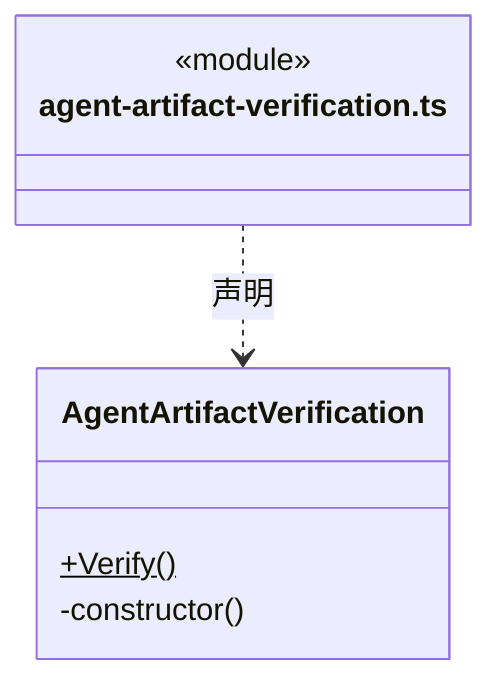

直接依赖：[../../../core/errors.ts](../../../core/errors.ts)、[../rules/artifact-evidence.ts](../rules/artifact-evidence.ts)、[../rules/artifact-baseline.ts](../rules/artifact-baseline.ts)。

### artifact-report-service.ts

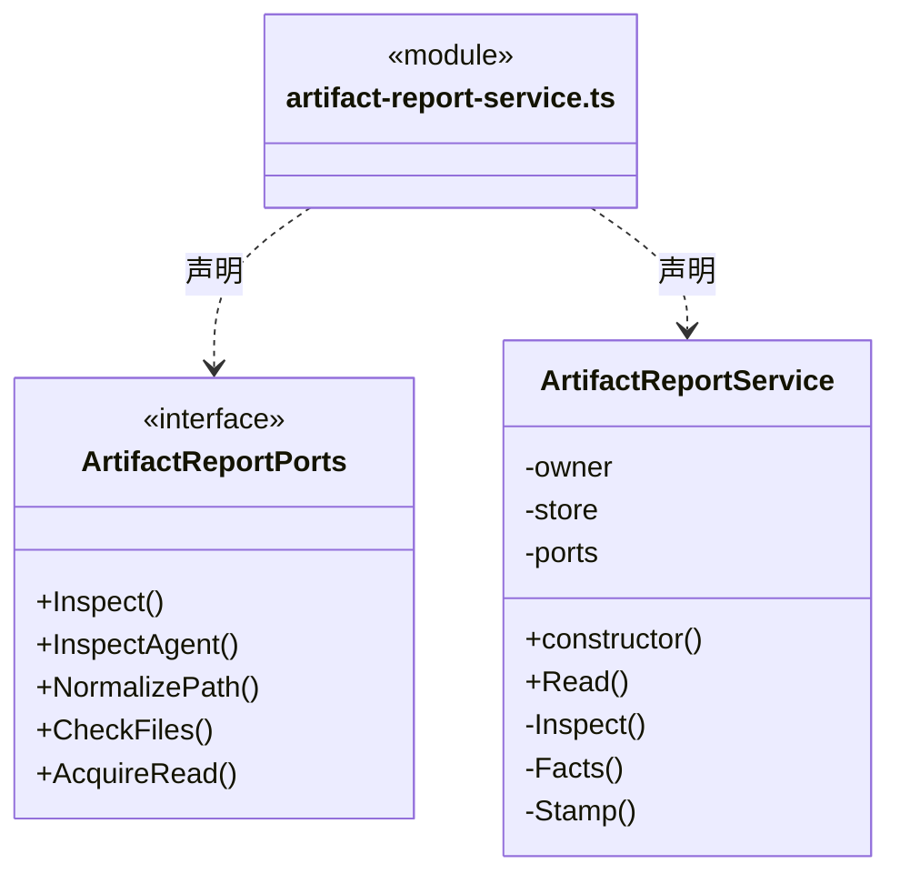

直接依赖：[../../execution/rules/business-run.ts](../../execution/rules/business-run.ts)、[recursive-evidence-source.ts](recursive-evidence-source.ts)、[../../../core/errors.ts](../../../core/errors.ts)、[../../../core/platform/node/serialization.ts](../../../core/platform/node/serialization.ts)、[../rules/artifact-baseline.ts](../rules/artifact-baseline.ts)、[../rules/artifact-evidence.ts](../rules/artifact-evidence.ts)、[../../dispatch/rules/dispatch-storage.ts](../../dispatch/rules/dispatch-storage.ts)、[../../tasks/rules/dispatch-execution.ts](../../tasks/rules/dispatch-execution.ts)、[../../knowledge/rules/ports.ts](../../knowledge/rules/ports.ts)、[../../execution/rules/types.ts](../../execution/rules/types.ts)、[../../runtime/monitoring/member-events.ts](../../runtime/monitoring/member-events.ts)。

### command-verification-service.ts

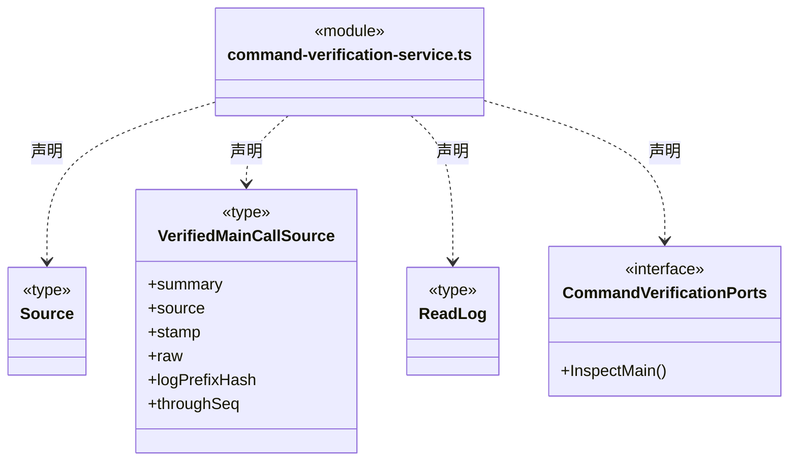

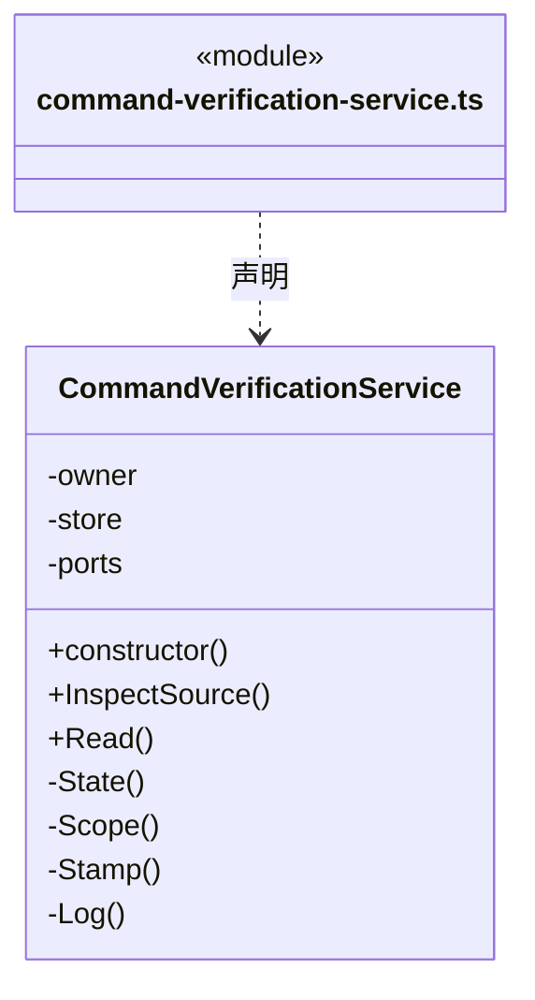

直接依赖：[../../../core/errors.ts](../../../core/errors.ts)、[../../../core/platform/node/serialization.ts](../../../core/platform/node/serialization.ts)、[../../knowledge/rules/ports.ts](../../knowledge/rules/ports.ts)、[../../execution/rules/types.ts](../../execution/rules/types.ts)、[../../execution/rules/conversation-binding.ts](../../execution/rules/conversation-binding.ts)、[../../dispatch/rules/dispatch-storage.ts](../../dispatch/rules/dispatch-storage.ts)、[../../tasks/rules/dispatch-scope.ts](../../tasks/rules/dispatch-scope.ts)、[../../tasks/rules/scope-goal.ts](../../tasks/rules/scope-goal.ts)、[../../tasks/rules/command-verification.ts](../../tasks/rules/command-verification.ts)、[../../tasks/rules/command-verification-output.ts](../../tasks/rules/command-verification-output.ts)、[execution-report-facts.ts](execution-report-facts.ts)、[../../tasks/runtime/main-command-request.ts](../../tasks/runtime/main-command-request.ts)。

### effect-controlled-file.ts

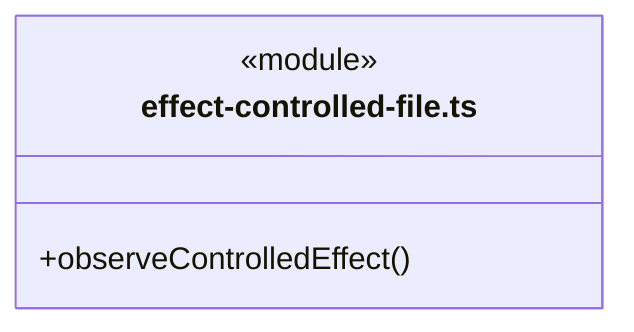

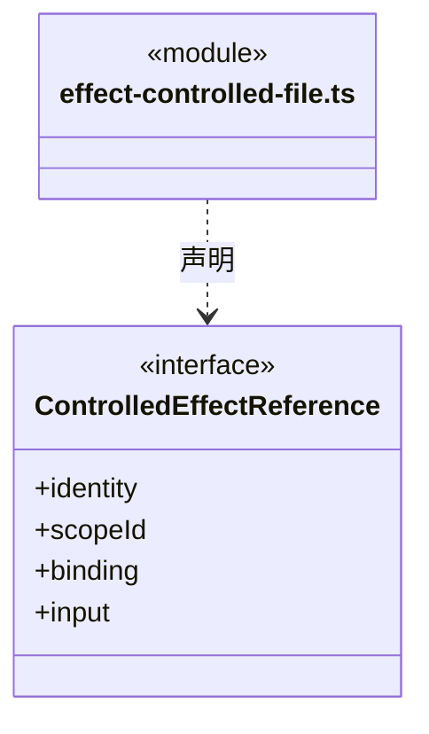

直接依赖：[../../../core/platform/node/serialization.ts](../../../core/platform/node/serialization.ts)、[../../../core/errors.ts](../../../core/errors.ts)、[../../file-operations/rules/controlled-file-operation.ts](../../file-operations/rules/controlled-file-operation.ts)、[../../file-operations/rules/controlled-file-rules.ts](../../file-operations/rules/controlled-file-rules.ts)。

### effect-observation-service.ts

成员 1/2（同名节点为同一声明，跨图合并阅读）。

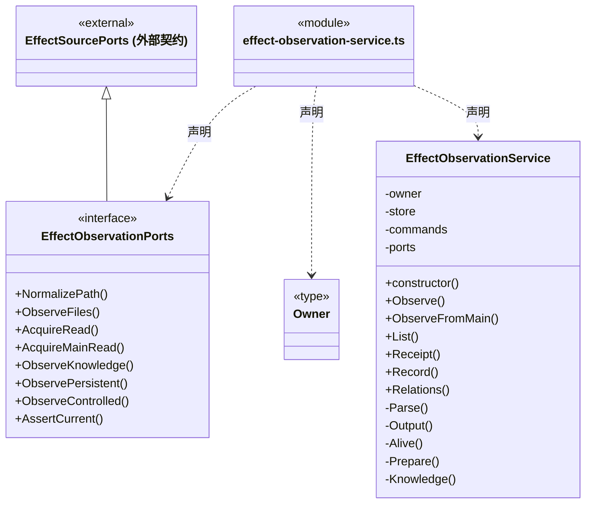

成员 2/2（同名节点为同一声明，跨图合并阅读）。

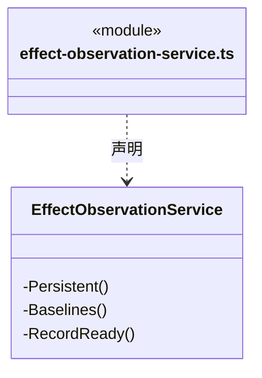

直接依赖：[../../../core/errors.ts](../../../core/errors.ts)、[../../../core/platform/node/serialization.ts](../../../core/platform/node/serialization.ts)、[../../knowledge/rules/ports.ts](../../knowledge/rules/ports.ts)、[../../dispatch/rules/dispatch-storage.ts](../../dispatch/rules/dispatch-storage.ts)、[../../tasks/rules/effect-observation.ts](../../tasks/rules/effect-observation.ts)、[../../tasks/rules/effect-observation-rules.ts](../../tasks/rules/effect-observation-rules.ts)、[../../tasks/rules/command-verification.ts](../../tasks/rules/command-verification.ts)、[../rules/artifact-evidence.ts](../rules/artifact-evidence.ts)、[../rules/artifact-baseline.ts](../rules/artifact-baseline.ts)、[command-verification-service.ts](command-verification-service.ts)、[effect-source.ts](effect-source.ts)、[../../knowledge/rules/knowledge-write-observation.ts](../../knowledge/rules/knowledge-write-observation.ts)、[../../knowledge/rules/knowledge-write-input.ts](../../knowledge/rules/knowledge-write-input.ts)、[../../tasks/rules/persistent-write-observation.ts](../../tasks/rules/persistent-write-observation.ts)、[../../tasks/rules/persistent-write-input.ts](../../tasks/rules/persistent-write-input.ts)、[../../file-operations/rules/controlled-file-operation.ts](../../file-operations/rules/controlled-file-operation.ts)、[effect-controlled-file.ts](effect-controlled-file.ts)。

### effect-source.ts

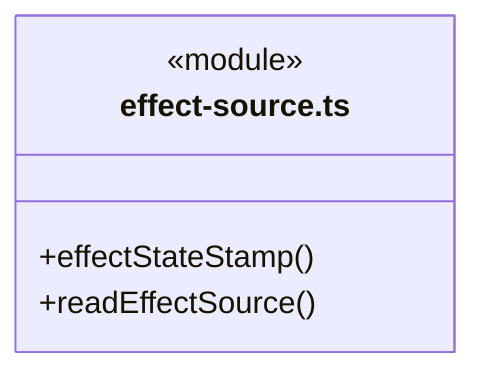

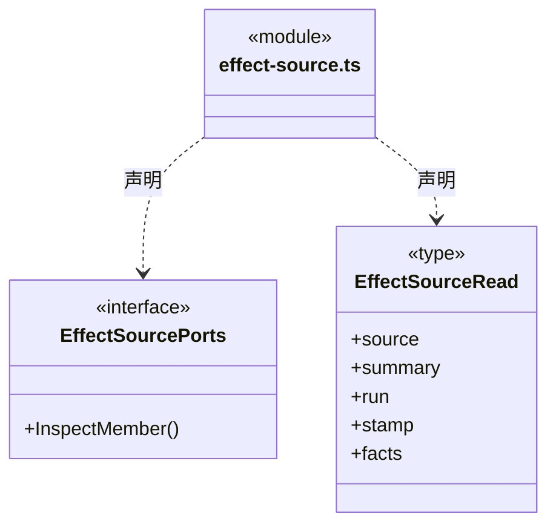

直接依赖：[../../../core/platform/node/serialization.ts](../../../core/platform/node/serialization.ts)、[../../execution/rules/types.ts](../../execution/rules/types.ts)、[../../dispatch/rules/dispatch-storage.ts](../../dispatch/rules/dispatch-storage.ts)、[../../execution/rules/business-run.ts](../../execution/rules/business-run.ts)、[../../tasks/rules/dispatch-execution.ts](../../tasks/rules/dispatch-execution.ts)、[../../tasks/rules/effect-observation.ts](../../tasks/rules/effect-observation.ts)、[../../tasks/rules/scope-goal.ts](../../tasks/rules/scope-goal.ts)、[../../runtime/monitoring/member-events.ts](../../runtime/monitoring/member-events.ts)、[execution-report-facts.ts](execution-report-facts.ts)、[command-verification-service.ts](command-verification-service.ts)。

### execution-report-facts.ts

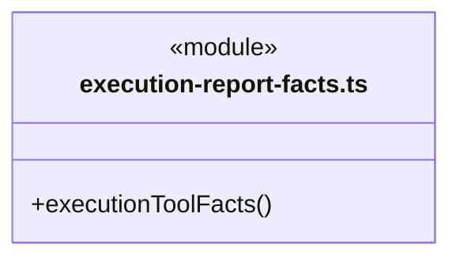

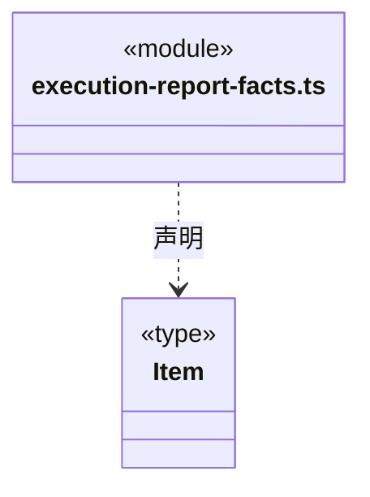

直接依赖：[../../tasks/rules/execution-report.ts](../../tasks/rules/execution-report.ts)、[../../execution/rules/types.ts](../../execution/rules/types.ts)、[../../tasks/rules/dispatch-execution.ts](../../tasks/rules/dispatch-execution.ts)、[../../../core/platform/node/serialization.ts](../../../core/platform/node/serialization.ts)。

### execution-report-service.ts

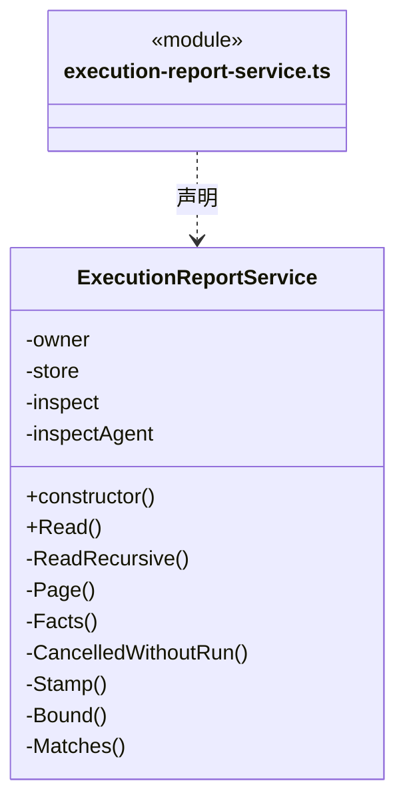

直接依赖：[../../execution/rules/business-run.ts](../../execution/rules/business-run.ts)、[recursive-evidence-source.ts](recursive-evidence-source.ts)、[../../../core/errors.ts](../../../core/errors.ts)、[../../../core/platform/node/serialization.ts](../../../core/platform/node/serialization.ts)、[../../tasks/rules/execution-report.ts](../../tasks/rules/execution-report.ts)、[../../dispatch/rules/dispatch-storage.ts](../../dispatch/rules/dispatch-storage.ts)、[../../tasks/rules/dispatch-execution.ts](../../tasks/rules/dispatch-execution.ts)、[../../knowledge/rules/ports.ts](../../knowledge/rules/ports.ts)、[../../execution/rules/types.ts](../../execution/rules/types.ts)、[execution-report-facts.ts](execution-report-facts.ts)、[../../tasks/rules/queued-task-cancel.ts](../../tasks/rules/queued-task-cancel.ts)。

### human-decision-evidence.ts

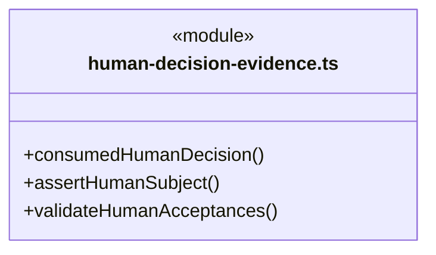

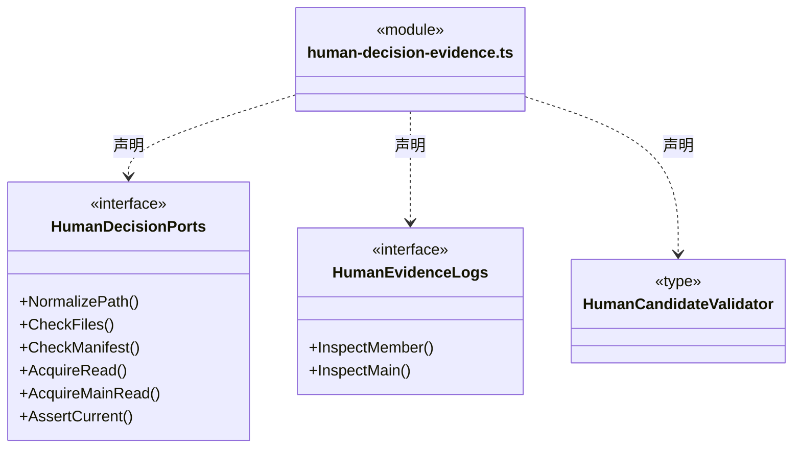

直接依赖：[../../../core/errors.ts](../../../core/errors.ts)、[../../../core/platform/node/serialization.ts](../../../core/platform/node/serialization.ts)、[../../knowledge/rules/ports.ts](../../knowledge/rules/ports.ts)、[../../execution/rules/types.ts](../../execution/rules/types.ts)、[../../dispatch/rules/dispatch-storage.ts](../../dispatch/rules/dispatch-storage.ts)、[../../tasks/rules/dispatch-scope.ts](../../tasks/rules/dispatch-scope.ts)、[../../tasks/rules/dispatch-execution.ts](../../tasks/rules/dispatch-execution.ts)、[../../tasks/rules/graph-types.ts](../../tasks/rules/graph-types.ts)、[../../tasks/rules/human-decisions.ts](../../tasks/rules/human-decisions.ts)、[../../tasks/rules/human-continue.ts](../../tasks/rules/human-continue.ts)、[../../tasks/rules/human-continuation-rules.ts](../../tasks/rules/human-continuation-rules.ts)、[../../tasks/rules/scope-goal.ts](../../tasks/rules/scope-goal.ts)、[../rules/artifact-baseline.ts](../rules/artifact-baseline.ts)、[../rules/artifact-evidence.ts](../rules/artifact-evidence.ts)、[../../team/runtime/member-workflow.ts](../../team/runtime/member-workflow.ts)、[../rules/output-manifest.ts](../rules/output-manifest.ts)、[../rules/complete-output-evidence.ts](../rules/complete-output-evidence.ts)。

### human-evidence-state.ts

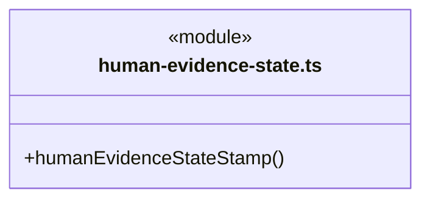

直接依赖：[../../../core/platform/node/serialization.ts](../../../core/platform/node/serialization.ts)、[../../dispatch/rules/dispatch-storage.ts](../../dispatch/rules/dispatch-storage.ts)。

### output-manifest-report-service.ts

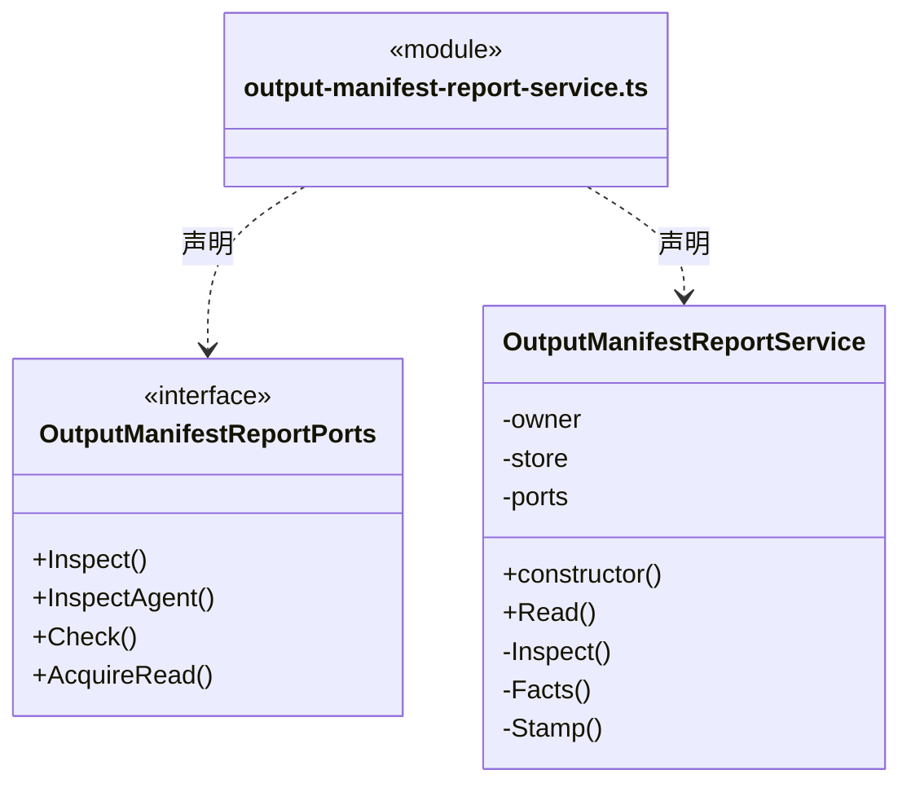

直接依赖：[../../execution/rules/business-run.ts](../../execution/rules/business-run.ts)、[recursive-evidence-source.ts](recursive-evidence-source.ts)、[../../../core/errors.ts](../../../core/errors.ts)、[../../../core/platform/node/serialization.ts](../../../core/platform/node/serialization.ts)、[../rules/output-manifest.ts](../rules/output-manifest.ts)、[../rules/output-manifest-evidence.ts](../rules/output-manifest-evidence.ts)、[../../tasks/rules/execution-context.ts](../../tasks/rules/execution-context.ts)、[../../workspace/rules/artifact-scope.ts](../../workspace/rules/artifact-scope.ts)、[../../dispatch/rules/dispatch-storage.ts](../../dispatch/rules/dispatch-storage.ts)、[../../tasks/rules/dispatch-execution.ts](../../tasks/rules/dispatch-execution.ts)、[../../knowledge/rules/ports.ts](../../knowledge/rules/ports.ts)、[../../execution/rules/types.ts](../../execution/rules/types.ts)、[../../runtime/monitoring/member-events.ts](../../runtime/monitoring/member-events.ts)。

### recursive-evidence-source.ts

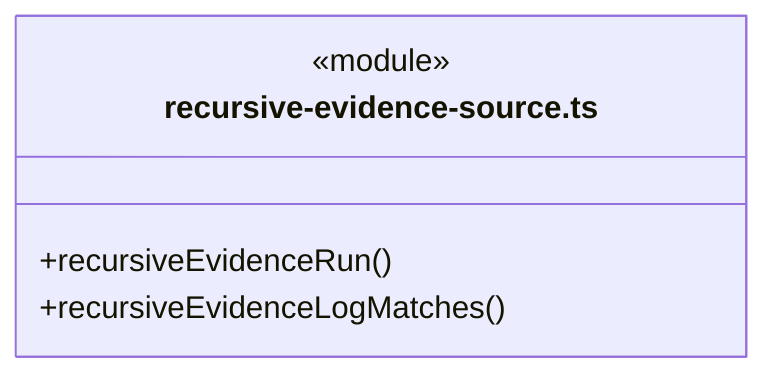

直接依赖：[../../../core/errors.ts](../../../core/errors.ts)、[../../agents/contracts.ts](../../agents/contracts.ts)、[../../execution/rules/business-run.ts](../../execution/rules/business-run.ts)、[../../dispatch/rules/dispatch-storage.ts](../../dispatch/rules/dispatch-storage.ts)、[../../execution/rules/types.ts](../../execution/rules/types.ts)、[../../tasks/rules/execution-context.ts](../../tasks/rules/execution-context.ts)。

### recursive-inspection-evidence.ts

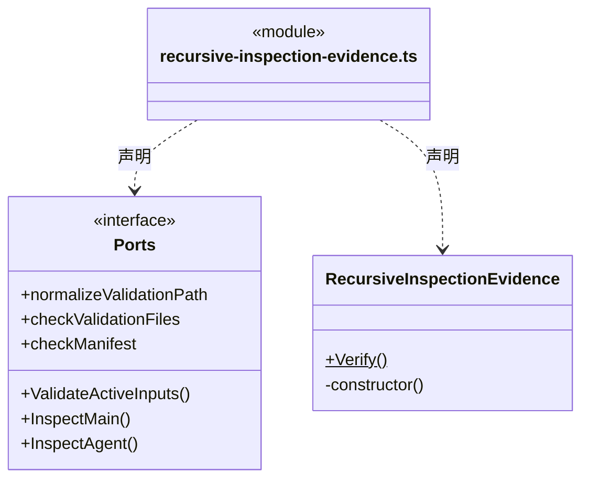

直接依赖：[../../../core/errors.ts](../../../core/errors.ts)、[../../../core/platform/node/serialization.ts](../../../core/platform/node/serialization.ts)、[../../dispatch/rules/dispatch-storage.ts](../../dispatch/rules/dispatch-storage.ts)、[../../tasks/rules/dispatch-scope.ts](../../tasks/rules/dispatch-scope.ts)、[../../knowledge/rules/ports.ts](../../knowledge/rules/ports.ts)、[../../execution/rules/types.ts](../../execution/rules/types.ts)、[../../tasks/rules/execution-context.ts](../../tasks/rules/execution-context.ts)、[recursive-evidence-source.ts](recursive-evidence-source.ts)、[execution-report-facts.ts](execution-report-facts.ts)、[../../team/runtime/member-workflow.ts](../../team/runtime/member-workflow.ts)、[../rules/workflow-evidence.ts](../rules/workflow-evidence.ts)、[agent-artifact-verification.ts](agent-artifact-verification.ts)。

### 本目录调用边界

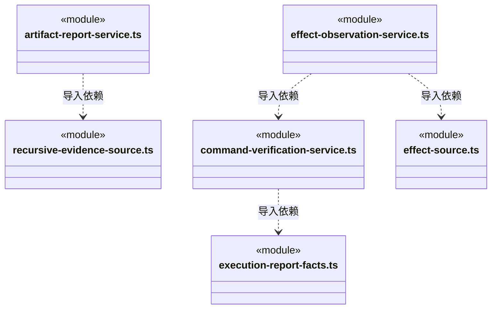

```mermaid
classDiagram
class N_src_logic_evidence_runtime_effect_observation_service_ts["effect-observation-service.ts"] {
  <<module>>
}
class N_src_logic_evidence_runtime_effect_controlled_file_ts["effect-controlled-file.ts"] {
  <<module>>
}
class N_src_logic_evidence_runtime_effect_source_ts["effect-source.ts"] {
  <<module>>
}
class N_src_logic_evidence_runtime_execution_report_facts_ts["execution-report-facts.ts"] {
  <<module>>
}
class N_src_logic_evidence_runtime_command_verification_service_ts["command-verification-service.ts"] {
  <<module>>
}
class N_src_logic_evidence_runtime_execution_report_service_ts["execution-report-service.ts"] {
  <<module>>
}
class N_src_logic_evidence_runtime_recursive_evidence_source_ts["recursive-evidence-source.ts"] {
  <<module>>
}
N_src_logic_evidence_runtime_effect_observation_service_ts ..> N_src_logic_evidence_runtime_effect_controlled_file_ts : 导入依赖
N_src_logic_evidence_runtime_effect_source_ts ..> N_src_logic_evidence_runtime_execution_report_facts_ts : 导入依赖
N_src_logic_evidence_runtime_effect_source_ts ..> N_src_logic_evidence_runtime_command_verification_service_ts : 导入依赖
N_src_logic_evidence_runtime_execution_report_service_ts ..> N_src_logic_evidence_runtime_recursive_evidence_source_ts : 导入依赖
```

```mermaid
classDiagram
class N_src_logic_evidence_runtime_execution_report_service_ts["execution-report-service.ts"] {
  <<module>>
}
class N_src_logic_evidence_runtime_execution_report_facts_ts["execution-report-facts.ts"] {
  <<module>>
}
class N_src_logic_evidence_runtime_output_manifest_report_service_ts["output-manifest-report-service.ts"] {
  <<module>>
}
class N_src_logic_evidence_runtime_recursive_evidence_source_ts["recursive-evidence-source.ts"] {
  <<module>>
}
class N_src_logic_evidence_runtime_recursive_inspection_evidence_ts["recursive-inspection-evidence.ts"] {
  <<module>>
}
N_src_logic_evidence_runtime_execution_report_service_ts ..> N_src_logic_evidence_runtime_execution_report_facts_ts : 导入依赖
N_src_logic_evidence_runtime_output_manifest_report_service_ts ..> N_src_logic_evidence_runtime_recursive_evidence_source_ts : 导入依赖
N_src_logic_evidence_runtime_recursive_inspection_evidence_ts ..> N_src_logic_evidence_runtime_recursive_evidence_source_ts : 导入依赖
N_src_logic_evidence_runtime_recursive_inspection_evidence_ts ..> N_src_logic_evidence_runtime_execution_report_facts_ts : 导入依赖
```

```mermaid
classDiagram
class N_src_logic_evidence_runtime_recursive_inspection_evidence_ts["recursive-inspection-evidence.ts"] {
  <<module>>
}
class N_src_logic_evidence_runtime_agent_artifact_verification_ts["agent-artifact-verification.ts"] {
  <<module>>
}
N_src_logic_evidence_runtime_recursive_inspection_evidence_ts ..> N_src_logic_evidence_runtime_agent_artifact_verification_ts : 导入依赖
```


## 子目录导航

无子目录。

[返回上层](../ARCHITECTURE.md)。

每次修改本目录代码，同步维护文件头、关键契约说明及本图。未实现的治理、证据验收和自动编排能力不列入当前类图。

## 设计契约 v1 与落地范围

以下内容区分已接通能力与后续设计；以各节的实现状态为准，不将目标图当作现状图。维护源：[CONTRACT.md](CONTRACT.md)；生成类图时同步附加，勿直接修改本附录。

## 递归业务影响观察

EffectSourcePorts 使用最小 BusinessRunSource；effect-source 对 agentBusinessRuns 明确走递归协议分支，核对原父引用、冻结岗位/模块、任务根路径、memberBinding、原生会话和完整 canonical。新来源不借用旧派工任务或成员会话，不伪造 taskRevision/planRevision。报告的 executionModel 标识可信递归来源；状态戳包含本根登记，读取期间关闭变化使依据失效。影响与处置仍不重写工具终态，不执行模型或文件命令。

## 递归业务产物报告

ArtifactReportService 与 OutputManifestReportService 读取同一 DispatchStore 的 agentBusinessRuns，明确 task/run/root 后使用独立 inspectAgent 固定日志端口；不造旧图节点、模型快照或派发状态。recursive-evidence-source 共用唯一周期/登记与 canonical 的父调用、模块、岗位、原生通道和连续事件核验。active 登记仅表示原启动意图；可列可信历史引用，但只有 closed 与真实终态同时成立才复核当前文件。读取前后比较原登记和日志，变化即 unverifiable；范围、哈希、只读占用及脱敏仍由原报告服务负责。旧报告路径和错误语义保留。


## 递归执行记录核实

执行记录报告同样按 agentBusinessRuns 读取原子调用；执行模型明确为 agent-tools-v1，不制造旧 taskRevision/taskStatus 或交付候选。active/closed 是登记状态，只有闭合登记与可信日志终态一致才 settled；未选择运行不读取最新日志。沿用工具授权/回执核验及分页，坏正文、缺失日志和读后登记变化保持 unknown；读取不启动引擎。


## 普通交付文件的再次核实
[AgentArtifactVerification](agent-artifact-verification.ts) 是无状态静态封装。它只组合既有 verifyArtifactBaselines 与注入的受限 checkFiles，读取原采集绑定、知识版本及成功授权链，拒绝损坏或全部已失效的采集。只复核当前有效基线列出的文件，逐项核对返回的路径、expected、observed 和 matches，不把文件集合称为完整影响范围。没有采集时返回空文件集合，不补采或伪造基线。调用方负责 canonical 完整身份与工作区生命周期；后续增加采集来源仍修改原 artifact-evidence 规则，不另建验证协议。


### 递归工具迁移收口

RecursiveInspectionEvidence 只读核证完整递归核实周期。精确 root freshMain/native 绑定、连续事件、已封存只读业务登记、原 TaskSpec、冻结 Workflow 与当前文件共同构成修复依据；失败、未知、权限扩大、知识变化均拒绝。Tasks 通过端口核对根补充输入，Evidence 不依赖 Tasks 运行实现。重用 validateBusinessWorkflow 和 AgentArtifactVerification；不创建旧 TaskNode。EffectObservationService 的处置关联包括真实递归业务 taskId。
