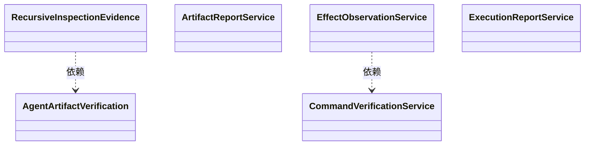
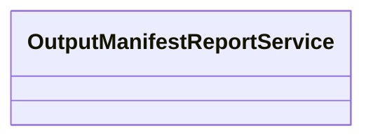

# src/logic/evidence/runtime 架构

## 设计意图

按原运行和可信记录生成可追溯的核实报告，为用户处置提供事实而不猜测操作结果。

文件基线、完整清单和递归证据服务各核自己的冻结依据，命令报告关联原调用与事务，影响观察服务组合文件、知识、治理和控制面事实。读取与明确保存处置分开；后续周期关联原证据，但不覆盖旧未知结果。

## 主要组成

| 组成 | 定位 |
| --- | --- |
| [AgentArtifactVerification](agent-artifact-verification.ts) | Logic 证据层复核递归交付中已采集的普通文件基线，补足非结构化产物的字节验证。 |
| [ArtifactReportService](artifact-report-service.ts) | 按指定旧成员或已登记递归运行列出可信文件基线，并在明确选定后对实际文件作独立只读复核。 |
| [CommandVerificationService](command-verification-service.ts) | 把原主运行的 canonical 调用与同一 Store 已提交命令只读关联，供桌面和主工具共用。 |
| [EffectObservationService](effect-observation-service.ts) | 组合原调用授权、已提交控制面、原知识事务、原治理/责任记录、受控文件阶段与当前选定文件，保存本机明确处置并派生新周期关联。 |
| [ExecutionReportService](execution-report-service.ts) | 以旧派发或新递归登记和指定运行日志生成异常核实报告。 |
| [OutputManifestReportService](output-manifest-report-service.ts) | 对指定旧成员或已登记递归运行列出原完整清单，并在用户明确选定后重新观察全部冻结范围。 |
| [RecursiveInspectionEvidence](recursive-inspection-evidence.ts) | 重读只读递归核实的根与业务子调用，形成正式修复前的证据摘要。 |

<!-- architecture:generated:start -->

## 架构关系

### 关系组 1：AgentArtifactVerification

### 关系组 2：OutputManifestReportService

[上层设计](../ARCHITECTURE.md)

<!-- architecture:generated:end -->
