# src/logic/evidence/runtime 架构

本目录只维护这一份说明。设计与契约直接编辑本文；文件清单、类图和导航由 [架构脚本](../../../../scripts/source-architecture.mjs) 更新，生成区域之外的人工说明会保留。

## 封装意图

证据编排：收集、核实和提交产物/输出/效果/人工证据，消费 logic/evidence/rules 的证据规则及对应存储端口。

## 类与模块的设计意图

下表依据源码声明及文件头说明定位封装。字段表示该实例持有的状态或协作引用，不表示它拥有被引用服务的生命周期；实际资源责任和调用限制见下文契约及源码注释。

| 类／模块 | 实现形式与实例字段 | 封装依据 |
| --- | --- | --- |
| [AgentArtifactVerification](agent-artifact-verification.ts) | 静态成员类；无实例字段声明 | 复用原采集证据规则与受限文件端口；不重新采集、不生成证明、不把单文件集合称为完整业务验收。 |
| [ArtifactReportService](artifact-report-service.ts) | 实例类；持有 `owner`、`store`、`ports` | 文件观察与执行回执分页使用不同基线；旧日志不补造，查询不创建模型、恢复任务或改写历史。 |
| [CommandVerificationService](command-verification-service.ts) | 实例类；持有 `owner`、`store`、`ports` | 坏回包不代表提交失败；原参数哈希、领域指纹和提交事实分别核验，派发隐藏父版本只取原事务前态。 |
| [effect-controlled-file.ts](effect-controlled-file.ts) | 函数／契约模块 | 原 applied/unknown 与原工具结果分开，补偿只作为独立历史；复用可信报告，不创建文件进程、补备份或执行预览。 |
| [EffectObservationService](effect-observation-service.ts) | 实例类；持有 `owner`、`store`、`commands`、`ports` | 原 unknown、今天的字节和后来修复完成各自保留；取证在任务事务外，提交只做原身份/版本 CAS，不执行工具或反向等知识/模型队列。 |
| [effect-source.ts](effect-source.ts) | 函数／契约模块 | 主对话、旧成员领取与已登记递归调用按各自原身份协议核验；只向内部返回日志，不把缺失、坏尾或同名角色拼接成可信文件来源。 |
| [execution-report-facts.ts](execution-report-facts.ts) | 函数／契约模块 | 工具结束、运行终态和业务验收不能互相替代；以最小可信运行身份复用于成员报告及主核实证明，缺少授权链时保留未知，不从模型正文推断成功。 |
| [ExecutionReportService](execution-report-service.ts) | 实例类；持有 `owner`、`store`、`inspect`、`inspectAgent` | inspect 必须读取指定 run 的权威日志，不能从 UI 缓存或最近一次运行替代。 |
| [human-decision-evidence.ts](human-decision-evidence.ts) | 函数／契约模块 | 人的历史意见不等于当前产物未变；独立端口避免目标服务与人工服务相互引用，全部接受项的选定基线及冻结产物验证文件共享一次有界读取。 |
| [human-evidence-state.ts](human-evidence-state.ts) | 函数／契约模块 | 文件、原生日志和知识检查在任务事务之外执行；提交只核原周期、图和运行是否仍与取证时一致，避免反向取得知识锁。 |
| [OutputManifestReportService](output-manifest-report-service.ts) | 实例类；持有 `owner`、`store`、`ports` | 完整日志、任务/原生身份及冻结约定须先一致，读取后复核知识、Store 和日志，不能把跨版本结果合为有效观察。 |
| [recursive-evidence-source.ts](recursive-evidence-source.ts) | 函数／契约模块 | 新子运行没有旧派工任务/信封；共享只读来源核验，不生成兼容任务或第二份运行状态。 |
| [RecursiveInspectionEvidence](recursive-inspection-evidence.ts) | 静态成员类；无实例字段声明 | 无状态核证器；证据稳定性由二次读取核实，不把文件检查描述成跨文件事务。 |

## 接口设计契约

<a id="contract"></a>

<a id="contract-递归业务影响观察"></a>

#### 递归业务影响观察

EffectSourcePorts 使用最小 BusinessRunSource；effect-source 对 agentBusinessRuns 明确走递归协议分支，核对原父引用、冻结岗位/模块、任务根路径、memberBinding、原生会话和完整 canonical。新来源不借用旧派工任务或成员会话，不伪造 taskRevision/planRevision。报告的 executionModel 标识可信递归来源；状态戳包含本根登记，读取期间关闭变化使依据失效。影响与处置仍不重写工具终态，不执行模型或文件命令。

<a id="contract-递归业务产物报告"></a>

#### 递归业务产物报告

ArtifactReportService 与 OutputManifestReportService 读取同一 DispatchStore 的 agentBusinessRuns，明确 task/run/root 后使用独立 inspectAgent 固定日志端口；不造旧图节点、模型快照或派发状态。recursive-evidence-source 共用唯一周期/登记与 canonical 的父调用、模块、岗位、原生通道和连续事件核验。active 登记仅表示原启动意图；可列可信历史引用，但只有 closed 与真实终态同时成立才复核当前文件。读取前后比较原登记和日志，变化即 unverifiable；范围、哈希、只读占用及脱敏仍由原报告服务负责。旧报告路径和错误语义保留。


<a id="contract-递归执行记录核实"></a>

#### 递归执行记录核实

执行记录报告同样按 agentBusinessRuns 读取原子调用；执行模型明确为 agent-tools-v1，不制造旧 taskRevision/taskStatus 或交付候选。active/closed 是登记状态，只有闭合登记与可信日志终态一致才 settled；未选择运行不读取最新日志。沿用工具授权/回执核验及分页，坏正文、缺失日志和读后登记变化保持 unknown；读取不启动引擎。


<a id="contract-普通交付文件的再次核实"></a>

#### 普通交付文件的再次核实
[AgentArtifactVerification](agent-artifact-verification.ts) 是无状态静态封装。它只组合既有 verifyArtifactBaselines 与注入的受限 checkFiles，读取原采集绑定、知识版本及成功授权链，拒绝损坏或全部已失效的采集。只复核当前有效基线列出的文件，逐项核对返回的路径、expected、observed 和 matches，不把文件集合称为完整影响范围。没有采集时返回空文件集合，不补采或伪造基线。调用方负责 canonical 完整身份与工作区生命周期；后续增加采集来源仍修改原 artifact-evidence 规则，不另建验证协议。


<a id="contract-递归工具迁移收口"></a>

##### 递归工具迁移收口

RecursiveInspectionEvidence 只读核证完整递归核实周期。精确 root freshMain/native 绑定、连续事件、已封存只读业务登记、原 TaskSpec、冻结 Workflow 与当前文件共同构成修复依据；失败、未知、权限扩大、知识变化均拒绝。Tasks 通过端口核对根补充输入，Evidence 不依赖 Tasks 运行实现。重用 validateBusinessWorkflow 和 AgentArtifactVerification；不创建旧 TaskNode。EffectObservationService 的处置关联包括真实递归业务 taskId。

## 开闭边界

本目录的职责及允许协作由[封装意图](#封装意图)限定，输入输出、状态与失败语义以[接口设计契约](#接口设计契约)为准。扩展从已有公开入口及实际装配位置进入；没有明确可替换契约的部分按真实影响修改和验证，不预建未使用的基类或插件入口。

<!-- architecture:generated:start -->

## 文件清单

| 文件 | 形式 | 当前职责 |
| --- | --- | --- |
| [ARCHITECTURE.md](ARCHITECTURE.md) | 说明文档 | 本目录的文件清单、真实声明、依赖与子封装导航。 |
| [agent-artifact-verification.ts](agent-artifact-verification.ts) | 源码模块 | Logic 证据层复核递归交付中已采集的普通文件基线，补足非结构化产物的字节验证。 |
| [artifact-report-service.ts](artifact-report-service.ts) | 源码模块 | 按指定旧成员或已登记递归运行列出可信文件基线，并在明确选定后对实际文件作独立只读复核。 |
| [command-verification-service.ts](command-verification-service.ts) | 源码模块 | 把原主运行的 canonical 调用与同一 Store 已提交命令只读关联，供桌面和主工具共用。 |
| [effect-controlled-file.ts](effect-controlled-file.ts) | 源码模块 | 在影响观察中核对已有受控文件报告与原成员完整绑定、参数和字节摘要。 |
| [effect-observation-service.ts](effect-observation-service.ts) | 源码模块 | 组合原调用授权、已提交控制面、原知识事务、原治理/责任记录、受控文件阶段与当前选定文件，保存本机明确处置并派生新周期关联。 |
| [effect-source.ts](effect-source.ts) | 源码模块 | 从唯一任务存储与 canonical 日志核实原成员/主运行，供影响观察和新核实来源共用。 |
| [execution-report-facts.ts](execution-report-facts.ts) | 源码模块 | 从已核对身份的成员运行日志提取工具授权与回执事实。 |
| [execution-report-service.ts](execution-report-service.ts) | 源码模块 | 以旧派发或新递归登记和指定运行日志生成异常核实报告。 |
| [human-decision-evidence.ts](human-decision-evidence.ts) | 源码模块 | 复核已消费人工接受的精确候选和选定文件，供显式接续、目标审阅及最终完成共用。 |
| [human-evidence-state.ts](human-evidence-state.ts) | 源码模块 | 为人工验收和按意见继续提供同一主周期的证据状态指纹。 |
| [output-manifest-report-service.ts](output-manifest-report-service.ts) | 源码模块 | 对指定旧成员或已登记递归运行列出原完整清单，并在用户明确选定后重新观察全部冻结范围。 |
| [recursive-evidence-source.ts](recursive-evidence-source.ts) | 源码模块 | 证据报告读取递归业务运行时，核对持久登记、原调用和固定 canonical 身份。 |
| [recursive-inspection-evidence.ts](recursive-inspection-evidence.ts) | 源码模块 | 重读只读递归核实的根与业务子调用，形成正式修复前的证据摘要。 |

## 架构类图

成员标记：`+` 公开、`-` 私有、`#` 受保护、`$` 静态；构造函数单独列出。文档和资源仅在文件清单中导航，不作为代码节点。

### agent-artifact-verification.ts

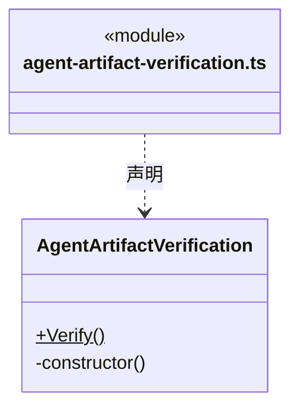

直接依赖：[../../../core/errors.ts](../../../core/errors.ts)、[../rules/artifact-baseline.ts](../rules/artifact-baseline.ts)、[../rules/artifact-evidence.ts](../rules/artifact-evidence.ts)。

### artifact-report-service.ts

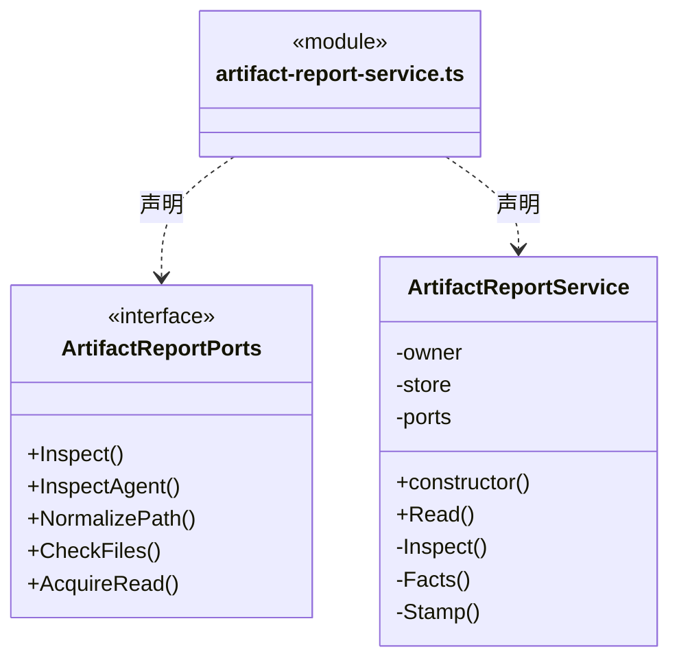

直接依赖：[../../../core/errors.ts](../../../core/errors.ts)、[../../../core/platform/node/serialization.ts](../../../core/platform/node/serialization.ts)、[../../dispatch/rules/dispatch-storage.ts](../../dispatch/rules/dispatch-storage.ts)、[../rules/artifact-baseline.ts](../rules/artifact-baseline.ts)、[../rules/artifact-evidence.ts](../rules/artifact-evidence.ts)、[recursive-evidence-source.ts](recursive-evidence-source.ts)、[../../execution/rules/business-run.ts](../../execution/rules/business-run.ts)、[../../execution/rules/types.ts](../../execution/rules/types.ts)、[../../knowledge/rules/ports.ts](../../knowledge/rules/ports.ts)、[../../runtime/monitoring/member-events.ts](../../runtime/monitoring/member-events.ts)、[../../tasks/rules/dispatch-execution.ts](../../tasks/rules/dispatch-execution.ts)。

### command-verification-service.ts

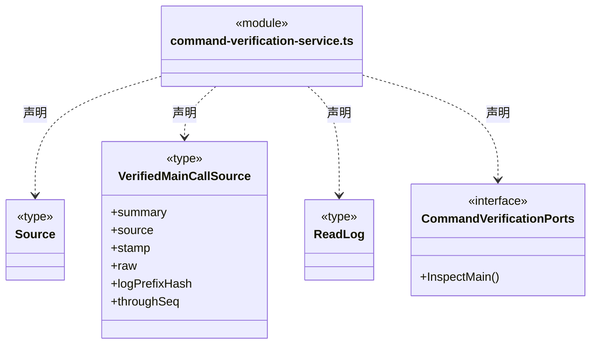

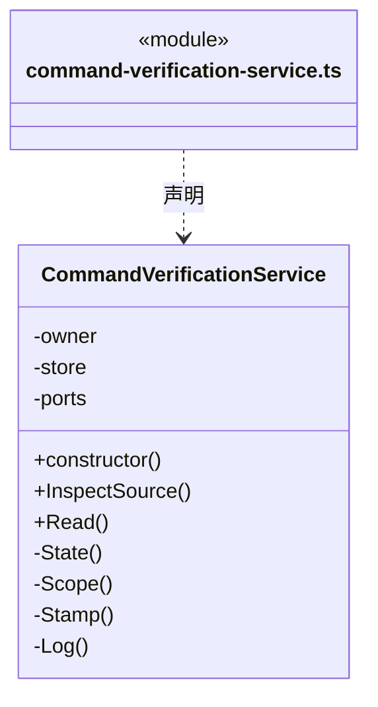

直接依赖：[../../../core/errors.ts](../../../core/errors.ts)、[../../../core/platform/node/serialization.ts](../../../core/platform/node/serialization.ts)、[../../dispatch/rules/dispatch-storage.ts](../../dispatch/rules/dispatch-storage.ts)、[execution-report-facts.ts](execution-report-facts.ts)、[../../execution/rules/conversation-binding.ts](../../execution/rules/conversation-binding.ts)、[../../execution/rules/types.ts](../../execution/rules/types.ts)、[../../knowledge/rules/ports.ts](../../knowledge/rules/ports.ts)、[../../tasks/rules/command-verification-output.ts](../../tasks/rules/command-verification-output.ts)、[../../tasks/rules/command-verification.ts](../../tasks/rules/command-verification.ts)、[../../tasks/rules/dispatch-scope.ts](../../tasks/rules/dispatch-scope.ts)、[../../tasks/rules/scope-goal.ts](../../tasks/rules/scope-goal.ts)、[../../tasks/runtime/main-command-request.ts](../../tasks/runtime/main-command-request.ts)。

### effect-controlled-file.ts

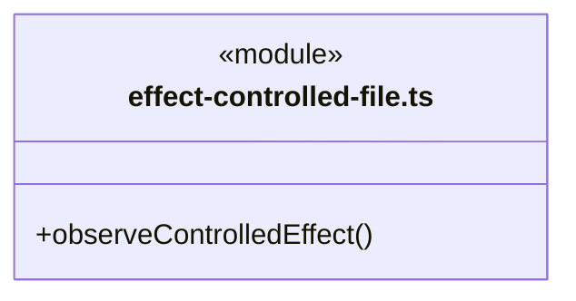

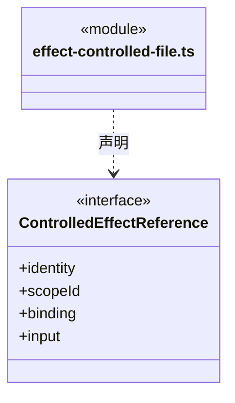

直接依赖：[../../../core/errors.ts](../../../core/errors.ts)、[../../../core/platform/node/serialization.ts](../../../core/platform/node/serialization.ts)、[../../file-operations/rules/controlled-file-operation.ts](../../file-operations/rules/controlled-file-operation.ts)、[../../file-operations/rules/controlled-file-rules.ts](../../file-operations/rules/controlled-file-rules.ts)。

### effect-observation-service.ts

成员 1/2（同名节点为同一声明，跨图合并阅读）。

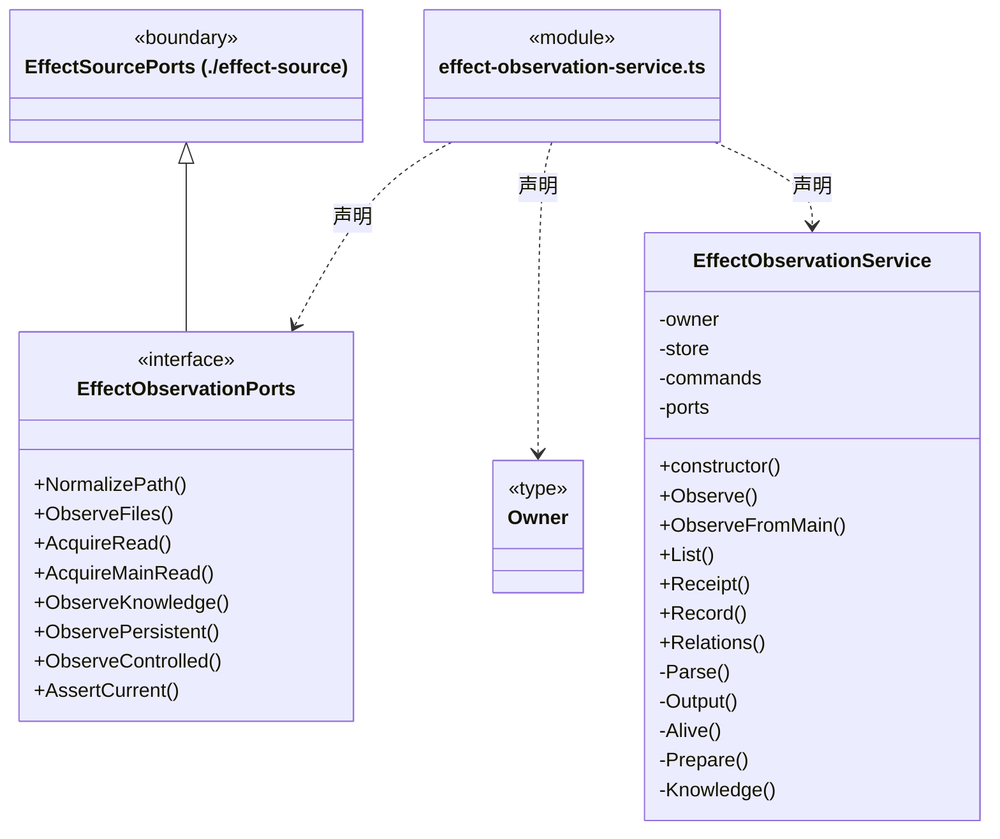

成员 2/2（同名节点为同一声明，跨图合并阅读）。

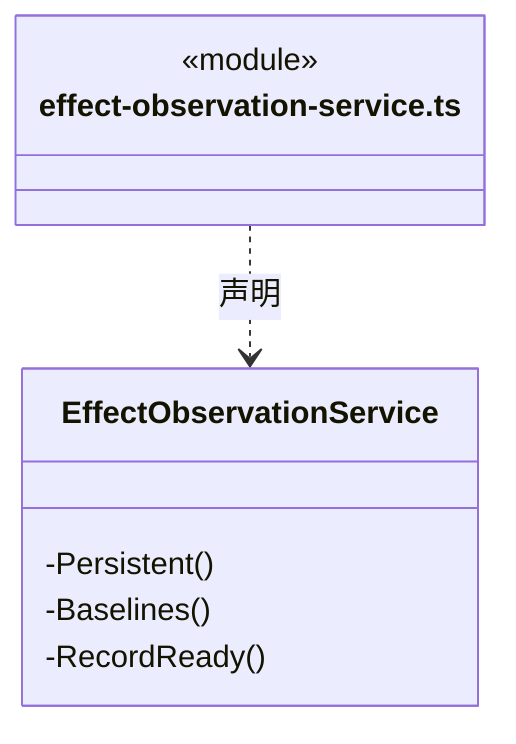

继承／实现来源：`EffectSourcePorts` → [effect-source.ts](effect-source.ts)。
直接依赖：[../../../core/errors.ts](../../../core/errors.ts)、[../../../core/platform/node/serialization.ts](../../../core/platform/node/serialization.ts)、[../../dispatch/rules/dispatch-storage.ts](../../dispatch/rules/dispatch-storage.ts)、[../rules/artifact-baseline.ts](../rules/artifact-baseline.ts)、[../rules/artifact-evidence.ts](../rules/artifact-evidence.ts)、[command-verification-service.ts](command-verification-service.ts)、[effect-controlled-file.ts](effect-controlled-file.ts)、[effect-source.ts](effect-source.ts)、[../../file-operations/rules/controlled-file-operation.ts](../../file-operations/rules/controlled-file-operation.ts)、[../../knowledge/rules/knowledge-write-input.ts](../../knowledge/rules/knowledge-write-input.ts)、[../../knowledge/rules/knowledge-write-observation.ts](../../knowledge/rules/knowledge-write-observation.ts)、[../../knowledge/rules/ports.ts](../../knowledge/rules/ports.ts)、[../../tasks/rules/command-verification.ts](../../tasks/rules/command-verification.ts)、[../../tasks/rules/effect-observation-rules.ts](../../tasks/rules/effect-observation-rules.ts)、[../../tasks/rules/effect-observation.ts](../../tasks/rules/effect-observation.ts)、[../../tasks/rules/persistent-write-input.ts](../../tasks/rules/persistent-write-input.ts)、[../../tasks/rules/persistent-write-observation.ts](../../tasks/rules/persistent-write-observation.ts)。

### effect-source.ts

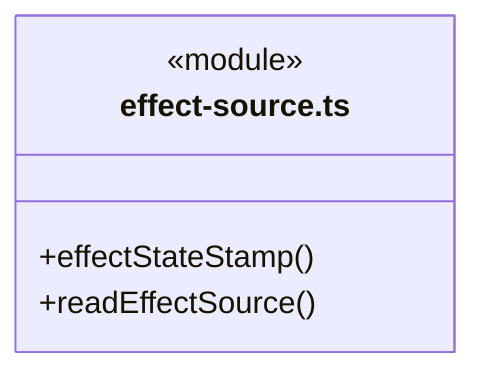

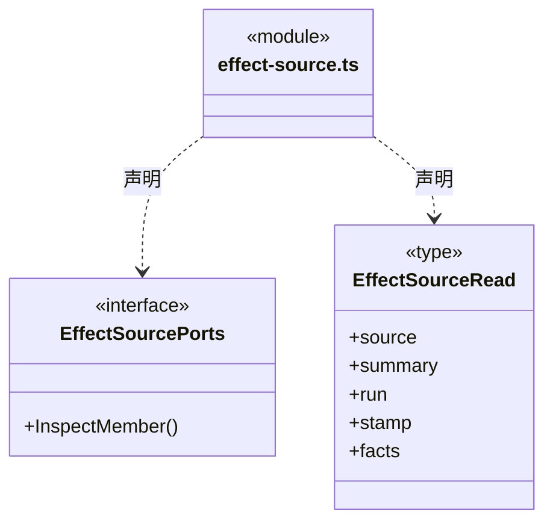

直接依赖：[../../../core/platform/node/serialization.ts](../../../core/platform/node/serialization.ts)、[../../dispatch/rules/dispatch-storage.ts](../../dispatch/rules/dispatch-storage.ts)、[command-verification-service.ts](command-verification-service.ts)、[execution-report-facts.ts](execution-report-facts.ts)、[../../execution/rules/business-run.ts](../../execution/rules/business-run.ts)、[../../execution/rules/types.ts](../../execution/rules/types.ts)、[../../runtime/monitoring/member-events.ts](../../runtime/monitoring/member-events.ts)、[../../tasks/rules/dispatch-execution.ts](../../tasks/rules/dispatch-execution.ts)、[../../tasks/rules/effect-observation.ts](../../tasks/rules/effect-observation.ts)、[../../tasks/rules/scope-goal.ts](../../tasks/rules/scope-goal.ts)。

### execution-report-facts.ts

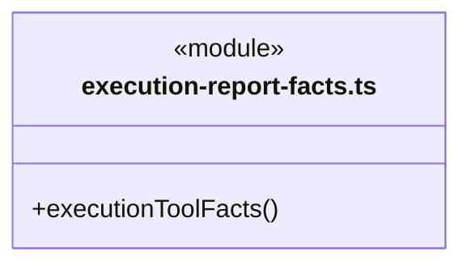

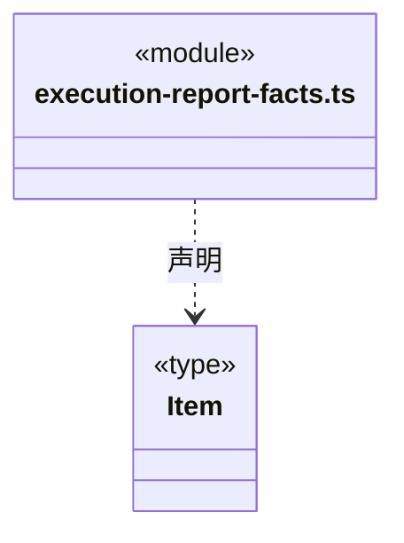

直接依赖：[../../../core/platform/node/serialization.ts](../../../core/platform/node/serialization.ts)、[../../execution/rules/types.ts](../../execution/rules/types.ts)、[../../tasks/rules/dispatch-execution.ts](../../tasks/rules/dispatch-execution.ts)、[../../tasks/rules/execution-report.ts](../../tasks/rules/execution-report.ts)。

### execution-report-service.ts

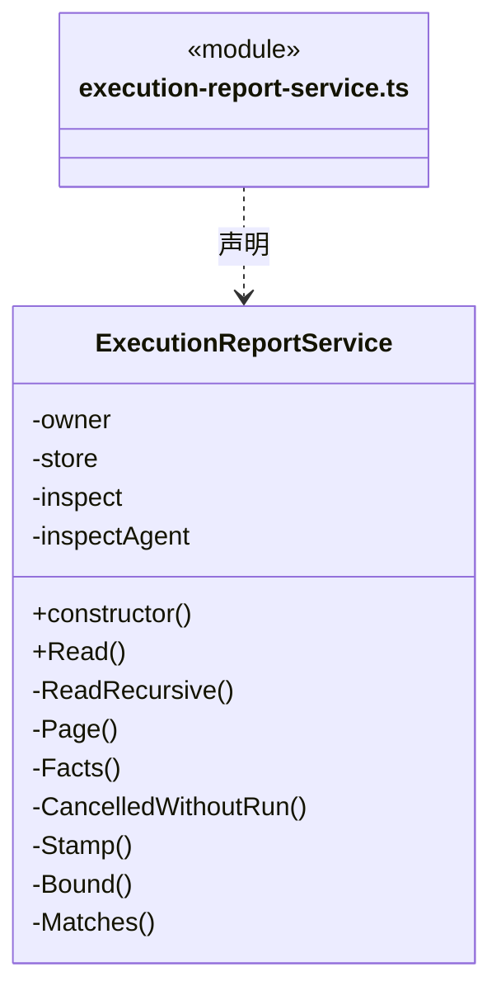

直接依赖：[../../../core/errors.ts](../../../core/errors.ts)、[../../../core/platform/node/serialization.ts](../../../core/platform/node/serialization.ts)、[../../dispatch/rules/dispatch-storage.ts](../../dispatch/rules/dispatch-storage.ts)、[execution-report-facts.ts](execution-report-facts.ts)、[recursive-evidence-source.ts](recursive-evidence-source.ts)、[../../execution/rules/business-run.ts](../../execution/rules/business-run.ts)、[../../execution/rules/types.ts](../../execution/rules/types.ts)、[../../knowledge/rules/ports.ts](../../knowledge/rules/ports.ts)、[../../tasks/rules/dispatch-execution.ts](../../tasks/rules/dispatch-execution.ts)、[../../tasks/rules/execution-report.ts](../../tasks/rules/execution-report.ts)、[../../tasks/rules/queued-task-cancel.ts](../../tasks/rules/queued-task-cancel.ts)。

### human-decision-evidence.ts

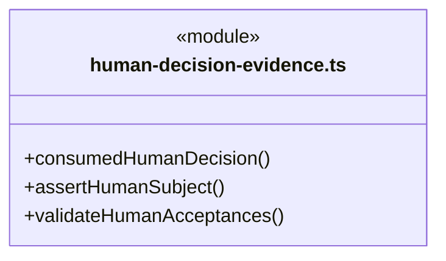

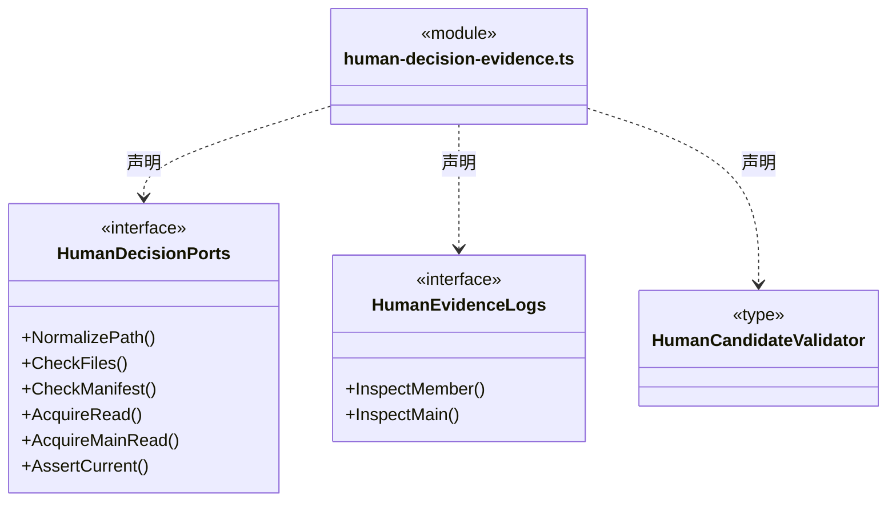

直接依赖：[../../../core/errors.ts](../../../core/errors.ts)、[../../../core/platform/node/serialization.ts](../../../core/platform/node/serialization.ts)、[../../dispatch/rules/dispatch-storage.ts](../../dispatch/rules/dispatch-storage.ts)、[../rules/artifact-baseline.ts](../rules/artifact-baseline.ts)、[../rules/artifact-evidence.ts](../rules/artifact-evidence.ts)、[../rules/complete-output-evidence.ts](../rules/complete-output-evidence.ts)、[../rules/output-manifest.ts](../rules/output-manifest.ts)、[../../execution/rules/types.ts](../../execution/rules/types.ts)、[../../knowledge/rules/ports.ts](../../knowledge/rules/ports.ts)、[../../tasks/rules/dispatch-execution.ts](../../tasks/rules/dispatch-execution.ts)、[../../tasks/rules/dispatch-scope.ts](../../tasks/rules/dispatch-scope.ts)、[../../tasks/rules/graph-types.ts](../../tasks/rules/graph-types.ts)、[../../tasks/rules/human-continuation-rules.ts](../../tasks/rules/human-continuation-rules.ts)、[../../tasks/rules/human-continue.ts](../../tasks/rules/human-continue.ts)、[../../tasks/rules/human-decisions.ts](../../tasks/rules/human-decisions.ts)、[../../tasks/rules/scope-goal.ts](../../tasks/rules/scope-goal.ts)、[../../team/runtime/member-workflow.ts](../../team/runtime/member-workflow.ts)。

### human-evidence-state.ts

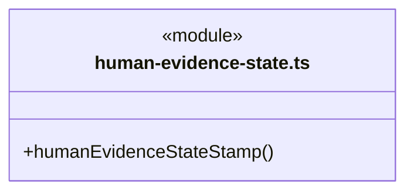

直接依赖：[../../../core/platform/node/serialization.ts](../../../core/platform/node/serialization.ts)、[../../dispatch/rules/dispatch-storage.ts](../../dispatch/rules/dispatch-storage.ts)。

### output-manifest-report-service.ts

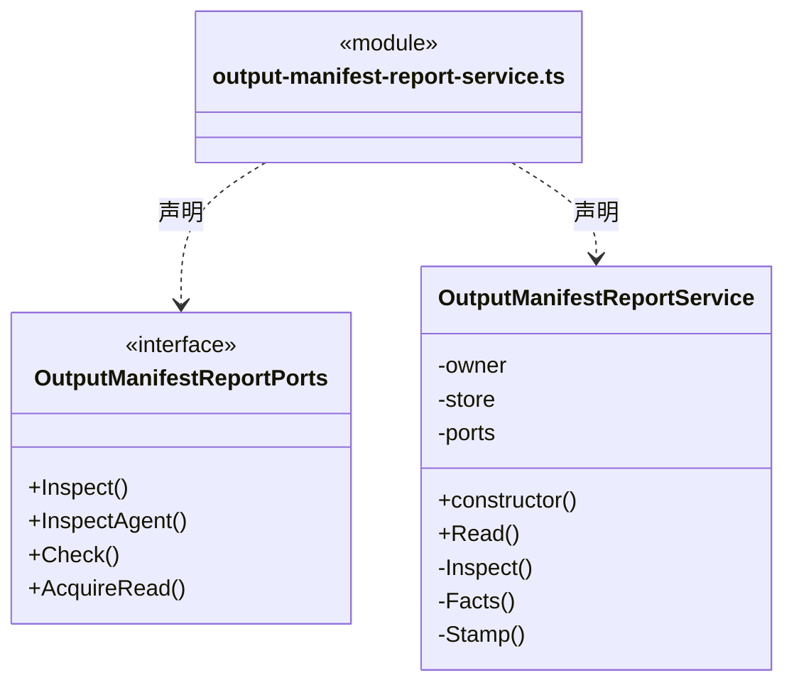

直接依赖：[../../../core/errors.ts](../../../core/errors.ts)、[../../../core/platform/node/serialization.ts](../../../core/platform/node/serialization.ts)、[../../dispatch/rules/dispatch-storage.ts](../../dispatch/rules/dispatch-storage.ts)、[../rules/output-manifest-evidence.ts](../rules/output-manifest-evidence.ts)、[../rules/output-manifest.ts](../rules/output-manifest.ts)、[recursive-evidence-source.ts](recursive-evidence-source.ts)、[../../execution/rules/business-run.ts](../../execution/rules/business-run.ts)、[../../execution/rules/types.ts](../../execution/rules/types.ts)、[../../knowledge/rules/ports.ts](../../knowledge/rules/ports.ts)、[../../runtime/monitoring/member-events.ts](../../runtime/monitoring/member-events.ts)、[../../tasks/rules/dispatch-execution.ts](../../tasks/rules/dispatch-execution.ts)、[../../tasks/rules/execution-context.ts](../../tasks/rules/execution-context.ts)、[../../workspace/rules/artifact-scope.ts](../../workspace/rules/artifact-scope.ts)。

### recursive-evidence-source.ts

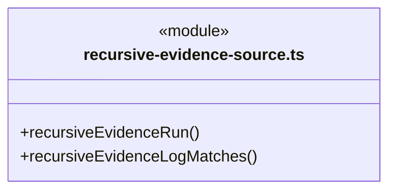

直接依赖：[../../../core/errors.ts](../../../core/errors.ts)、[../../agents/contracts.ts](../../agents/contracts.ts)、[../../dispatch/rules/dispatch-storage.ts](../../dispatch/rules/dispatch-storage.ts)、[../../execution/rules/business-run.ts](../../execution/rules/business-run.ts)、[../../execution/rules/types.ts](../../execution/rules/types.ts)、[../../tasks/rules/execution-context.ts](../../tasks/rules/execution-context.ts)。

### recursive-inspection-evidence.ts

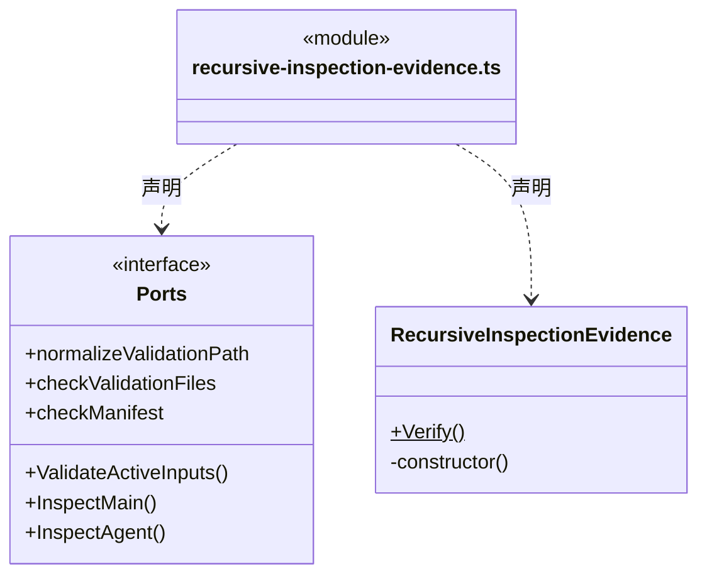

直接依赖：[../../../core/errors.ts](../../../core/errors.ts)、[../../../core/platform/node/serialization.ts](../../../core/platform/node/serialization.ts)、[../../dispatch/rules/dispatch-storage.ts](../../dispatch/rules/dispatch-storage.ts)、[../rules/workflow-evidence.ts](../rules/workflow-evidence.ts)、[agent-artifact-verification.ts](agent-artifact-verification.ts)、[execution-report-facts.ts](execution-report-facts.ts)、[recursive-evidence-source.ts](recursive-evidence-source.ts)、[../../execution/rules/types.ts](../../execution/rules/types.ts)、[../../knowledge/rules/ports.ts](../../knowledge/rules/ports.ts)、[../../tasks/rules/dispatch-scope.ts](../../tasks/rules/dispatch-scope.ts)、[../../tasks/rules/execution-context.ts](../../tasks/rules/execution-context.ts)、[../../team/runtime/member-workflow.ts](../../team/runtime/member-workflow.ts)。

### 本目录调用边界

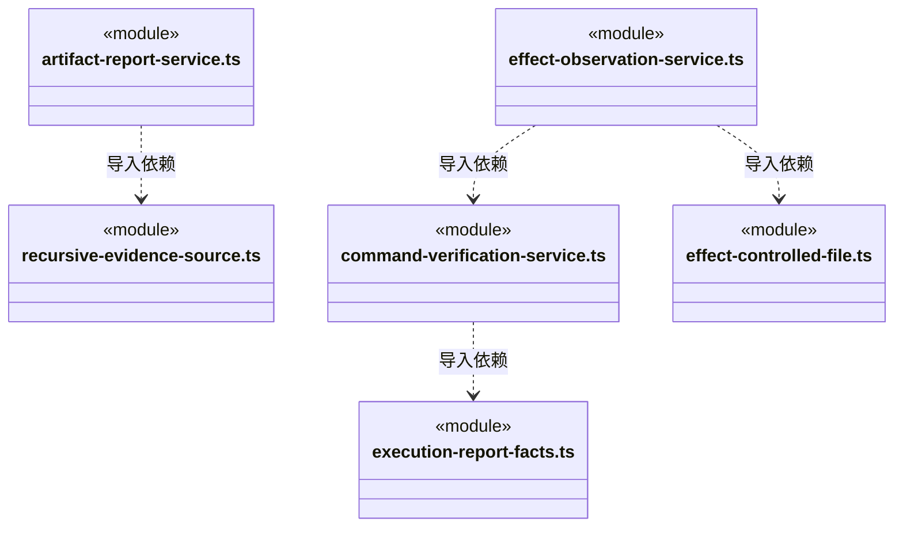

```mermaid
classDiagram
class N_src_logic_evidence_runtime_effect_observation_service_ts["effect-observation-service.ts"] {
  <<module>>
}
class N_src_logic_evidence_runtime_effect_source_ts["effect-source.ts"] {
  <<module>>
}
class N_src_logic_evidence_runtime_command_verification_service_ts["command-verification-service.ts"] {
  <<module>>
}
class N_src_logic_evidence_runtime_execution_report_facts_ts["execution-report-facts.ts"] {
  <<module>>
}
class N_src_logic_evidence_runtime_execution_report_service_ts["execution-report-service.ts"] {
  <<module>>
}
N_src_logic_evidence_runtime_effect_observation_service_ts ..> N_src_logic_evidence_runtime_effect_source_ts : 导入依赖
N_src_logic_evidence_runtime_effect_source_ts ..> N_src_logic_evidence_runtime_command_verification_service_ts : 导入依赖
N_src_logic_evidence_runtime_effect_source_ts ..> N_src_logic_evidence_runtime_execution_report_facts_ts : 导入依赖
N_src_logic_evidence_runtime_execution_report_service_ts ..> N_src_logic_evidence_runtime_execution_report_facts_ts : 导入依赖
```

```mermaid
classDiagram
class N_src_logic_evidence_runtime_execution_report_service_ts["execution-report-service.ts"] {
  <<module>>
}
class N_src_logic_evidence_runtime_recursive_evidence_source_ts["recursive-evidence-source.ts"] {
  <<module>>
}
class N_src_logic_evidence_runtime_output_manifest_report_service_ts["output-manifest-report-service.ts"] {
  <<module>>
}
class N_src_logic_evidence_runtime_recursive_inspection_evidence_ts["recursive-inspection-evidence.ts"] {
  <<module>>
}
class N_src_logic_evidence_runtime_agent_artifact_verification_ts["agent-artifact-verification.ts"] {
  <<module>>
}
class N_src_logic_evidence_runtime_execution_report_facts_ts["execution-report-facts.ts"] {
  <<module>>
}
N_src_logic_evidence_runtime_execution_report_service_ts ..> N_src_logic_evidence_runtime_recursive_evidence_source_ts : 导入依赖
N_src_logic_evidence_runtime_output_manifest_report_service_ts ..> N_src_logic_evidence_runtime_recursive_evidence_source_ts : 导入依赖
N_src_logic_evidence_runtime_recursive_inspection_evidence_ts ..> N_src_logic_evidence_runtime_agent_artifact_verification_ts : 导入依赖
N_src_logic_evidence_runtime_recursive_inspection_evidence_ts ..> N_src_logic_evidence_runtime_execution_report_facts_ts : 导入依赖
```

```mermaid
classDiagram
class N_src_logic_evidence_runtime_recursive_inspection_evidence_ts["recursive-inspection-evidence.ts"] {
  <<module>>
}
class N_src_logic_evidence_runtime_recursive_evidence_source_ts["recursive-evidence-source.ts"] {
  <<module>>
}
N_src_logic_evidence_runtime_recursive_inspection_evidence_ts ..> N_src_logic_evidence_runtime_recursive_evidence_source_ts : 导入依赖
```


## 子目录导航

无子目录。

[返回上层](../ARCHITECTURE.md)。

每次修改本目录代码，同步维护文件头、关键契约说明及本图。未实现的治理、证据验收和自动编排能力不列入当前类图。

<!-- architecture:generated:end -->
