# src/logic/evidence/runtime 架构

## 目录定位

证据编排：收集、核实和提交产物/输出/效果/人工证据，消费 Core 的证据规则及存储端口。

本文描述当前实现。通过分析目录边界后维护的 [源码架构脚本](../../../../scripts/source-architecture.mjs) 同步清单和声明；代码变更时仍须核对职责、关键成员与关系。

## 代码清单

| 文件 | 当前职责 |
| --- | --- |
| [artifact-report-service.ts](artifact-report-service.ts) | 按指定成员运行列出可信文件基线，并在明确选定后对实际文件作独立只读复核。 |
| [command-verification-service.ts](command-verification-service.ts) | 把原主运行的 canonical 调用与同一 Store 已提交命令只读关联，供桌面和主工具共用。 |
| [effect-controlled-file.ts](effect-controlled-file.ts) | 在影响观察中核对已有受控文件报告与原成员完整绑定、参数和字节摘要。 |
| [effect-observation-service.ts](effect-observation-service.ts) | 组合原调用授权、已提交控制面、原知识事务、原治理/责任记录、受控文件阶段与当前选定文件，保存本机明确处置并派生新周期关联。 |
| [effect-source.ts](effect-source.ts) | 从唯一任务存储与 canonical 日志核实原成员/主运行，供影响观察和新核实来源共用。 |
| [execution-report-facts.ts](execution-report-facts.ts) | 从已核对身份的成员运行日志提取工具授权与回执事实。 |
| [execution-report-service.ts](execution-report-service.ts) | 以持久派发状态和指定成员运行日志生成异常核实报告。 |
| [human-decision-evidence.ts](human-decision-evidence.ts) | 复核已消费人工接受的精确候选和选定文件，供显式接续、目标审阅及最终完成共用。 |
| [human-evidence-state.ts](human-evidence-state.ts) | 为人工验收和按意见继续提供同一主周期的证据状态指纹。 |
| [output-manifest-report-service.ts](output-manifest-report-service.ts) | 对指定成员运行列出原完整清单，并在用户明确选定后重新观察全部冻结范围。 |

## 架构类图

### artifact-report-service.ts

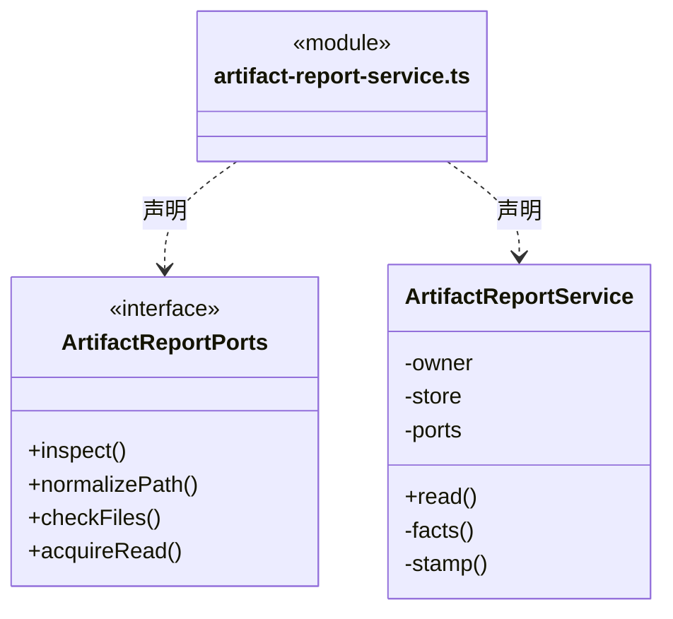

直接依赖：[../../../core/errors.ts](../../../core/errors.ts)、[../../../core/platform/node/serialization.ts](../../../core/platform/node/serialization.ts)、[../rules/artifact-baseline.ts](../rules/artifact-baseline.ts)、[../rules/artifact-evidence.ts](../rules/artifact-evidence.ts)、[../../dispatch/rules/dispatch-storage.ts](../../dispatch/rules/dispatch-storage.ts)、[../../tasks/rules/dispatch-execution.ts](../../tasks/rules/dispatch-execution.ts)、[../../knowledge/rules/ports.ts](../../knowledge/rules/ports.ts)、[../../execution/rules/types.ts](../../execution/rules/types.ts)、[../../runtime/monitoring/member-events.ts](../../runtime/monitoring/member-events.ts)。

### command-verification-service.ts

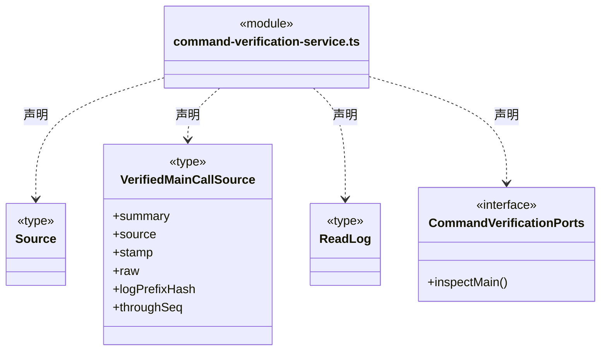

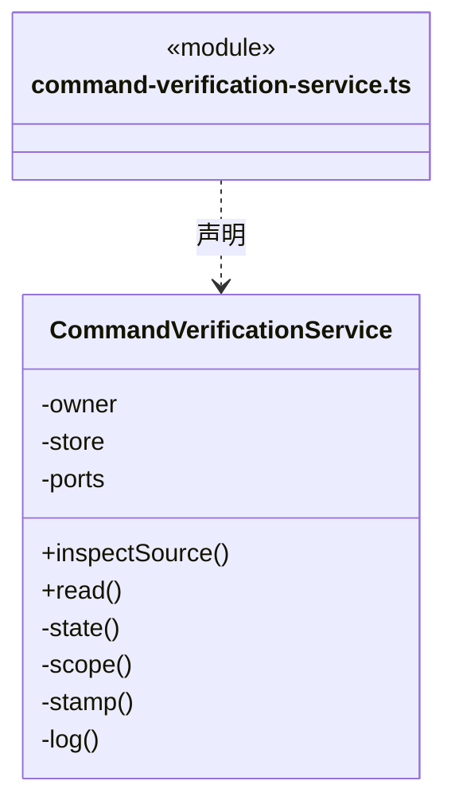

直接依赖：[../../../core/errors.ts](../../../core/errors.ts)、[../../../core/platform/node/serialization.ts](../../../core/platform/node/serialization.ts)、[../../knowledge/rules/ports.ts](../../knowledge/rules/ports.ts)、[../../execution/rules/types.ts](../../execution/rules/types.ts)、[../../execution/rules/conversation-binding.ts](../../execution/rules/conversation-binding.ts)、[../../dispatch/rules/dispatch-storage.ts](../../dispatch/rules/dispatch-storage.ts)、[../../tasks/rules/dispatch-scope.ts](../../tasks/rules/dispatch-scope.ts)、[../../tasks/rules/scope-goal.ts](../../tasks/rules/scope-goal.ts)、[../../tasks/rules/command-verification.ts](../../tasks/rules/command-verification.ts)、[../../tasks/rules/command-verification-output.ts](../../tasks/rules/command-verification-output.ts)、[execution-report-facts.ts](execution-report-facts.ts)、[../../tasks/runtime/main-command-request.ts](../../tasks/runtime/main-command-request.ts)。

### effect-controlled-file.ts

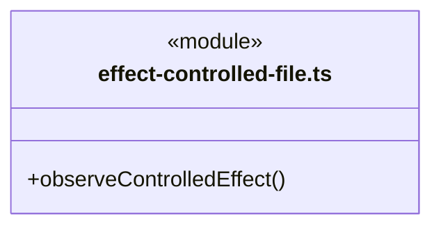

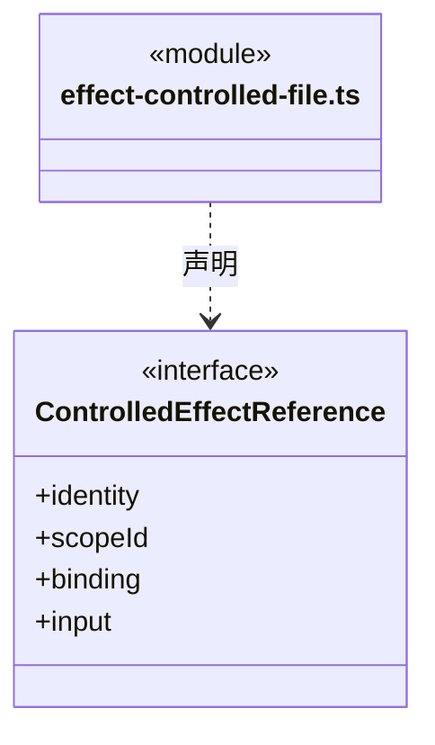

直接依赖：[../../../core/platform/node/serialization.ts](../../../core/platform/node/serialization.ts)、[../../../core/errors.ts](../../../core/errors.ts)、[../../file-operations/rules/controlled-file-operation.ts](../../file-operations/rules/controlled-file-operation.ts)、[../../file-operations/rules/controlled-file-rules.ts](../../file-operations/rules/controlled-file-rules.ts)。

### effect-observation-service.ts

成员 1/2（同名节点为同一声明，跨图合并阅读）。

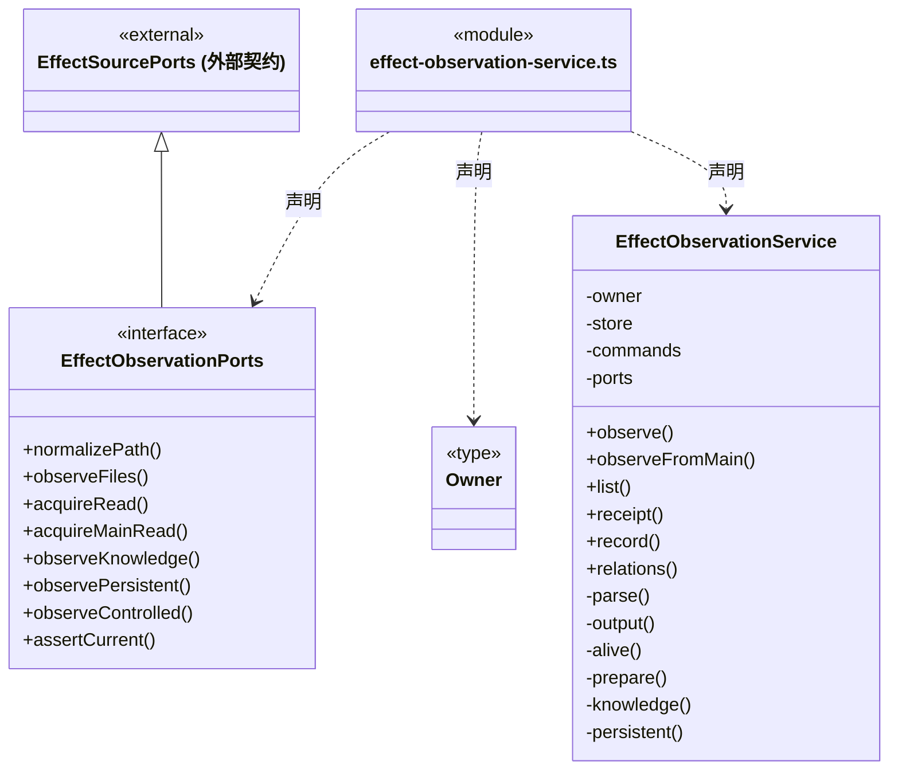

成员 2/2（同名节点为同一声明，跨图合并阅读）。

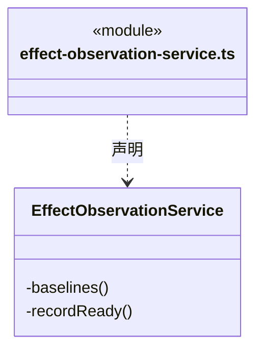

直接依赖：[../../../core/errors.ts](../../../core/errors.ts)、[../../../core/platform/node/serialization.ts](../../../core/platform/node/serialization.ts)、[../../knowledge/rules/ports.ts](../../knowledge/rules/ports.ts)、[../../dispatch/rules/dispatch-storage.ts](../../dispatch/rules/dispatch-storage.ts)、[../../tasks/rules/effect-observation.ts](../../tasks/rules/effect-observation.ts)、[../../tasks/rules/effect-observation-rules.ts](../../tasks/rules/effect-observation-rules.ts)、[../../tasks/rules/command-verification.ts](../../tasks/rules/command-verification.ts)、[../rules/artifact-evidence.ts](../rules/artifact-evidence.ts)、[../rules/artifact-baseline.ts](../rules/artifact-baseline.ts)、[command-verification-service.ts](command-verification-service.ts)、[effect-source.ts](effect-source.ts)、[../../knowledge/rules/knowledge-write-observation.ts](../../knowledge/rules/knowledge-write-observation.ts)、[../../knowledge/rules/knowledge-write-input.ts](../../knowledge/rules/knowledge-write-input.ts)、[../../tasks/rules/persistent-write-observation.ts](../../tasks/rules/persistent-write-observation.ts)、[../../tasks/rules/persistent-write-input.ts](../../tasks/rules/persistent-write-input.ts)、[../../file-operations/rules/controlled-file-operation.ts](../../file-operations/rules/controlled-file-operation.ts)、[effect-controlled-file.ts](effect-controlled-file.ts)。

### effect-source.ts

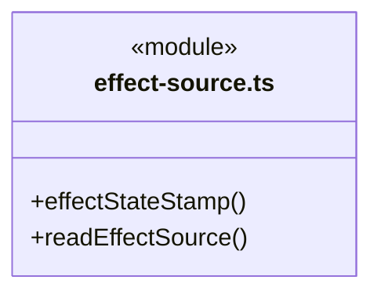

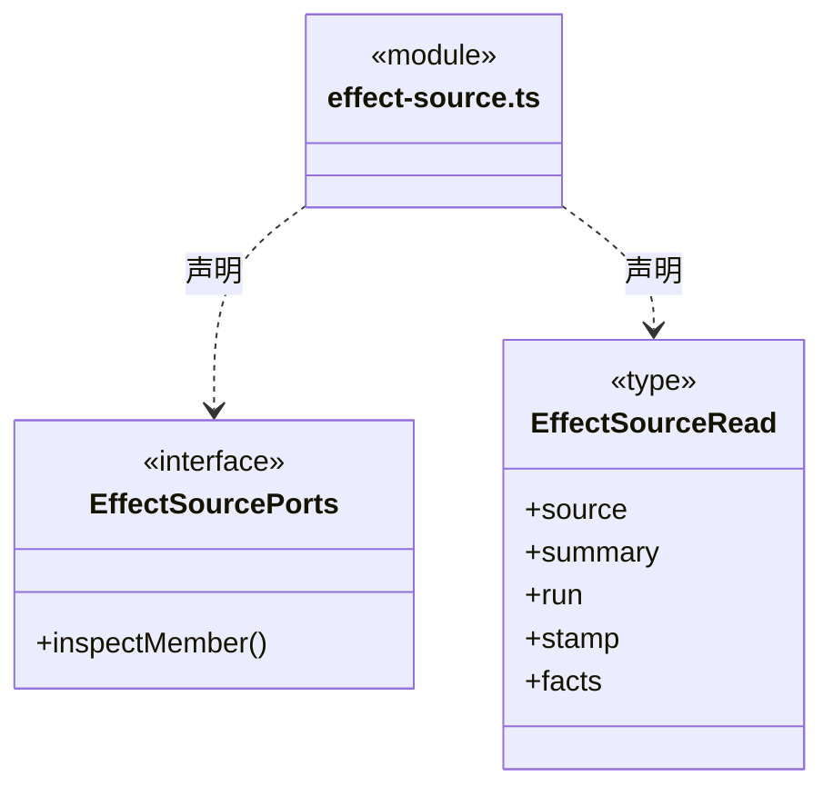

直接依赖：[../../../core/platform/node/serialization.ts](../../../core/platform/node/serialization.ts)、[../../execution/rules/types.ts](../../execution/rules/types.ts)、[../../dispatch/rules/dispatch-storage.ts](../../dispatch/rules/dispatch-storage.ts)、[../../tasks/rules/dispatch-execution.ts](../../tasks/rules/dispatch-execution.ts)、[../../tasks/rules/effect-observation.ts](../../tasks/rules/effect-observation.ts)、[../../tasks/rules/scope-goal.ts](../../tasks/rules/scope-goal.ts)、[../../runtime/monitoring/member-events.ts](../../runtime/monitoring/member-events.ts)、[execution-report-facts.ts](execution-report-facts.ts)、[command-verification-service.ts](command-verification-service.ts)。

### execution-report-facts.ts

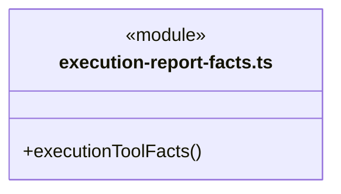

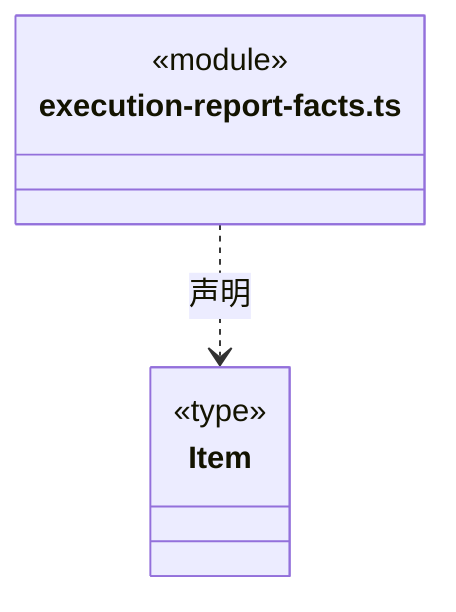

直接依赖：[../../tasks/rules/execution-report.ts](../../tasks/rules/execution-report.ts)、[../../execution/rules/types.ts](../../execution/rules/types.ts)、[../../tasks/rules/dispatch-execution.ts](../../tasks/rules/dispatch-execution.ts)、[../../../core/platform/node/serialization.ts](../../../core/platform/node/serialization.ts)。

### execution-report-service.ts

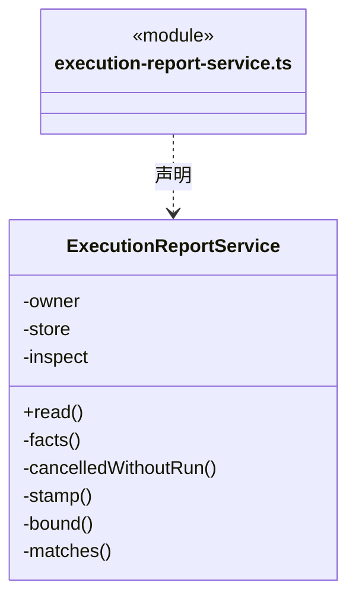

直接依赖：[../../../core/errors.ts](../../../core/errors.ts)、[../../../core/platform/node/serialization.ts](../../../core/platform/node/serialization.ts)、[../../tasks/rules/execution-report.ts](../../tasks/rules/execution-report.ts)、[../../dispatch/rules/dispatch-storage.ts](../../dispatch/rules/dispatch-storage.ts)、[../../tasks/rules/dispatch-execution.ts](../../tasks/rules/dispatch-execution.ts)、[../../knowledge/rules/ports.ts](../../knowledge/rules/ports.ts)、[../../execution/rules/types.ts](../../execution/rules/types.ts)、[execution-report-facts.ts](execution-report-facts.ts)、[../../tasks/rules/queued-task-cancel.ts](../../tasks/rules/queued-task-cancel.ts)。

### human-decision-evidence.ts

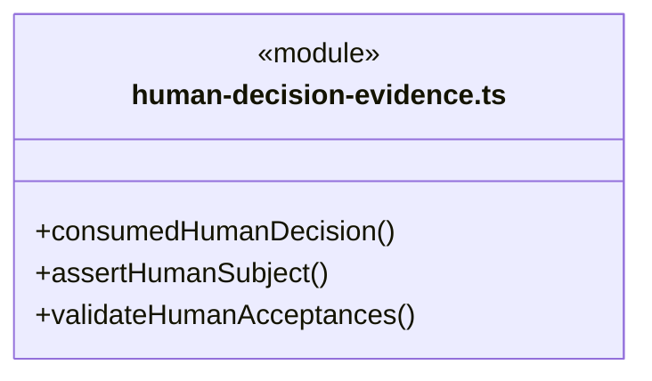

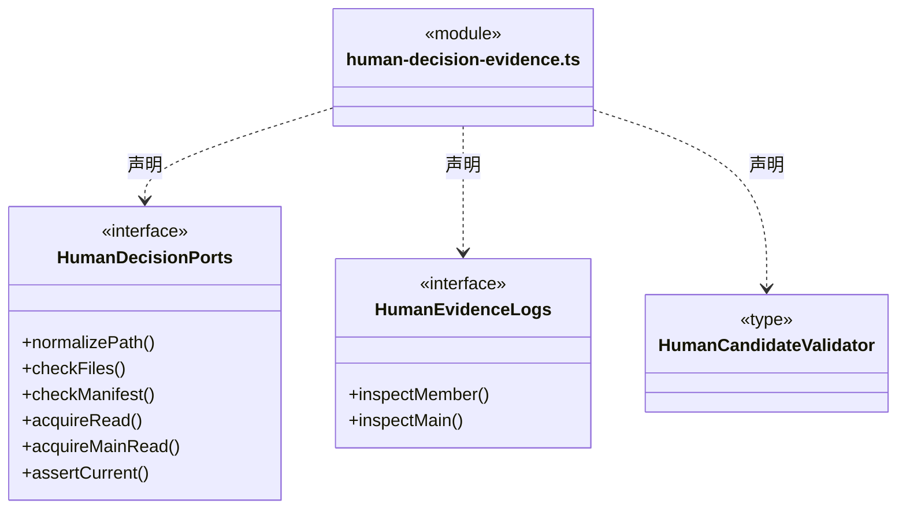

直接依赖：[../../../core/errors.ts](../../../core/errors.ts)、[../../../core/platform/node/serialization.ts](../../../core/platform/node/serialization.ts)、[../../knowledge/rules/ports.ts](../../knowledge/rules/ports.ts)、[../../execution/rules/types.ts](../../execution/rules/types.ts)、[../../dispatch/rules/dispatch-storage.ts](../../dispatch/rules/dispatch-storage.ts)、[../../tasks/rules/dispatch-scope.ts](../../tasks/rules/dispatch-scope.ts)、[../../tasks/rules/dispatch-execution.ts](../../tasks/rules/dispatch-execution.ts)、[../../tasks/rules/graph-types.ts](../../tasks/rules/graph-types.ts)、[../../tasks/rules/human-decisions.ts](../../tasks/rules/human-decisions.ts)、[../../tasks/rules/human-continue.ts](../../tasks/rules/human-continue.ts)、[../../tasks/rules/human-continuation-rules.ts](../../tasks/rules/human-continuation-rules.ts)、[../../tasks/rules/scope-goal.ts](../../tasks/rules/scope-goal.ts)、[../rules/artifact-baseline.ts](../rules/artifact-baseline.ts)、[../rules/artifact-evidence.ts](../rules/artifact-evidence.ts)、[../../team/runtime/member-workflow.ts](../../team/runtime/member-workflow.ts)、[../rules/output-manifest.ts](../rules/output-manifest.ts)、[../rules/complete-output-evidence.ts](../rules/complete-output-evidence.ts)。

### human-evidence-state.ts

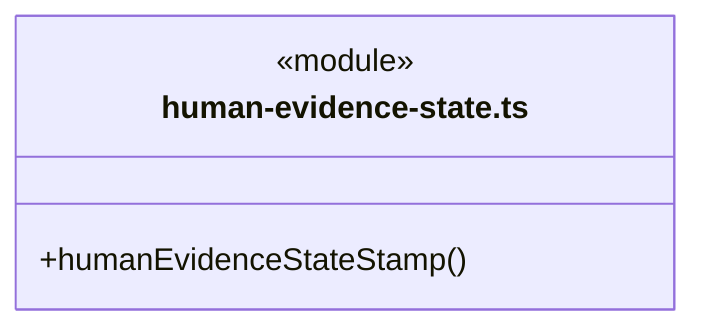

直接依赖：[../../../core/platform/node/serialization.ts](../../../core/platform/node/serialization.ts)、[../../dispatch/rules/dispatch-storage.ts](../../dispatch/rules/dispatch-storage.ts)。

### output-manifest-report-service.ts

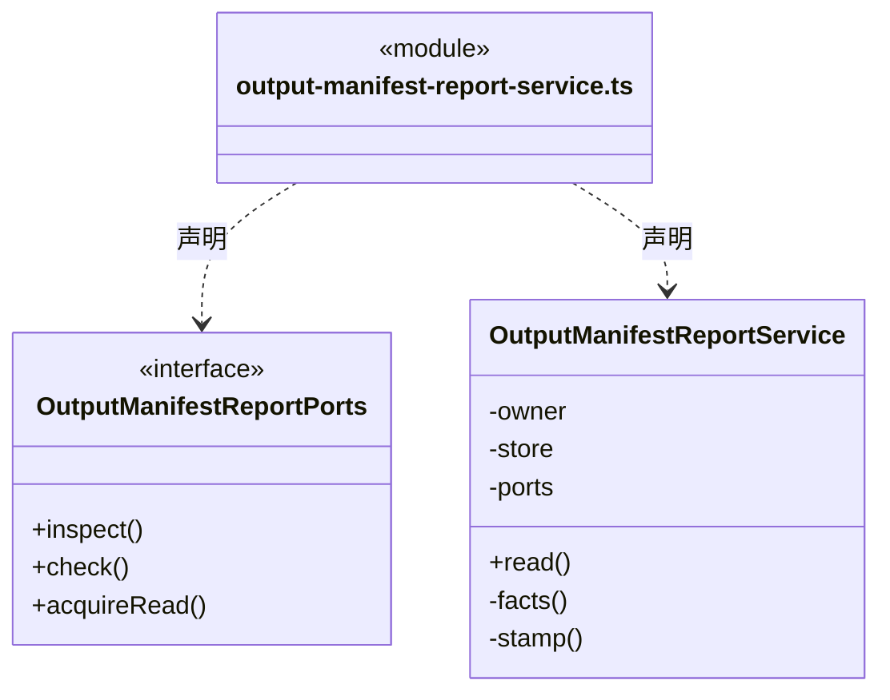

直接依赖：[../../../core/errors.ts](../../../core/errors.ts)、[../../../core/platform/node/serialization.ts](../../../core/platform/node/serialization.ts)、[../rules/output-manifest.ts](../rules/output-manifest.ts)、[../rules/output-manifest-evidence.ts](../rules/output-manifest-evidence.ts)、[../../tasks/rules/execution-context.ts](../../tasks/rules/execution-context.ts)、[../../workspace/rules/artifact-scope.ts](../../workspace/rules/artifact-scope.ts)、[../../dispatch/rules/dispatch-storage.ts](../../dispatch/rules/dispatch-storage.ts)、[../../tasks/rules/dispatch-execution.ts](../../tasks/rules/dispatch-execution.ts)、[../../knowledge/rules/ports.ts](../../knowledge/rules/ports.ts)、[../../execution/rules/types.ts](../../execution/rules/types.ts)、[../../runtime/monitoring/member-events.ts](../../runtime/monitoring/member-events.ts)。

### 本目录调用边界

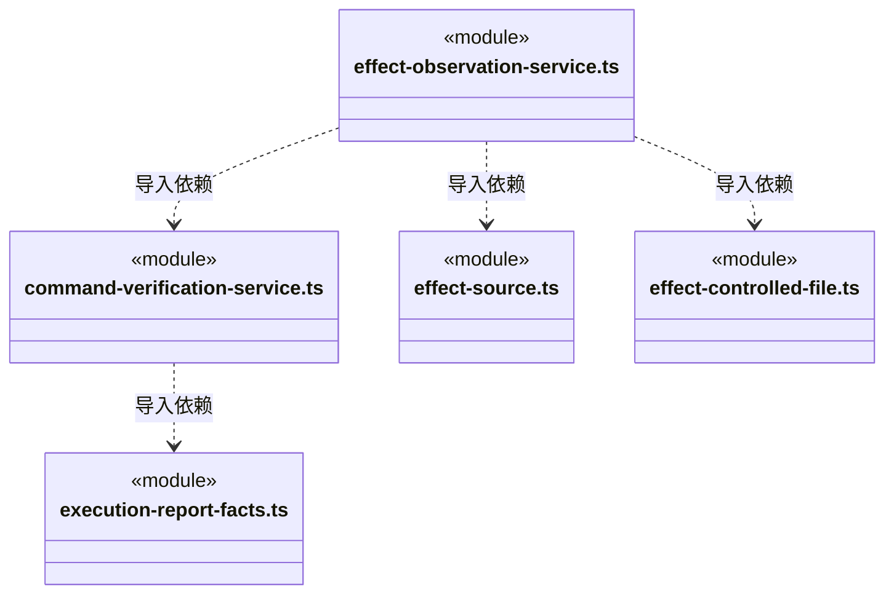

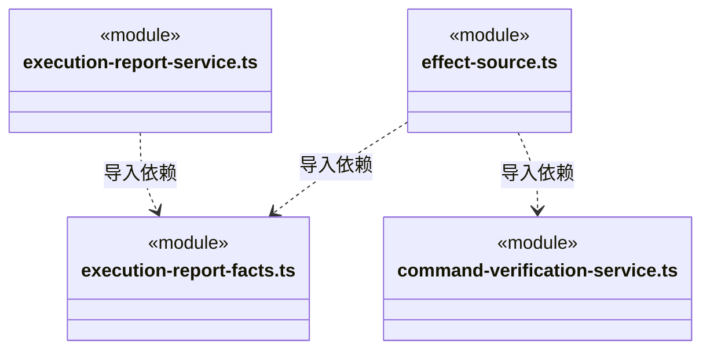

## 子目录导航

无子目录。

[返回上层](../ARCHITECTURE.md)。

每次修改本目录代码，同步维护文件头、关键契约说明及本图。未实现的治理、证据验收和自动编排能力不列入当前类图。
