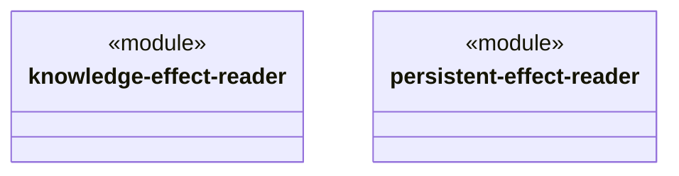

# src/logic/evidence/service 架构

## 设计意图

把工作区知识事务与治理记录适配为有界的只读效果证据，供证据运行服务组合。

`knowledge-effect-reader` 核实原知识请求和事务，`persistent-effect-reader` 投影治理命令与责任审计。两者依赖明确身份和原记录，只返回已保存事实，不提交新知识、不代替人工批准或验收。

## 主要组成

| 组成 | 定位 |
| --- | --- |
| [knowledge-effect-reader](knowledge-effect-reader.ts) | 在已打开工作区内只读核实原知识工具请求和事务，向调度影响观察提供有界摘要。 |
| [persistent-effect-reader](persistent-effect-reader.ts) | 只读原治理命令与责任审计，向影响观察投影有界的“原记录已保存”证据。 |

<!-- architecture:generated:start -->

## 架构关系

[上层设计](../ARCHITECTURE.md)

<!-- architecture:generated:end -->
