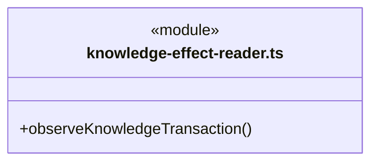
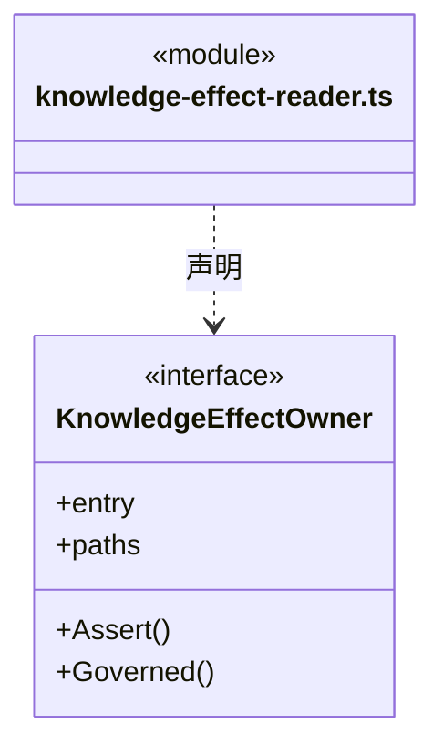
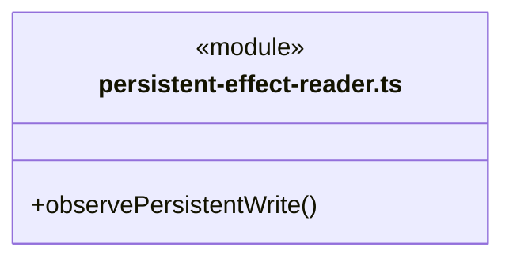
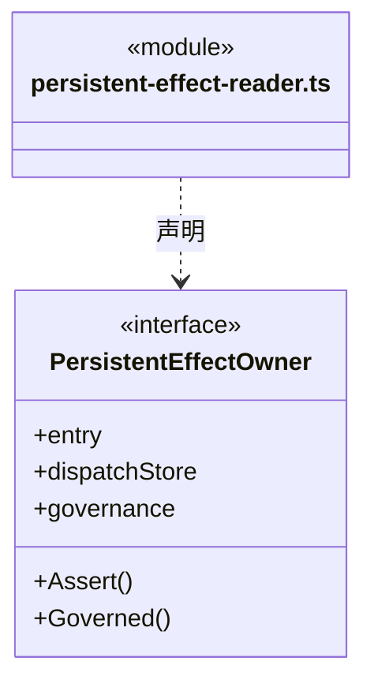

# src/logic/evidence/service 架构

本目录只维护这一份说明。设计与契约直接编辑本文；文件清单、类图和导航由 [架构脚本](../../../../scripts/source-architecture.mjs) 更新，生成区域之外的人工说明会保留。

## 封装意图

真实工程效果读取适配：在明确范围和版本下采集观察供证据服务使用。

## 类与模块的设计意图

下表依据源码声明及文件头说明定位封装。字段表示该实例持有的状态或协作引用，不表示它拥有被引用服务的生命周期；实际资源责任和调用限制见下文契约及源码注释。

| 类／模块 | 实现形式与实例字段 | 封装依据 |
| --- | --- | --- |
| [knowledge-effect-reader.ts](knowledge-effect-reader.ts) | 函数／契约模块 | 完整 journal 校验复用唯一知识串行队列，原对象计划只从固定私有缓存加载；不把工具失败当作事务回滚，也不借当前实例补造历史请求。 |
| [persistent-effect-reader.ts](persistent-effect-reader.ts) | 函数／契约模块 | 治理账本借用知识串行队列，责任事件与回执复用唯一 DispatchStore；完整原请求与来源均核实，不从当前保护或负责人倒推旧结果。 |

## 接口设计契约

- [knowledge-effect-reader.ts](knowledge-effect-reader.ts)：职责边界：不提交知识、不刷新索引、不修剪目录、不恢复事务或创建另一个 Store；前后正文仅参与私有摘要，不进入公开报告。
- [persistent-effect-reader.ts](persistent-effect-reader.ts)：职责边界：不调用提交、预览、恢复或初始化；不查询新模型，不把保存当作批准、实施、迁移或交接。正文只参与私有指纹。

## 开闭边界

本目录的职责及允许协作由[封装意图](#封装意图)限定，输入输出、状态与失败语义以[接口设计契约](#接口设计契约)为准。扩展从已有公开入口及实际装配位置进入；没有明确可替换契约的部分按真实影响修改和验证，不预建未使用的基类或插件入口。

<!-- architecture:generated:start -->

## 文件清单

| 文件 | 形式 | 当前职责 |
| --- | --- | --- |
| [ARCHITECTURE.md](ARCHITECTURE.md) | 说明文档 | 本目录的文件清单、真实声明、依赖与子封装导航。 |
| [knowledge-effect-reader.ts](knowledge-effect-reader.ts) | 源码模块 | 在已打开工作区内只读核实原知识工具请求和事务，向调度影响观察提供有界摘要。 |
| [persistent-effect-reader.ts](persistent-effect-reader.ts) | 源码模块 | 只读原治理命令与责任审计，向影响观察投影有界的“原记录已保存”证据。 |

## 架构类图

成员标记：`+` 公开、`-` 私有、`#` 受保护、`$` 静态；`function` 为函数值成员，`get`／`set` 为访问器。调用／构造／索引签名按匿名签名列出，不虚构方法名；`global.` 表示全局声明补充，非运行时嵌套类。构造函数单独列出，运行时私有字段保留 `#`。文档和资源仅在文件清单中导航，不作为代码节点。

### knowledge-effect-reader.ts

[查看源码](knowledge-effect-reader.ts)。

直接依赖：[../../../core/errors.ts](../../../core/errors.ts)、[../../../core/platform/node/serialization.ts](../../../core/platform/node/serialization.ts)、[../../knowledge/rules/knowledge-write-input.ts](../../knowledge/rules/knowledge-write-input.ts)、[../../knowledge/rules/knowledge-write-observation.ts](../../knowledge/rules/knowledge-write-observation.ts)、[../../knowledge/rules/types.ts](../../knowledge/rules/types.ts)、[../../knowledge/storage/governance-port.ts](../../knowledge/storage/governance-port.ts)、[../../knowledge/storage/planned-commit.ts](../../knowledge/storage/planned-commit.ts)、[../../workspace/ports/paths.ts](../../workspace/ports/paths.ts)。

### persistent-effect-reader.ts

[查看源码](persistent-effect-reader.ts)。

直接依赖：[../../../core/errors.ts](../../../core/errors.ts)、[../../../core/platform/node/serialization.ts](../../../core/platform/node/serialization.ts)、[../../dispatch/rules/dispatch-storage.ts](../../dispatch/rules/dispatch-storage.ts)、[../../governance/rules/module-governance.ts](../../governance/rules/module-governance.ts)、[../../governance/service/storage/module-governance-store.ts](../../governance/service/storage/module-governance-store.ts)、[../../tasks/rules/persistent-write-input.ts](../../tasks/rules/persistent-write-input.ts)、[../../tasks/rules/persistent-write-observation.ts](../../tasks/rules/persistent-write-observation.ts)、[../../workspace/rules/module-ownership-rules.ts](../../workspace/rules/module-ownership-rules.ts)、[../../workspace/rules/module-ownership.ts](../../workspace/rules/module-ownership.ts)。

## 子目录导航

无子目录。

[返回上层](../ARCHITECTURE.md)。

每次修改本目录代码，同步维护文件头、关键契约说明及本图。未实现的治理、证据验收和自动编排能力不列入当前类图。

<!-- architecture:generated:end -->
