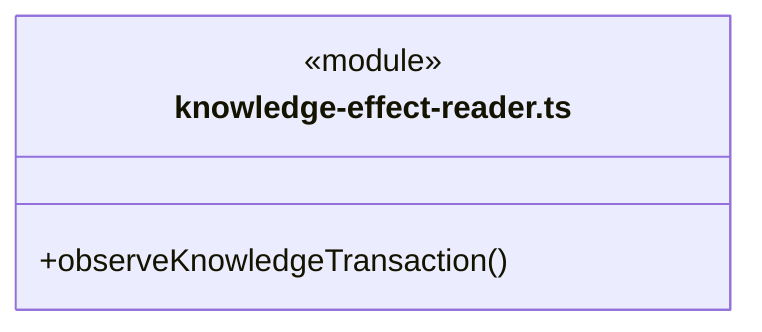
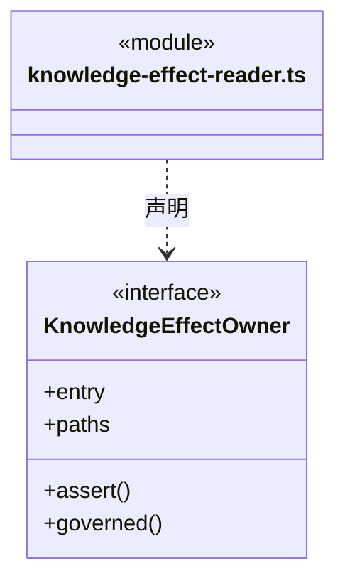
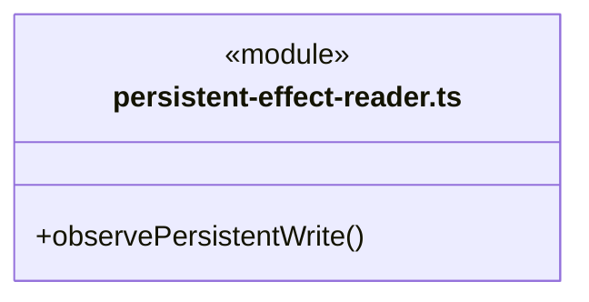
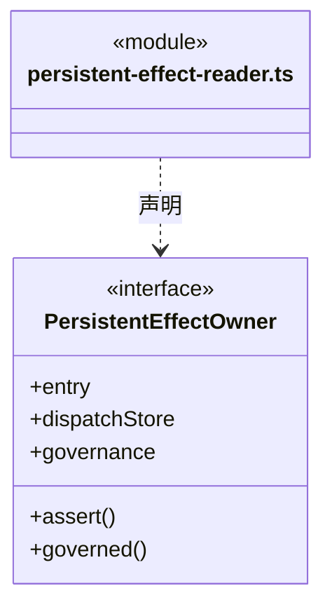

# src/logic/evidence/service 架构

## 目录定位

真实工程效果读取适配：在明确范围和版本下采集观察供证据服务使用。

本文描述当前实现。通过分析目录边界后维护的 [源码架构脚本](../../../../scripts/source-architecture.mjs) 同步清单和声明；代码变更时仍须核对职责、关键成员与关系。

## 代码清单

| 文件 | 当前职责 |
| --- | --- |
| [knowledge-effect-reader.ts](knowledge-effect-reader.ts) | 在已打开工作区内只读核实原知识工具请求和事务，向调度影响观察提供有界摘要。 |
| [persistent-effect-reader.ts](persistent-effect-reader.ts) | 只读原治理命令与责任审计，向影响观察投影有界的“原记录已保存”证据。 |

## 架构类图

### knowledge-effect-reader.ts

直接依赖：[../../../core/platform/node/serialization.ts](../../../core/platform/node/serialization.ts)、[../../../core/errors.ts](../../../core/errors.ts)、[../../workspace/ports/paths.ts](../../workspace/ports/paths.ts)、[../../knowledge/rules/types.ts](../../knowledge/rules/types.ts)、[../../knowledge/rules/knowledge-write-observation.ts](../../knowledge/rules/knowledge-write-observation.ts)、[../../knowledge/rules/knowledge-write-input.ts](../../knowledge/rules/knowledge-write-input.ts)、[../../knowledge/storage/governance-port.ts](../../knowledge/storage/governance-port.ts)、[../../knowledge/storage/planned-commit.ts](../../knowledge/storage/planned-commit.ts)。

### persistent-effect-reader.ts

直接依赖：[../../../core/platform/node/serialization.ts](../../../core/platform/node/serialization.ts)、[../../../core/errors.ts](../../../core/errors.ts)、[../../tasks/rules/persistent-write-observation.ts](../../tasks/rules/persistent-write-observation.ts)、[../../tasks/rules/persistent-write-input.ts](../../tasks/rules/persistent-write-input.ts)、[../../governance/rules/module-governance.ts](../../governance/rules/module-governance.ts)、[../../workspace/rules/module-ownership.ts](../../workspace/rules/module-ownership.ts)、[../../workspace/rules/module-ownership-rules.ts](../../workspace/rules/module-ownership-rules.ts)、[../../dispatch/rules/dispatch-storage.ts](../../dispatch/rules/dispatch-storage.ts)、[../../governance/service/storage/module-governance-store.ts](../../governance/service/storage/module-governance-store.ts)。

## 子目录导航

无子目录。

[返回上层](../ARCHITECTURE.md)。

每次修改本目录代码，同步维护文件头、关键契约说明及本图。未实现的治理、证据验收和自动编排能力不列入当前类图。
