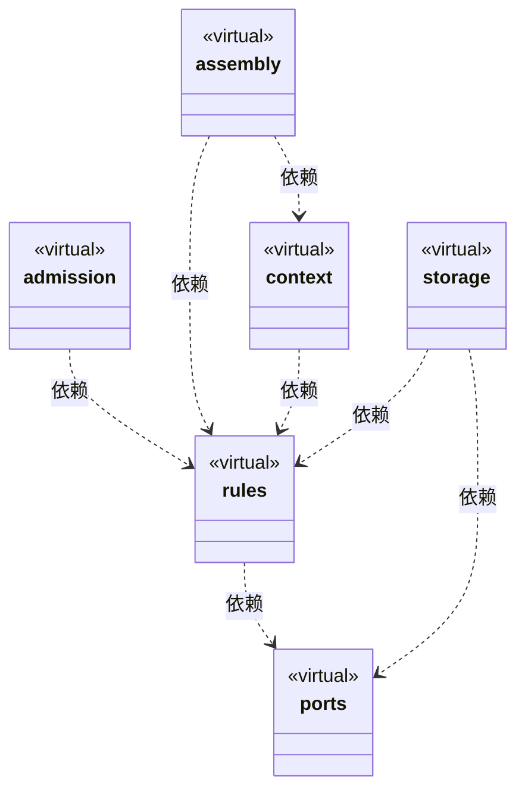
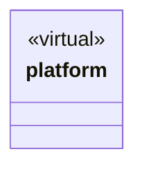

# src/logic/execution 架构

## 设计意图

把已核实的 Agent 调用转化为真实执行，分离准入、上下文、循环机制、引擎适配与运行持久化。

`assembly` 连接各能力，`admission` 管理占用，`context` 冻结执行资料，`rules` 驱动引擎无关协议，具体运行包由 Logic 的引擎适配器提供；`storage` 保存运行事实，`platform` 和 `ports` 约束本机身份与会话访问。执行结束与目标验收分别由本域和任务域判断。

## 主要组成

本层没有直接产品实现，由下方子模块组成；每个直接子模块作为一个虚拟封装，只在本层呈现整体职责与协作。

<!-- architecture:generated:start -->

## 架构关系

标注为 `virtual` 的节点是直接子模块的虚拟类封装；内部设计沿下方入口阅读。

### 关系组 1：rules

### 关系组 2：platform

## 子模块

| 虚拟封装 | 整体职责 |
| --- | --- |
| [admission](admission/ARCHITECTURE.md) | 协调应用执行名额与工作区占用，令等待、获准和释放都有可信身份。 |
| [assembly](assembly/ARCHITECTURE.md) | 选择具体引擎并连接调用协调、运行循环与可信工具，作为执行域认识实现细节的装配点。 |
| [context](context/ARCHITECTURE.md) | 把明确的角色、模块与 Workflow 选择解析为冻结执行资料，保留来源、版本与范围。 |
| [platform](platform/ARCHITECTURE.md) | 核实受管原生会话文件与工作区工具路径，为续执行和工具访问提供本机边界。 |
| [ports](ports/ARCHITECTURE.md) | 集中校验用于运行目录定位的工作区、任务和运行标识格式，避免调用方拼接未验证标识。 |
| [rules](rules/ARCHITECTURE.md) | 定义引擎无关的任务、事件、工具和存储协议，组合运行机制与受控能力而不认识具体 SDK。 |
| [storage](storage/ARCHITECTURE.md) | 保存运行的可靠事件、摘要和业务关联，为实时执行与重启读取提供同一事实来源。 |

[上层设计](../ARCHITECTURE.md)

<!-- architecture:generated:end -->
