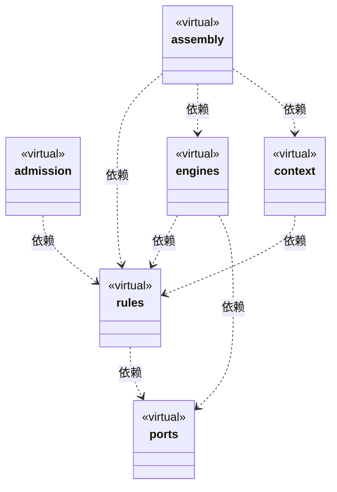
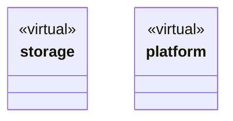

# src/logic/execution 架构

## 设计意图

封装 Agent 调用如何成为真实执行。准入、上下文、循环规则、引擎和存储各自承担一部分责任，由 assembly 组合；任务业务策略通过端口接入。

## 主要组成

本层由下列子模块组合，每个子模块作为独立的虚拟类封装参与本层协作。

<!-- architecture:generated:start -->

## 架构关系

标注为 `virtual` 的节点是直接子模块的虚拟类封装；内部设计沿下方入口阅读。

### 关系组 1

### 关系组 2

### 跨图协作

- [storage](storage/ARCHITECTURE.md)（图 2）→ [ports](ports/ARCHITECTURE.md)（图 1）：依赖。
- [storage](storage/ARCHITECTURE.md)（图 2）→ [rules](rules/ARCHITECTURE.md)（图 1）：依赖。

## 子模块

| 虚拟封装 | 整体职责 |
| --- | --- |
| [admission](admission/ARCHITECTURE.md) | 运行准入的票据与运行注册，保持可信入口、占用与释放语义；与业务验收分离。 |
| [assembly](assembly/ARCHITECTURE.md) | 执行域的具体装配点：把 Agent 调用、运行循环、引擎适配和工具能力连接起来。调度器协调父子调用，装配函数选择真实实现；规则层不反向认识这些选择。 |
| [context](context/ARCHITECTURE.md) | 根据明确选择的角色、模块和 Workflow 生成执行上下文。自动范围、主会话与成员任务分别解析，共用冻结知识边界，不在这里启动模型或持有执行状态。 |
| [engines](engines/ARCHITECTURE.md) | 将不同模型引擎适配为统一执行协议。各引擎独立封装会话与工具差异，共用传输能力、无进展计时和运行包绑定；具体选择由上层装配完成。 |
| [platform](platform/ARCHITECTURE.md) | 原生会话文件归属与工作区工具路径保护；业务隔离平台归 file-operations，系统加密归 Core。 |
| [ports](ports/ARCHITECTURE.md) | 执行及工作区身份格式校验；不拥有路径授权、磁盘访问或应用生命周期。 |
| [rules](rules/ARCHITECTURE.md) | 提供引擎无关的运行协议与工具协调规则。runtime 封装循环机制，capabilities 封装具体执行能力；它们通过明确端口协作，具体引擎由上层装配选择。 |
| [storage](storage/ARCHITECTURE.md) | 运行日志、运行内输入和游标文件实现；按 logic/execution/rules 的 RunStorage 等端口提供持久化，保留追加、未知和恢复语义。 |

[上层设计](../ARCHITECTURE.md)

<!-- architecture:generated:end -->
