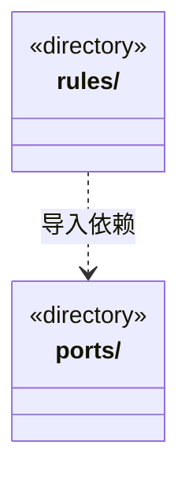

# src/logic/execution 架构

## 目录定位

执行会话、工具能力、运行恢复与身份契约；服务与规则分开归属，实际依赖通过明确入口验证。

本文描述当前实现。通过分析目录边界后维护的 [源码架构脚本](../../../scripts/source-architecture.mjs) 同步清单和声明；代码变更时仍须核对职责、关键成员与关系。

## 代码清单

本层无直接代码文件。

## 架构类图

各图中的同名节点表示同一目录边界；跨组及完整直接依赖如下（无边不代表继承）：

- `rules` → `ports`：导入。

## 子目录导航

- [ports/](ports/ARCHITECTURE.md)：执行及工作区身份格式校验；不拥有路径授权、磁盘访问或应用生命周期。
- [rules/](rules/ARCHITECTURE.md)：引擎无关的运行契约与执行入口。runtime、capabilities 是同一执行模块的内部职责分区，不声明为已经独立解耦的子系统；状态、日志和授权语义保持原有契约。具体引擎由上层装配。 EngineRuntimeResolver 是受管引擎已验证包的窄契约；不包含下载实现、活动指针或用户凭据。

[返回上层](../ARCHITECTURE.md)。

每次修改本目录代码，同步维护文件头、关键契约说明及本图。未实现的治理、证据验收和自动编排能力不列入当前类图。
