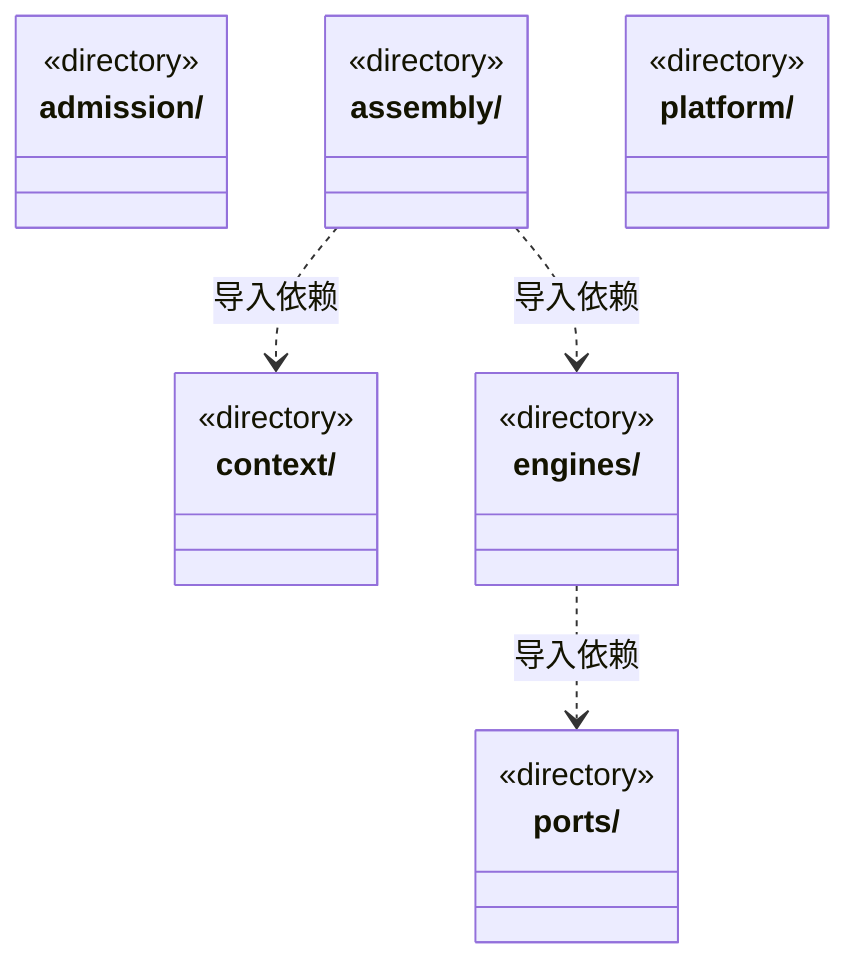
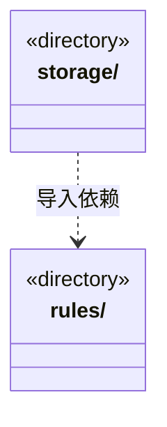

# src/logic/execution 架构

本目录只维护这一份说明。设计与契约直接编辑本文；文件清单、类图和导航由 [架构脚本](../../../scripts/source-architecture.mjs) 更新，生成区域之外的人工说明会保留。

## 封装意图

执行会话、工具能力、运行恢复与身份契约；服务与规则分开归属，实际依赖通过明确入口验证。

## 类与模块的设计意图

本层没有直接源码声明，负责组合下级封装；各子系统的类、状态与公开入口见本文的[子目录导航](#子目录导航)。

## 接口设计契约

本层没有独立代码入口或运行实例。公开契约与资源生命周期分别归属下级封装，按[子目录导航](#子目录导航)进入实际所有者。

## 开闭边界

本目录的职责及允许协作由[封装意图](#封装意图)限定，输入输出、状态与失败语义以[接口设计契约](#接口设计契约)为准。扩展从已有公开入口及实际装配位置进入；没有明确可替换契约的部分按真实影响修改和验证，不预建未使用的基类或插件入口。

<!-- architecture:generated:start -->

## 文件清单

| 文件 | 形式 | 当前职责 |
| --- | --- | --- |
| [ARCHITECTURE.md](ARCHITECTURE.md) | 说明文档 | 本目录的文件清单、真实声明、依赖与子封装导航。 |

本层无直接代码文件。

## 架构类图

成员标记：`+` 公开、`-` 私有、`#` 受保护、`$` 静态；构造函数单独列出。文档和资源仅在文件清单中导航，不作为代码节点。

各图中的同名节点表示同一目录边界；跨组及完整直接依赖如下（无边不代表继承）：

- `admission` → `rules`：导入。
- `assembly` → `rules`：导入。
- `assembly` → `engines`：导入。
- `assembly` → `context`：导入。
- `context` → `rules`：导入。
- `engines` → `rules`：导入。
- `engines` → `ports`：导入。
- `rules` → `ports`：导入。
- `storage` → `rules`：导入。
- `storage` → `ports`：导入。

## 子目录导航

- [admission/](admission/ARCHITECTURE.md)：运行准入的票据与运行注册，保持可信入口、占用与释放语义；与业务验收分离。
- [assembly/](assembly/ARCHITECTURE.md)：引擎装配：loop-engine 将实际 Pi/Claude/Codex、模型预算及工具能力接入 logic/execution/rules/runtime 运行循环。这里有意认识具体实现；高密度装配依赖仍需独立评审。 主/成员运行按可信端口准备 E，并用 pinRuntimeEngine 固定历史兼容边界；可执行路径不来自公开运行选项。
- [context/](context/ARCHITECTURE.md)：内置主角色诊断和治理知识，执行者冻结角色/Skill、模块/岗位责任、Workflow与规范。显式流程只从本模块挂载清单解析，准备按任务原选择重核，不回退默认或刷新旧绑定；前置替换保留原实例和流程；两种模式的主会话都可直接执行未配置自定义岗位的模块，不把主 Agent 派成独立成员。 team-workflow 只向知识查询转发 snapshot，查询不取得工作区写能力。 team-workflow 调用 logic/knowledge/rules 的 KnowledgeQueries，后者只取快照读取端口并组合 Team/BusinessWorkspace；跨查询一致性由准备用例核版本，索引写入留在知识领域。 执行上下文同时冻结负责岗位、项目适配、采纳能力与模型身份，主模型不会替换成员配置。
- [engines/](engines/ARCHITECTURE.md)：执行域的具体引擎适配边界：Pi、Claude、Codex 及其共享 HTTP 预算传输和原生工具加载。依赖 Logic 引擎/模型契约，由 execution/assembly 选择并注入；不持有任务派发与应用存储。 runtime-binding 在 agentHome 固定原生会话的 E 摘要；包变化时拒绝无兼容依据的恢复，历史不删除、不自动迁移。 可组合 utility 通用入口的分帧与在途集合，不依赖其 Node 入口或其他基础方案。
- [platform/](platform/ARCHITECTURE.md)：原生会话文件归属与工作区工具路径保护；业务隔离平台归 file-operations，系统加密归 Core。
- [ports/](ports/ARCHITECTURE.md)：执行及工作区身份格式校验；不拥有路径授权、磁盘访问或应用生命周期。
- [rules/](rules/ARCHITECTURE.md)：引擎无关的运行契约与执行入口。runtime、capabilities 是同一执行模块的内部职责分区，不声明为已经独立解耦的子系统；状态、日志和授权语义保持原有契约。具体引擎由上层装配。 EngineRuntimeResolver 是受管引擎已验证包的窄契约；不包含下载实现、活动指针或用户凭据。
- [storage/](storage/ARCHITECTURE.md)：运行日志、运行内输入和游标文件实现；按 logic/execution/rules 的 RunStorage 等端口提供持久化，保留追加、未知和恢复语义。

[返回上层](../ARCHITECTURE.md)。

每次修改本目录代码，同步维护文件头、关键契约说明及本图。未实现的治理、证据验收和自动编排能力不列入当前类图。

<!-- architecture:generated:end -->
