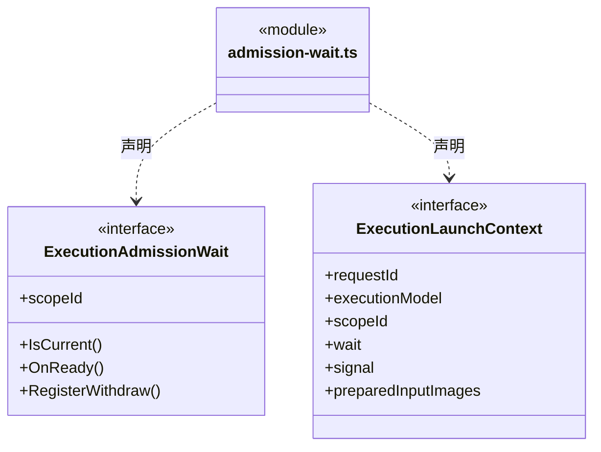
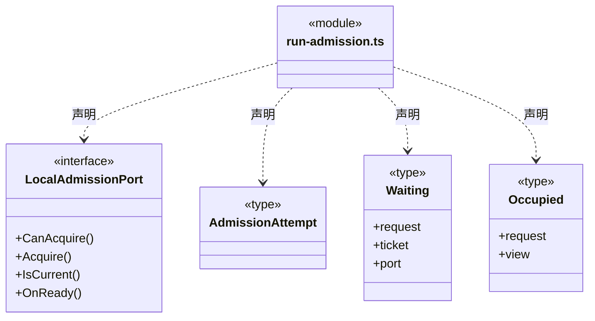
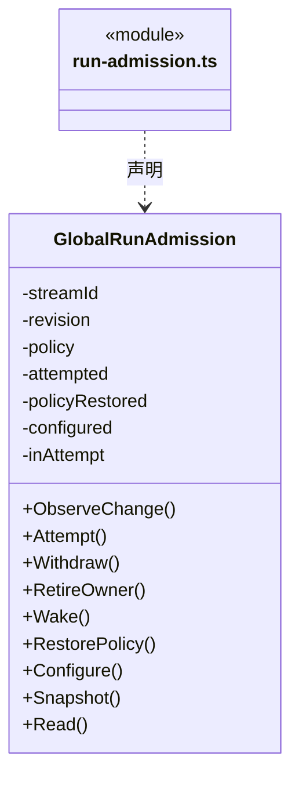
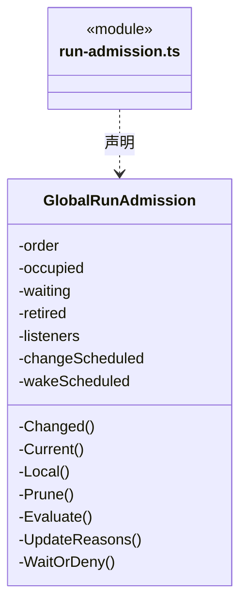
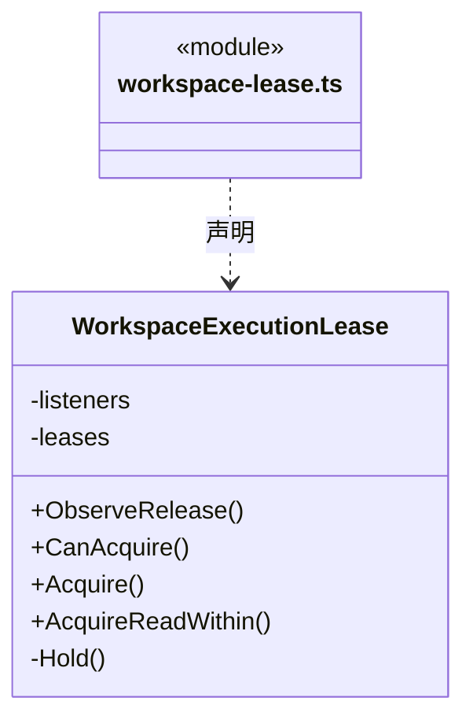

# src/logic/execution/admission 架构

本目录只维护这一份说明。设计与契约直接编辑本文；文件清单、类图和导航由 [架构脚本](../../../../scripts/source-architecture.mjs) 更新，生成区域之外的人工说明会保留。

## 封装意图

运行准入的票据与运行注册，保持可信入口、占用与释放语义；与业务验收分离。

## 类与模块的设计意图

下表依据源码声明及文件头说明定位封装。字段表示该实例持有的状态或协作引用，不表示它拥有被引用服务的生命周期；实际资源责任和调用限制见下文契约及源码注释。

| 类／模块 | 实现形式与实例字段 | 封装依据 |
| --- | --- | --- |
| [admission-wait.ts](admission-wait.ts) | 函数／契约模块 | 容量不足只通知原协调器重新核实；票据随批次停止撤销。单轮附件图片另经可信内存上下文传递，不能混入持久配置后随成员结果再次发送。 |
| [GlobalRunAdmission](run-admission.ts) | 实例类；持有 `streamId`、`revision`、`policy`、`attempted`、`policyRestored`、`configured`、`inAttempt`、`order`、`occupied`、`waiting`、`retired`、`listeners`、`changeScheduled`、`wakeScheduled` | Application 单例。所有资格判断与本地领取都在一个同步段内；异步等待由调用方已有队列负责。 |
| [WorkspaceExecutionLease](workspace-lease.ts) | 实例类；持有 `listeners`、`leases` | 由工作区装配方共享的进程内协调器；只控制已接入运行，不限制外部程序对文件的访问。 |

## 接口设计契约

##### Agent 执行模型的可信选择

`ExecutionLaunchContext.executionModel` 仅供管理器与产品工厂传递已核实的新调用／旧恢复选择，不进入可序列化聊天选项。旧调用缺省保持原行为；实际启用新调度由工厂装配确认，模式标记本身不授予能力或并发额度。

## 开闭边界

本目录的职责及允许协作由[封装意图](#封装意图)限定，输入输出、状态与失败语义以[接口设计契约](#接口设计契约)为准。扩展从已有公开入口及实际装配位置进入；没有明确可替换契约的部分按真实影响修改和验证，不预建未使用的基类或插件入口。

<!-- architecture:generated:start -->

## 文件清单

| 文件 | 形式 | 当前职责 |
| --- | --- | --- |
| [ARCHITECTURE.md](ARCHITECTURE.md) | 说明文档 | 本目录的文件清单、真实声明、依赖与子封装导航。 |
| [admission-wait.ts](admission-wait.ts) | 源码模块 | 定义已受理协作批次交给运行入口的进程内等待通知，不进入模型或公开 IPC 参数。 |
| [run-admission.ts](run-admission.ts) | 源码模块 | 为应用内主轮和成员轮统一提供同步执行准入、FIFO 等待及独立只读投影。 |
| [workspace-lease.ts](workspace-lease.ts) | 源码模块 | 同一已打开工作区内，主会话与独立成员共享的执行占用协调器。 |

## 架构类图

成员标记：`+` 公开、`-` 私有、`#` 受保护、`$` 静态；构造函数单独列出。文档和资源仅在文件清单中导航，不作为代码节点。

### admission-wait.ts

直接依赖：[../rules/types.ts](../rules/types.ts)。

### run-admission.ts

成员 1/2（同名节点为同一声明，跨图合并阅读）。

成员 2/2（同名节点为同一声明，跨图合并阅读）。

直接依赖：[../../../core/errors.ts](../../../core/errors.ts)、[../../runtime/rules/admission.ts](../../runtime/rules/admission.ts)。

### workspace-lease.ts

直接依赖：[../../../core/errors.ts](../../../core/errors.ts)、[../../tools/rules/policy/types.ts](../../tools/rules/policy/types.ts)。

## 子目录导航

无子目录。

[返回上层](../ARCHITECTURE.md)。

每次修改本目录代码，同步维护文件头、关键契约说明及本图。未实现的治理、证据验收和自动编排能力不列入当前类图。

<!-- architecture:generated:end -->
