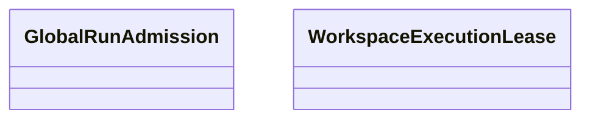

# src/logic/execution/admission 架构

## 设计意图

协调应用执行名额与工作区占用，令等待、获准和释放都有可信身份。

`GlobalRunAdmission` 管理应用级占用和 FIFO 等待，`WorkspaceExecutionLease` 在同一工作区协调主轮与成员轮。票据和只读投影不是业务恢复许可，实际取消、排空及释放由装配的运行生命周期完成。

## 主要组成

| 组成 | 定位 |
| --- | --- |
| [GlobalRunAdmission](run-admission.ts) | 为应用内主轮和成员轮统一提供同步执行准入、FIFO 等待及独立只读投影。 |
| [WorkspaceExecutionLease](workspace-lease.ts) | 同一已打开工作区内，主会话与独立成员共享的执行占用协调器。 |

<!-- architecture:generated:start -->

## 架构关系

[上层设计](../ARCHITECTURE.md)

<!-- architecture:generated:end -->
