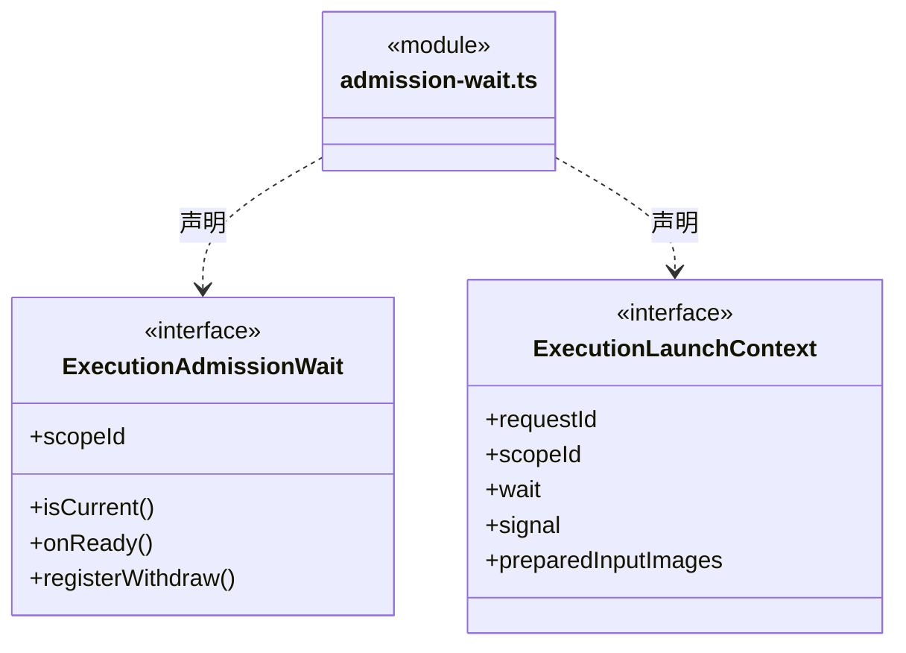
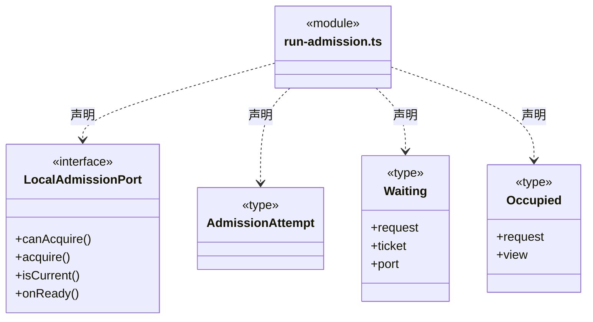
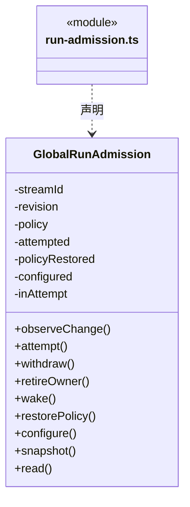
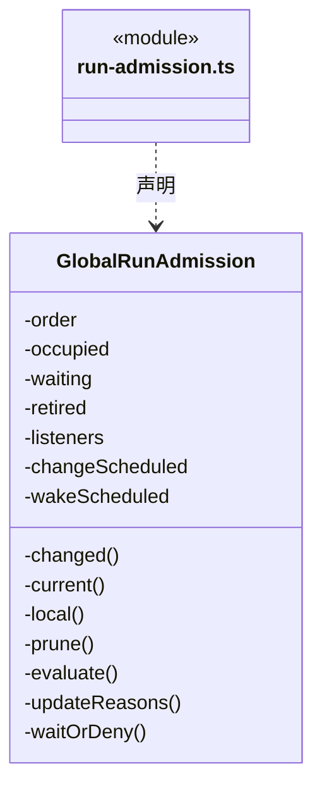
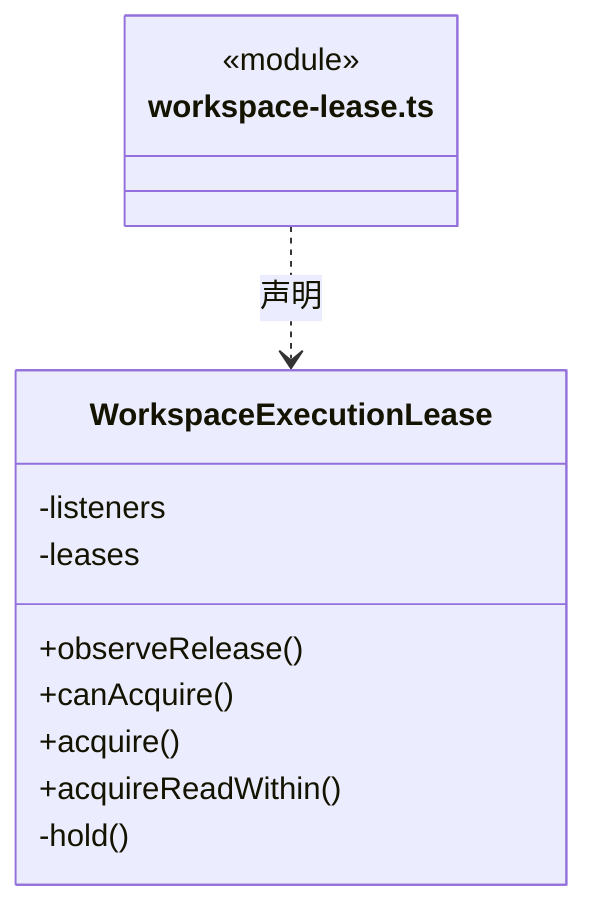

# src/logic/execution/admission 架构

## 目录定位

运行准入的票据与运行注册，保持可信入口、占用与释放语义；与业务验收分离。

本文描述当前实现。通过分析目录边界后维护的 [源码架构脚本](../../../../scripts/source-architecture.mjs) 同步清单和声明；代码变更时仍须核对职责、关键成员与关系。

## 代码清单

| 文件 | 当前职责 |
| --- | --- |
| [admission-wait.ts](admission-wait.ts) | 定义已受理协作批次交给运行入口的进程内等待通知，不进入模型或公开 IPC 参数。 |
| [run-admission.ts](run-admission.ts) | 为应用内主轮和成员轮统一提供同步执行准入、FIFO 等待及独立只读投影。 |
| [workspace-lease.ts](workspace-lease.ts) | 同一已打开工作区内，主会话与独立成员共享的执行占用协调器。 |

## 架构类图

### admission-wait.ts

直接依赖：[../rules/types.ts](../rules/types.ts)。

### run-admission.ts

成员 1/2（同名节点为同一声明，跨图合并阅读）。

成员 2/2（同名节点为同一声明，跨图合并阅读）。

直接依赖：[../../../core/errors.ts](../../../core/errors.ts)、[../../runtime/rules/admission.ts](../../runtime/rules/admission.ts)。

### workspace-lease.ts

直接依赖：[../../../core/errors.ts](../../../core/errors.ts)、[../../tools/rules/policy/types.ts](../../tools/rules/policy/types.ts)。

## 子目录导航

无子目录。

[返回上层](../ARCHITECTURE.md)。

每次修改本目录代码，同步维护文件头、关键契约说明及本图。未实现的治理、证据验收和自动编排能力不列入当前类图。
