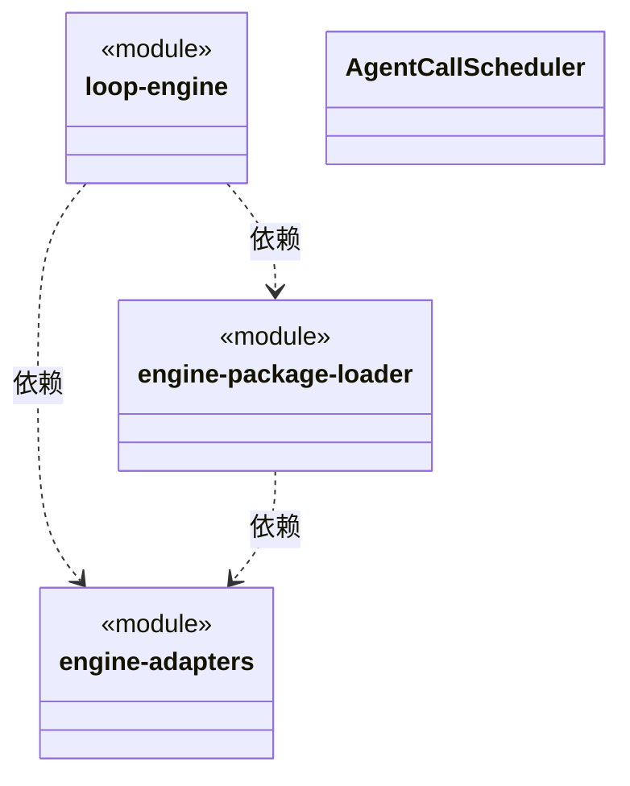

# src/logic/execution/assembly 架构

## 设计意图

选择具体引擎并连接调用协调、运行循环与可信工具，作为执行域认识实现细节的装配点。

`AgentCallScheduler` 维护父子调用、深度、结果核验和后代取消，`loop-engine` 将冻结知识及能力装入运行机制；包加载与适配表核实工厂协议后创建引擎。规则层通过端口协作，不反向依赖此处的具体选择。

## 主要组成

| 组成 | 定位 |
| --- | --- |
| [AgentCallScheduler](agent-call-scheduler.ts) | execution 内的递归调用协调，拥有父子关联、深度限制、业务结果核验、用户意见的两阶段保存、反馈与后代取消。 |
| [loop-engine](loop-engine.ts) | 将工作区知识、权限和工具注入 LoopRuntime；业务 Agent 同时取得冻结 Workflow 指引及产物验证能力，主 Agent 的人工评审沿原工具门禁。 |
| [engine-package-loader](engine-package-loader.ts) | 从冷宿主已验证的不可变包路径加载统一引擎工厂。 |
| [engine-adapters](engine-adapters.ts) | 当前源码/旧包的官方适配器装配表，所有实现均通过同一版本协议取得工厂。 |

<!-- architecture:generated:start -->

## 架构关系

[上层设计](../ARCHITECTURE.md)

<!-- architecture:generated:end -->
