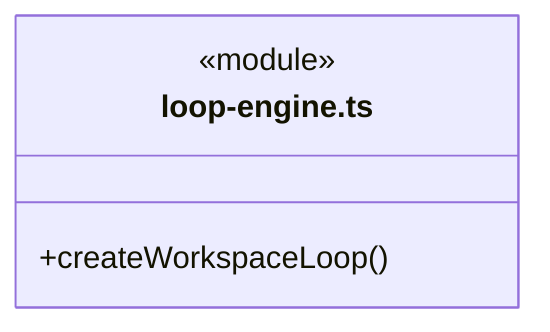
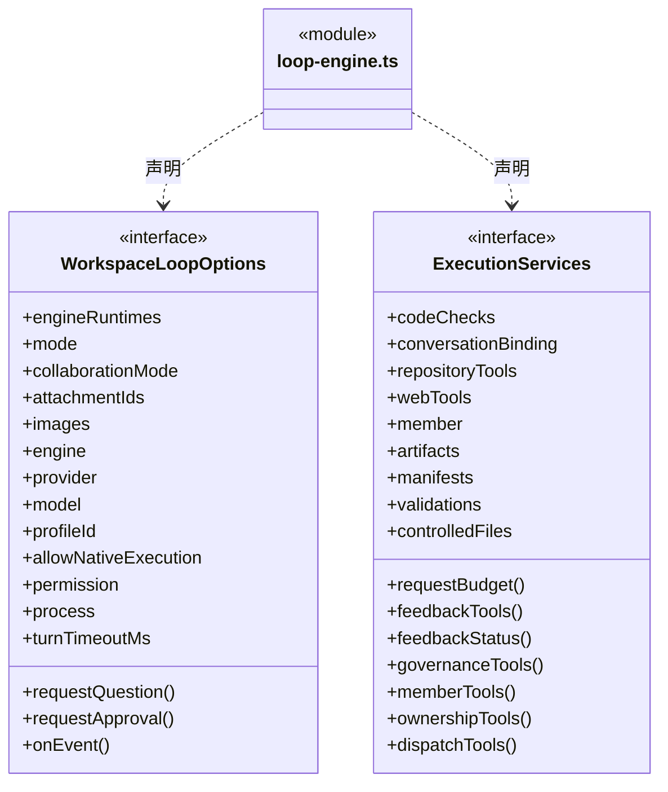
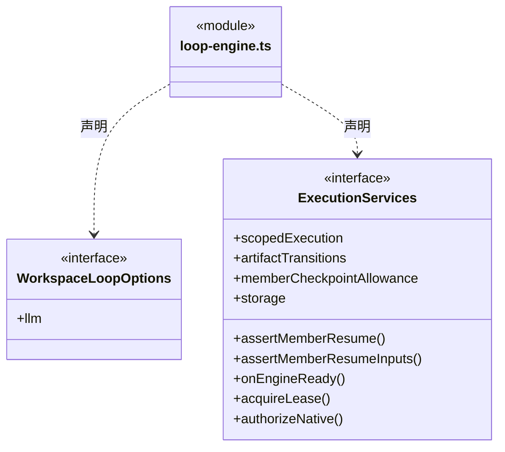

# src/logic/execution/assembly 架构

## 目录定位

引擎装配：loop-engine 将实际 Pi/Claude/Codex、模型预算及工具能力接入 logic/execution/rules/runtime 运行循环。这里有意认识具体实现；高密度装配依赖仍需独立评审。 主/成员运行按可信端口准备 E，并用 pinRuntimeEngine 固定历史兼容边界；可执行路径不来自公开运行选项。

本文描述当前实现。通过分析目录边界后维护的 [源码架构脚本](../../../../scripts/source-architecture.mjs) 同步清单和声明；代码变更时仍须核对职责、关键成员与关系。

## 代码清单

| 文件 | 当前职责 |
| --- | --- |
| [loop-engine.ts](loop-engine.ts) | 调度引擎：将工作区内部知识服务、内核锁与前置策略注入独立 LoopRuntime。 |

## 架构类图

### loop-engine.ts

成员 1/2（同名节点为同一声明，跨图合并阅读）。

成员 2/2（同名节点为同一声明，跨图合并阅读）。

直接依赖：[../../tools/runtime/question-tools.ts](../../tools/runtime/question-tools.ts)、[../../tools/runtime/web-tools.ts](../../tools/runtime/web-tools.ts)、[../../web/index.ts](../../web/index.ts)、[../../workspace/ports/paths.ts](../../workspace/ports/paths.ts)、[../../knowledge/rules/ports.ts](../../knowledge/rules/ports.ts)、[../../tools/runtime/knowledge-tools.ts](../../tools/runtime/knowledge-tools.ts)、[../context/team-workflow.ts](../context/team-workflow.ts)、[../../../core/errors.ts](../../../core/errors.ts)、[../../conversation/runtime/main-agent.ts](../../conversation/runtime/main-agent.ts)、[../rules/types.ts](../rules/types.ts)、[../engines/claude/engine.ts](../engines/claude/engine.ts)、[../engines/codex/engine.ts](../engines/codex/engine.ts)、[../../models/index.ts](../../models/index.ts)、[../rules/index.ts](../rules/index.ts)、[../engines/pi/engine.ts](../engines/pi/engine.ts)、[../engines/pi/rpc.ts](../engines/pi/rpc.ts)、[../../tools/rules/policy/tool-policy.ts](../../tools/rules/policy/tool-policy.ts)、[../../evidence/rules/progress-tools.ts](../../evidence/rules/progress-tools.ts)、[../engines/runtime-binding.ts](../engines/runtime-binding.ts)、[../../tasks/rules/member-help-tools.ts](../../tasks/rules/member-help-tools.ts)、[../../evidence/rules/artifact-tools.ts](../../evidence/rules/artifact-tools.ts)、[../rules/capabilities/artifact-capture.ts](../rules/capabilities/artifact-capture.ts)、[../rules/capabilities/output-manifest-capture.ts](../rules/capabilities/output-manifest-capture.ts)、[../../evidence/rules/output-manifest-tools.ts](../../evidence/rules/output-manifest-tools.ts)、[../rules/capabilities/run-controlled-file.ts](../rules/capabilities/run-controlled-file.ts)、[../../file-operations/rules/controlled-file-operation.ts](../../file-operations/rules/controlled-file-operation.ts)、[../rules/capabilities/run-artifact-transition.ts](../rules/capabilities/run-artifact-transition.ts)、[../../file-operations/rules/artifact-transition.ts](../../file-operations/rules/artifact-transition.ts)、[../rules/capabilities/run-validation.ts](../rules/capabilities/run-validation.ts)、[../../evidence/rules/validation-tools.ts](../../evidence/rules/validation-tools.ts)、[../../tasks/rules/member-checkpoint-tools.ts](../../tasks/rules/member-checkpoint-tools.ts)、[../../tools/runtime/dispatch-tools.ts](../../tools/runtime/dispatch-tools.ts)、[../rules/capabilities/run-scoped-execution.ts](../rules/capabilities/run-scoped-execution.ts)、[../../file-operations/rules/scoped-execution.ts](../../file-operations/rules/scoped-execution.ts)、[../../workspace/rules/execution-scope.ts](../../workspace/rules/execution-scope.ts)、[../../tools/rules/native-tools.ts](../../tools/rules/native-tools.ts)、[../../tasks/rules/execution-context.ts](../../tasks/rules/execution-context.ts)、[../../connectors/rules/repository-tools.ts](../../connectors/rules/repository-tools.ts)、[../../tools/runtime/feedback-tools.ts](../../tools/runtime/feedback-tools.ts)、[../../tools/runtime/feedback-status-tool.ts](../../tools/runtime/feedback-status-tool.ts)、[../../feedback/index.ts](../../feedback/index.ts)、[../../tools/runtime/repository-tools.ts](../../tools/runtime/repository-tools.ts)、[../../governance/rules/module-governance-tools.ts](../../governance/rules/module-governance-tools.ts)、[../../tools/runtime/governance-tools.ts](../../tools/runtime/governance-tools.ts)、[../../tools/runtime/coordination-tools.ts](../../tools/runtime/coordination-tools.ts)、[../../tools/runtime/workspace-member-tools.ts](../../tools/runtime/workspace-member-tools.ts)、[../../team/rules/workspace-member-tools.ts](../../team/rules/workspace-member-tools.ts)、[../../tools/runtime/module-ownership-tools.ts](../../tools/runtime/module-ownership-tools.ts)、[../../workspace/rules/module-ownership-tools.ts](../../workspace/rules/module-ownership-tools.ts)、[../../budget/rules/request-budget.ts](../../budget/rules/request-budget.ts)、[../rules/engine-runtime.ts](../rules/engine-runtime.ts)、[../../evidence/rules/code-check.ts](../../evidence/rules/code-check.ts)、[../rules/storage.ts](../rules/storage.ts)。

## 子目录导航

无子目录。

[返回上层](../ARCHITECTURE.md)。

每次修改本目录代码，同步维护文件头、关键契约说明及本图。未实现的治理、证据验收和自动编排能力不列入当前类图。

## 设计契约 v1 与落地范围

以下内容区分已接通能力与后续设计；以各节的实现状态为准，不将目标图当作现状图。维护源：[CONTRACT.md](CONTRACT.md)；生成类图时同步附加，勿直接修改本附录。

## 知识参数默认值装配

loop-engine 仅对 KnowledgeTools.has 命中的当前注册知识工具提供 normalizeToolInput；通过 normalizeInput 校验绑定实例和实际 Schema，在 Runtime 记录请求前补齐身份与默认值。派发、岗位、原生及其它工具保持原输入和独立校验。执行服务仍重新核对同一实例与写权限，不借规范化提升授权。
